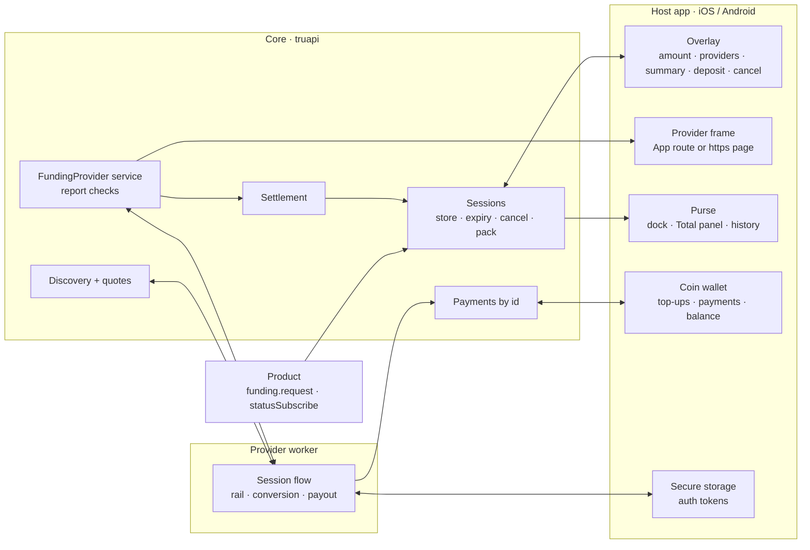
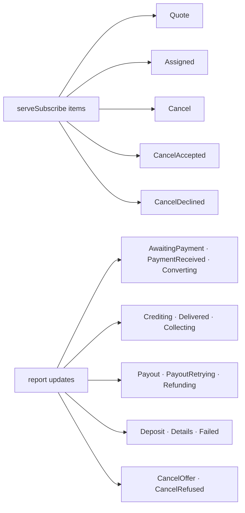
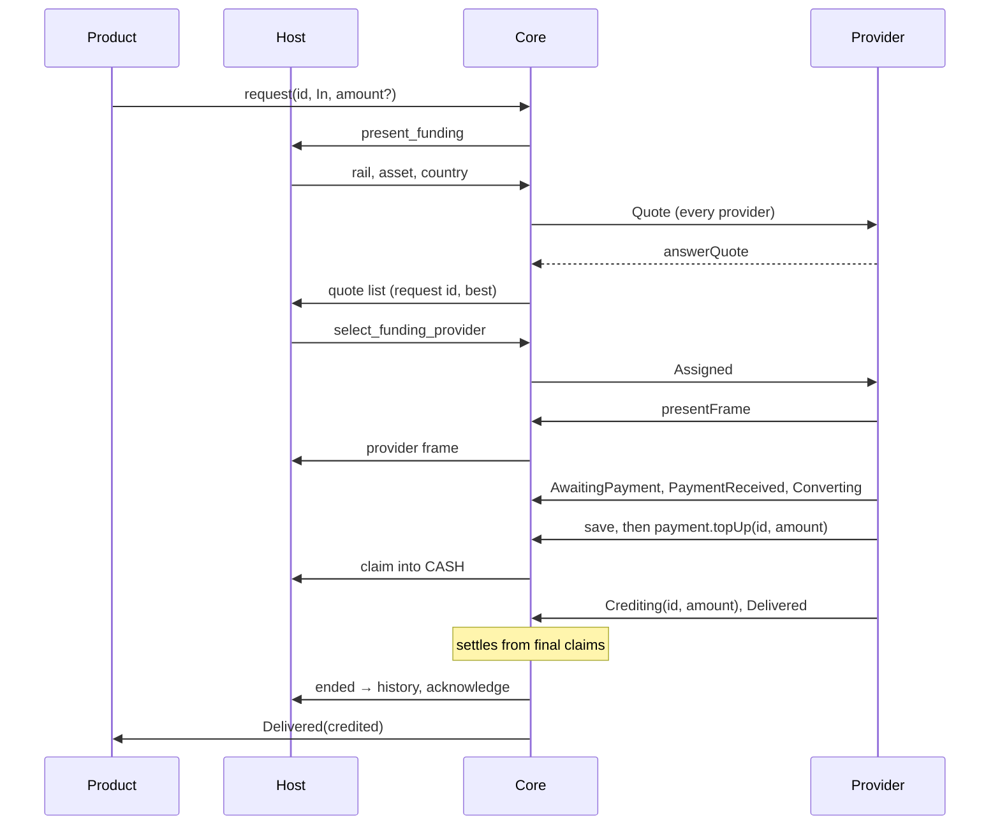
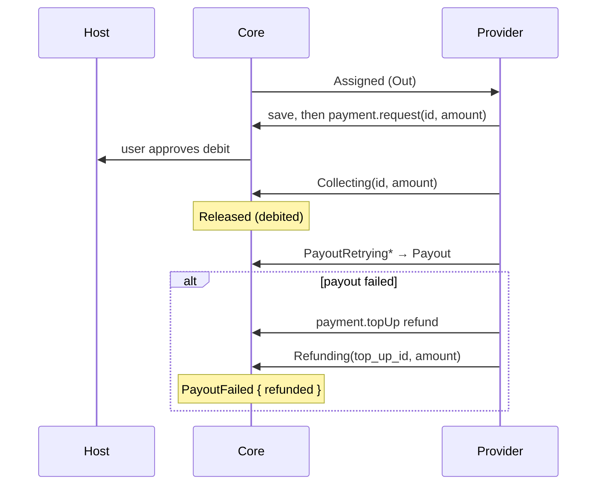
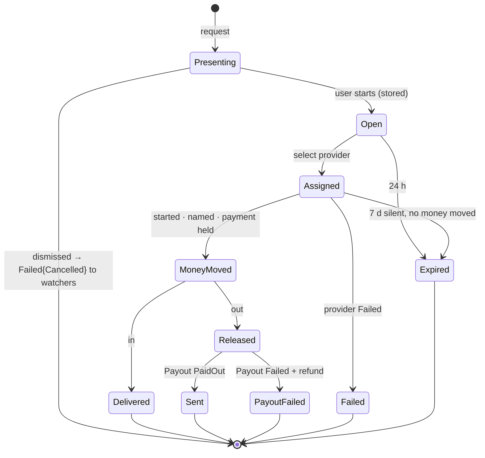
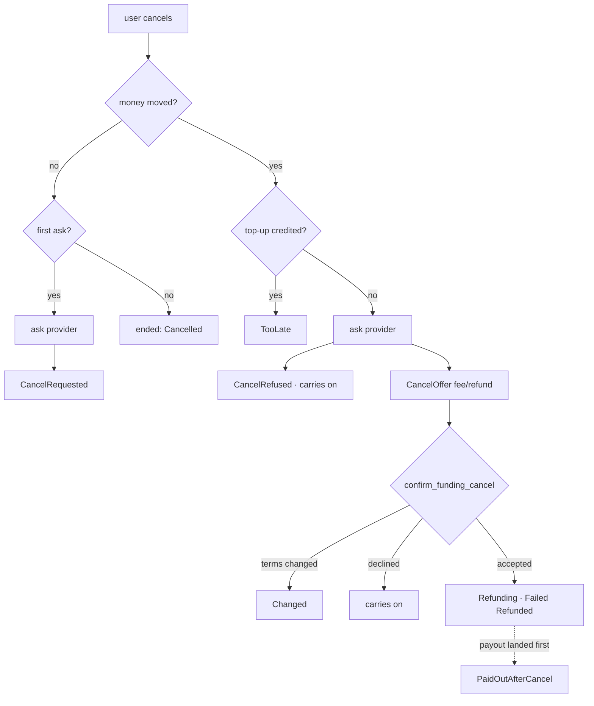
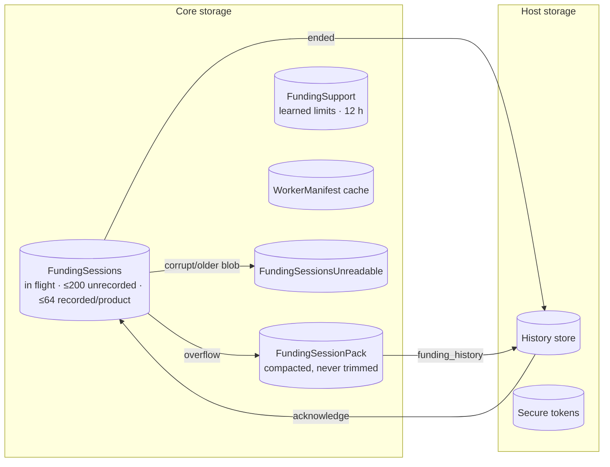
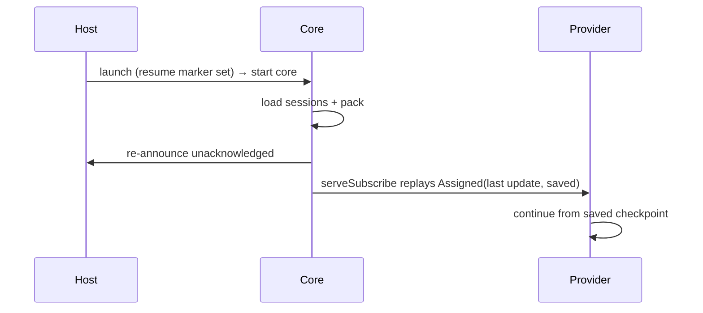

# Funding Modality

_How value moves into and out of the user's CASH balance, across product, core, host and provider. Rationale:
[RFC — Funding modality](../rfcs/funding-modality.md), [product manifest](../rfcs/product-manifest.md#funding-configuration)._

## Parts



| Who | Owns | Never |
|---|---|---|
| Host | screens, coins, secrets, history | decides an outcome |
| Core | sessions, quotes, outcome | moves funds |
| Provider | rail, conversion, payout | declares success |

## Interfaces

| Trait | Id | Methods | Caller |
|---|---|---|---|
| `Funding` | 22 | `request({ id, direction, amount? })` · `statusSubscribe({ id })` | product |
| `FundingProvider` | 24 | `serveSubscribe` · `answerQuote` · `report` · `presentFrame` · `save` | provider worker |
| `Payment` | 9 | `topUp` · `topUpStatusSubscribe` · `request` · `statusSubscribe` · `balanceSubscribe` | provider worker |
| `AuthTokens` | 26 | store · read | provider worker |
| `FundingPlatform` | host | `present_funding` · `present_provider_frame` · `detected_country` · `funding_session_changed` | core → host |

Session id: `fs_` + hex(blake2("truapi/funding-id", product, id)). Reused id → `AlreadyExists`.



## Top-up



## Withdrawal



## Session lifecycle



The overlay runs on its own task: a request that goes away still starts or discards its session.

## Cancel



## Storage



| Blob | Format rule |
|---|---|
| current format | read |
| older or corrupt | set aside, start empty |
| newer (downgrade) | left untouched, funding unavailable |

## Rows

Title · subtitle. Ended subtitle: `{Rail} · {moment}`.

| Status | Row |
|---|---|
| WaitingForPayment / WaitingForDeposit | Topping up · Upcoming receiving |
| WaitingForTransfer | Topping up · Waiting for transfer |
| ConvertingToCash | Topping up · Converting to Cash |
| Retrying | Topping up · Provider is retrying your payment (amber) |
| TransactionInitiated | Sending · Transaction initiated |
| PreparingPayout / ConvertingTo | Sending · Preparing payout / Converting to {asset} |
| RetryingPayout | Sending · Provider is retrying the payout (amber) |
| TakingLonger | · Taking a little longer (amber) |
| ToppedUp / Sent / PaidOutAfterCancel | Topped up / Sent · {Rail} · {moment} |
| PayoutFailed / Cancelled / Refunded | Payout failed / Cancelled / Refunded · {Rail} · {moment} |
| Failed | Top-up failed / Withdrawal failed · reason |

Source of truth: `FundingStatus` docs in `host_logic/funding.rs`.

## Purse

```
┌ Purse ─────────────────────┐   scroll: card → 60pt thumbnail in header
│ [ leather card  $X CASH ]  │            + sticky "Current balance" bar
│ [ Get ]        [ Send ]    │
│ Total $X CASH  ●●●●●●      │   Clearing / Ready from coinage
│ ▒▒▒░░░░░░  Clearing · Ready│
│ Today                      │
│  ○ Topped up       +$25    │   history by day
│  ○ Sent            -$50    │
└────────────────────────────┘
  ┌ in progress dock ──────┐     front: delayed, else newest
  │ (2) Topping up   +$50  │     tap → panel
  └────────────────────────┘
```

## Restart



## Test

`make e2e-funding-cli`: the product and provider battery against a scripted CLI host.
