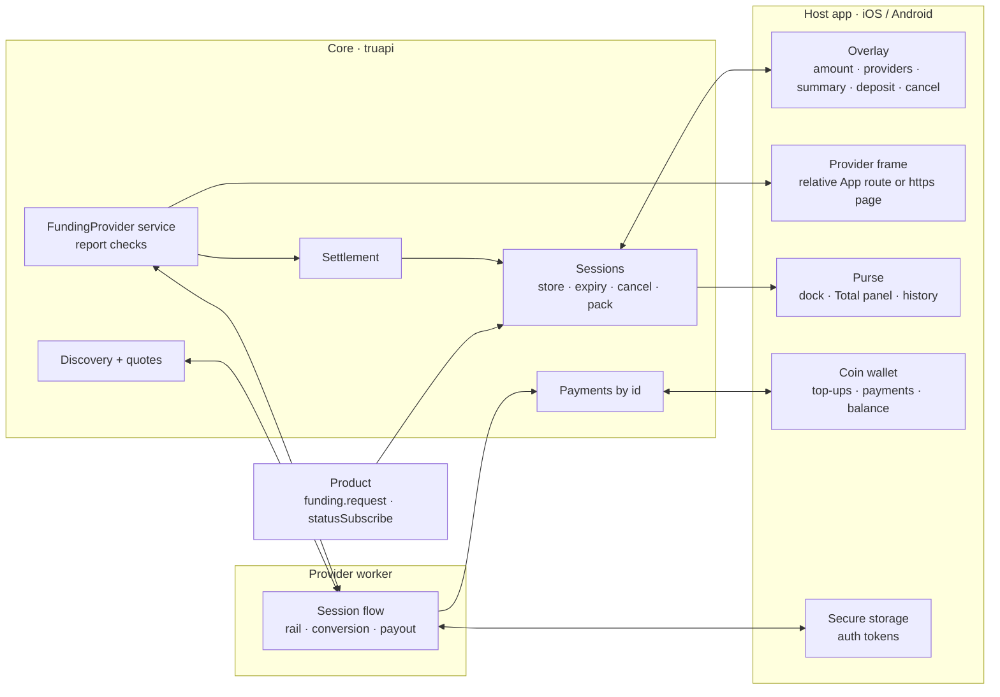
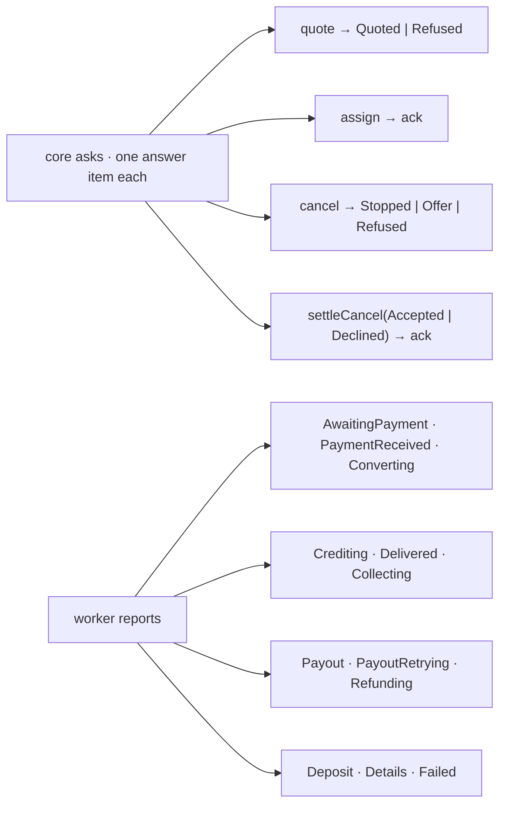
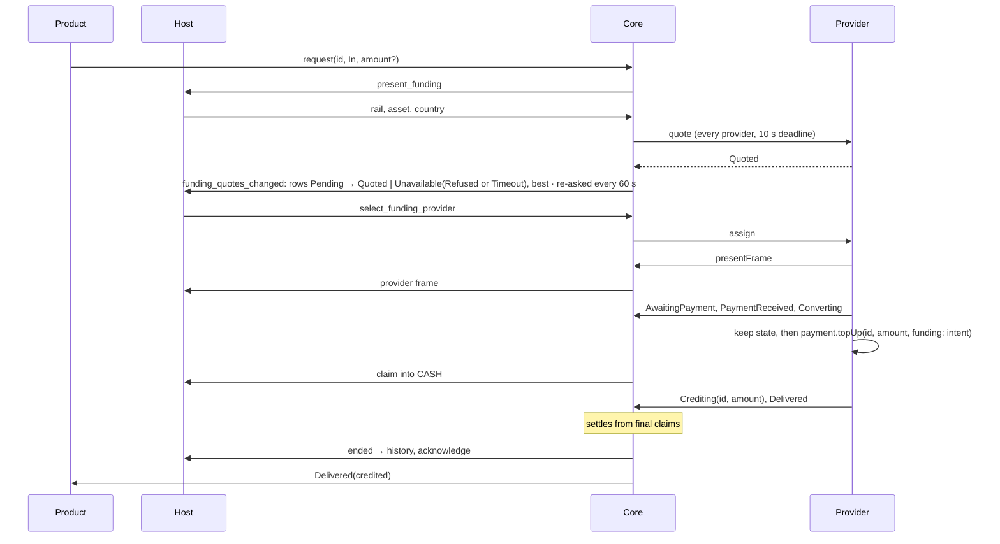
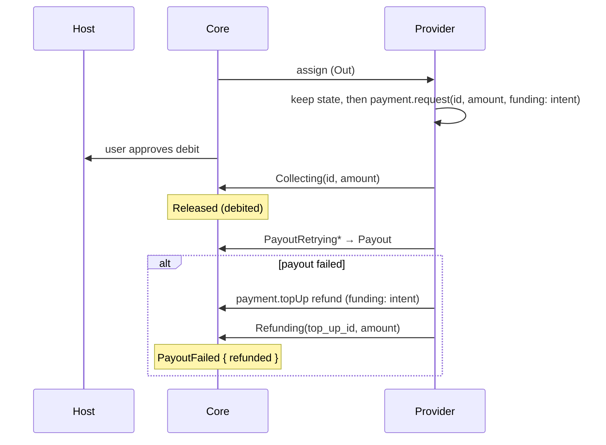
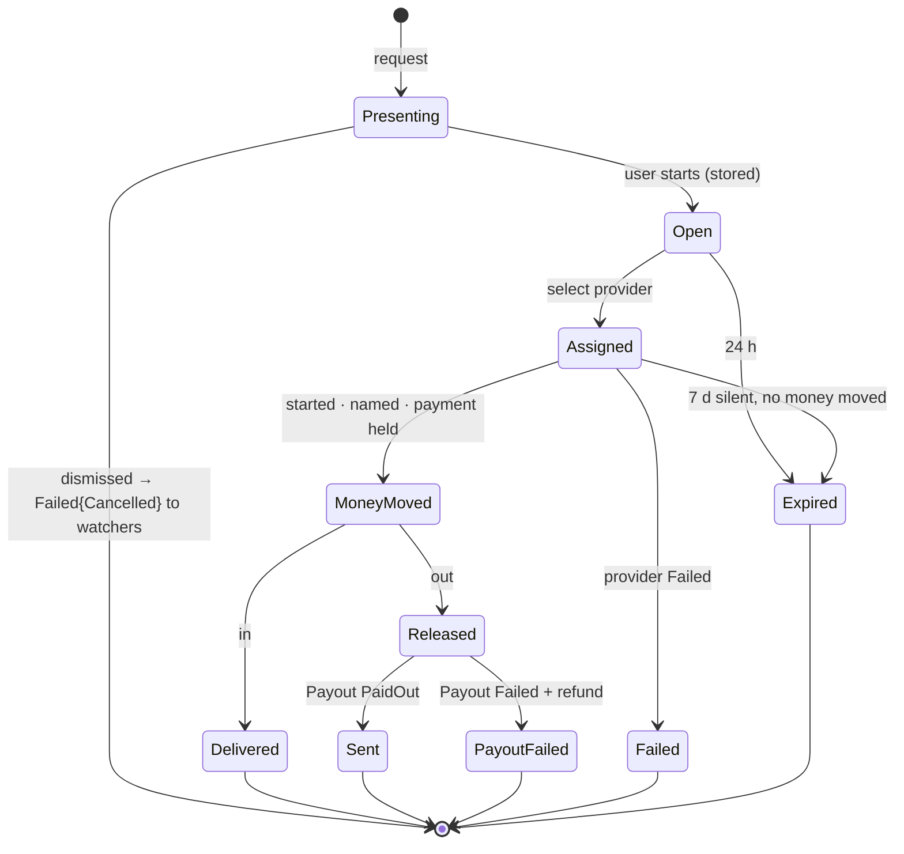
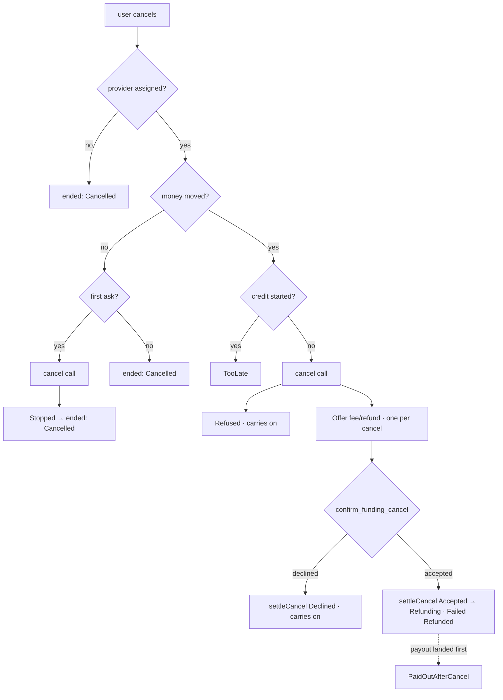
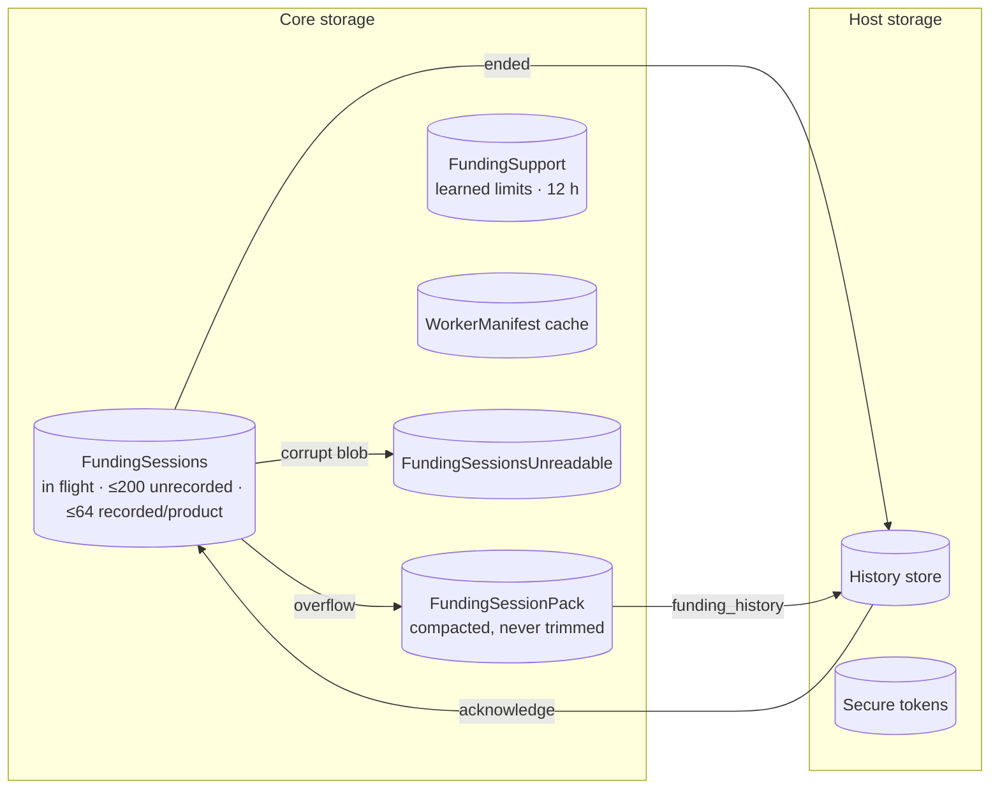
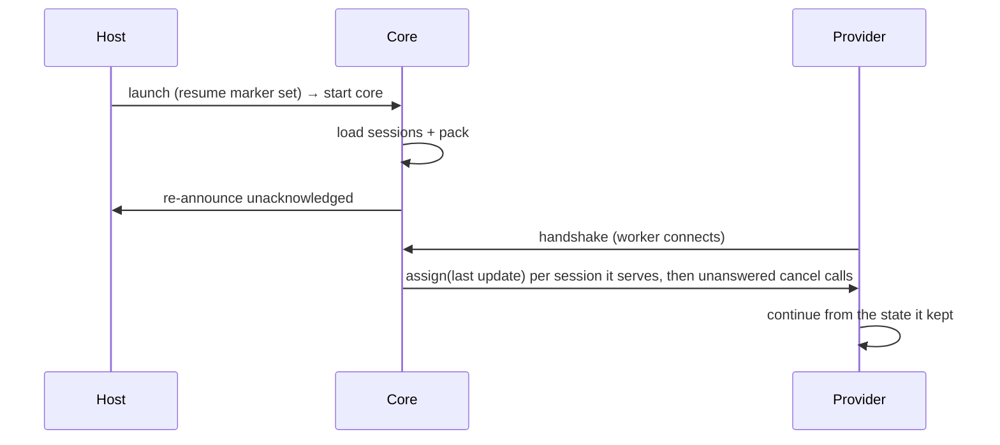

# Funding Modality

_How value moves into and out of the user's CASH balance, across product, core, host and provider. Rationale:
[RFC — Funding modality](../rfcs/funding-modality.md), [product manifest](../rfcs/product-manifest.md#funding-configuration)._

## Parts



| Who | Owns | Never |
|---|---|---|
| Host | screens, coins, secrets, history | decides an outcome |
| Core | sessions, quotes, outcome | moves funds |
| Provider | rail, conversion, payout | declares success |

## Interfaces

| Trait | Id | Methods | Caller |
|---|---|---|---|
| `Funding` | 22 | `request({ id, direction, amount? })` · `statusSubscribe({ id })` | product |
| `FundingProvider` | 24 | core → worker: `quote` · `assign` · `cancel` · `settleCancel`; worker → core: `report` · `presentFrame` | core and provider worker |
| `Payment` | 9 | `topUp` · `topUpStatusSubscribe` · `request` · `statusSubscribe` · `balanceSubscribe` | provider worker |
| `AuthTokens` | 27 (#1553) | `store` · `get` · `remove` | provider worker |
| `FundingPlatform` | host | `present_funding` · `present_provider_frame` · `detected_country` · `funding_session_changed` · `funding_quotes_changed` | core → host |

Session id: `fs_` + hex(blake2("truapi/funding-id", product, id)). Reused id → `AlreadyExists`. Host-opened: `fs_` + nanoid(10).

Worker payments name their session (`funding`). A session the worker doesn't serve, the wrong direction, or a full session (≤3 top-ups/payments) → `FundingNotServed`. A repeat under the same id must ask the same.

Started funds are recorded Pending before the call and Accepted once the host holds them. Only Accepted funds can be named in a report, and only once. Unaccepted ones go after 1 h if the engine doesn't hold them.



## Top-up



## Withdrawal



## Session lifecycle



The overlay runs on its own task: a request that goes away still starts or discards its session.

One serialized reconciler, woken on every change, runs the background work: load or sweep, then retain quotes · hold workers · follow settlements · resolve starts · catch up links. Sweep retry 30 s, catch-up retry 5 s, provider call timeout 60 s.

## Cancel



## Storage



Sessions blob format 2, pack format 1. Each blob leads with a u16 format.

| Blob | Format rule |
|---|---|
| current format | read |
| older | cleared, start empty |
| corrupt | set aside (≤8), start empty |
| newer (downgrade) | left untouched, funding unavailable |

## Rows

Title is the amount (`$50 CASH` in flight, `+$50 CASH` added, `-$50 CASH` out), rail pill on the right, subtitle below.
History: In progress · Completed.

| Status | Subtitle |
|---|---|
| WaitingForPayment / WaitingForDeposit / WaitingForTransfer | Waiting for your payment / deposit / transfer |
| ConvertingToCash · AddingToBalance | On its way · Adding to your balance |
| Retrying | The provider is retrying. Don't pay again (amber) |
| TransactionInitiated | Withdrawal initiated |
| ConvertingTo / PreparingPayout | Converting to {asset}… / Preparing your payout |
| RetryingPayout | The provider is retrying the payout (amber) |
| TakingLonger | Delayed, don't pay again · out: Taking longer than usual (amber) |
| ToppedUp / Sent / PaidOutAfterCancel | {moment} |
| Refunded / PayoutFailed / Cancelled | Refunded / Payout failed / Cancelled · {moment} |
| CancelRequested · CancelOffered · CancelRefused · Cancelling | Cancel requested, waiting for the provider · Cancel offer waiting for you (amber) · The provider can't cancel (amber) · Cancelling… |
| Failed | Expired · {moment} / Payment failed · {moment} |

## Session sheet

```
        ⟳
     $50 CASH
 ●─•─•─●─•─•─○        Started · Received · Added      (out: Received by provider · Sent)
 Checking your payment            band
 Checked with the provider 3s ago  last_heard_at_ms · just now / s / min / h
 Send this exact amount inc. fees   €50.55 ›
 Reference                    5729 4183 6602 ⧉
 Arrives  1–2 business days · Final Cash depends on the rate on arrival
 [ Cancel ]   pending bank top-up → Cancel top-up? · Cancel / Keep it
```

| Band | Line |
|---|---|
| AwaitingPayment | Waiting for your payment · bank: "If you've sent the money from your bank, it's on its way to us…" |
| CheckingPayment · OnItsWay | Checking your payment · Your money is on its way |
| Adding · Added | Adding $50 CASH to your balance · $50 CASH added to your balance |
| Converting · PreparingPayout · Sending · Sent | Converting your Cash · The provider is preparing your payout · Sending the money to your {rail} · Sent to your {rail} |
| crypto: CheckingPayment · PreparingPayout · Sending · Sent | Confirming your {asset} deposit · Exchanging your money for {asset} · Sending your {asset} · Your {asset} is on its way to your wallet |
| Retrying · Delayed | amber, "don't pay again" on top-ups |
| Cancel · Ended | no line |

A bank top-up cancelled before paying takes a transfer that arrives within 7 days: it opens again and is added.

## Purse

```
┌ Purse ─────────────────────┐
│ [ leather card  $X CASH ]  │
│ [ ↑ Get ]      [ ↓ Send ]  │   Get: Topping up sheet if any in progress, else amount
│ Total $X CASH  ●●●●●●      │   Send: contacts · Send money out → Sending sheet / amount
│ ▒▒▒░░░░░░   Ready $X       │   ⟲ clock → History
└────────────────────────────┘
```

## Restart



Catch-up is one call at a time per link, retried until every call is answered.

## Test

`make e2e-funding-cli`: the product and provider battery against a scripted CLI host.
