# Funding Modality

_How value moves into and out of the user's CASH balance. Rationale: [RFC](../rfcs/funding-modality.md) ·
[product manifest](../rfcs/product-manifest.md#funding-configuration) · for provider teams:
[Building a funding provider](../guides/funding-provider.md)._

_Screens are from the Pocket R2 design in Figma; the apps follow it, with small differences._

## Parts

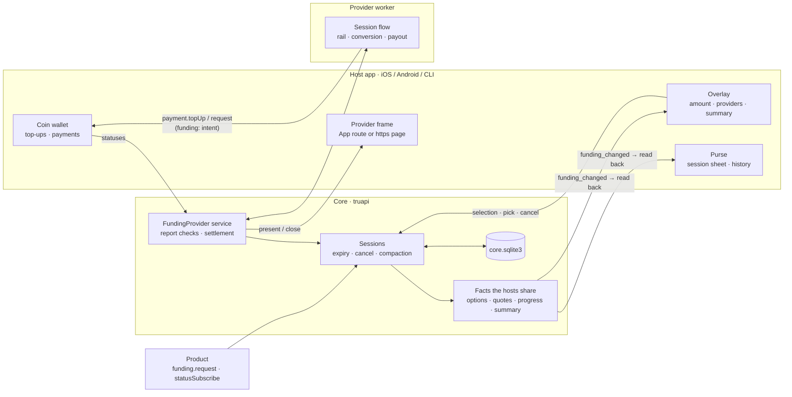

| Who      | Owns                                               | Never                      |
| -------- | -------------------------------------------------- | -------------------------- |
| Host     | screens and their wording, coins, the device       | decides an outcome         |
| Core     | sessions, quotes, outcome, history, the facts      | moves funds, words a label |
| Provider | rail, conversion, payout, its own screens and keys | declares success           |

## Interfaces

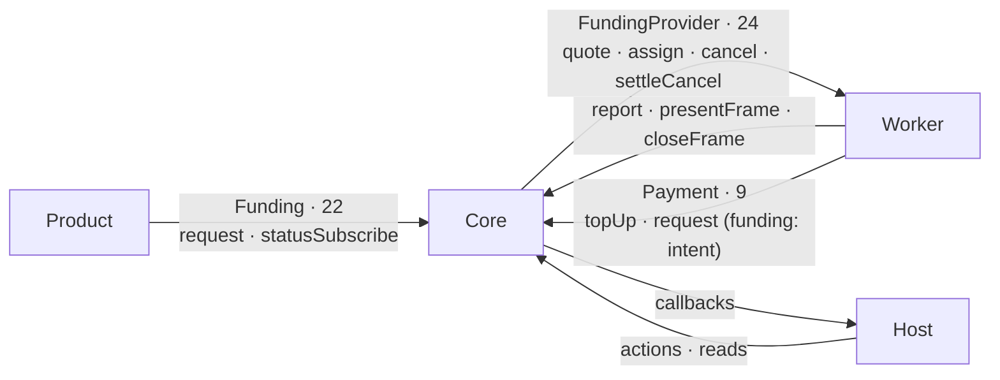

| Host ↔ core (native names) | Methods                                                                                                                                                                                                                                                                                 |
| -------------------------- | --------------------------------------------------------------------------------------------------------------------------------------------------------------------------------------------------------------------------------------------------------------------------------------- |
| Callbacks (core → host)    | `present_funding` · `provider_frame_requested` · `present_provider_frame` · `close_provider_frame` · `detected_country` · `funding_changed(intent, kind)`                                                                                                                                                            |
| Actions (host → core)      | `set_funding_provider_config` · `open_funding` · `open_provider_frame` · `select_funding_options` · `get_funding_quote` · `start_funding_when_quoted` · `cancel_funding_auto_start` · `select_funding_provider` · `cancel_funding` · `confirm_funding_cancel` · `acknowledge_funding_session` · `worker_exited` |
| Reads (host → core)         | `funding_session` · `funding_progress` · `funding_options` · `funding_quotes` · `funding_amount_issue` · `funding_entries` · `funding_summary` · `funding_history` · `funding_available` · `funding_resume_pending`                                                                     |

Session id: `fs_` + nanoid(10). Another product's session reads as `NotFound`. Amounts cross the FFI as decimal strings.

### The host loop

The core never pushes state. It says what changed; the host reads it back and draws it.

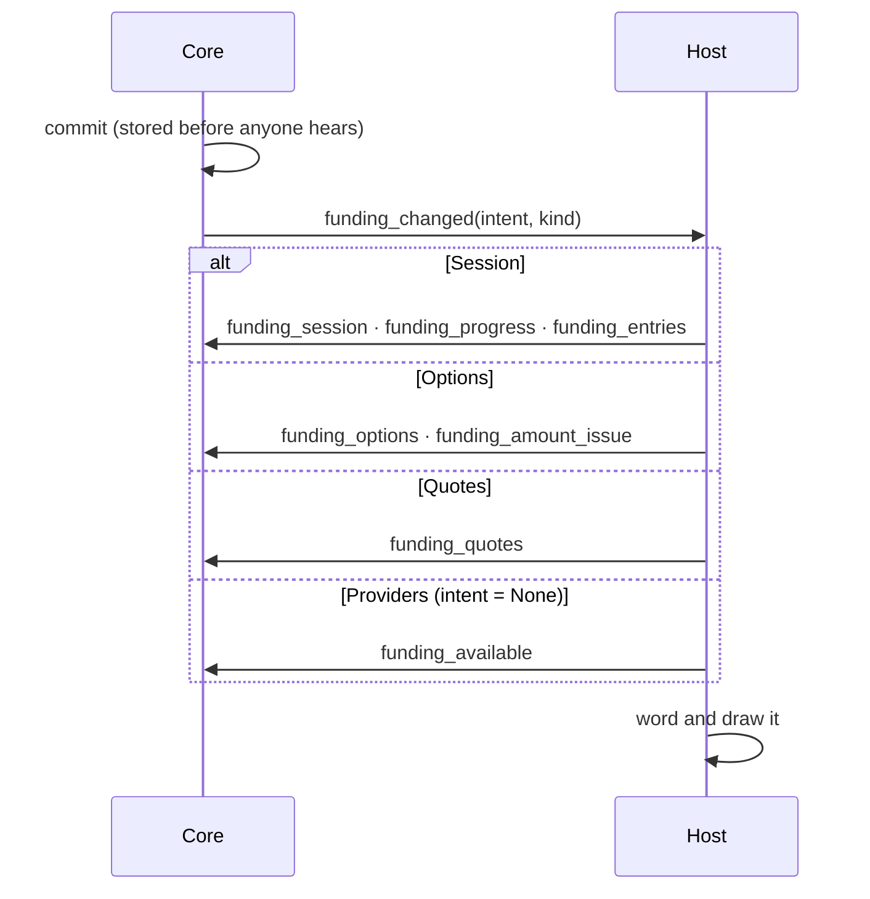

## Top-up

  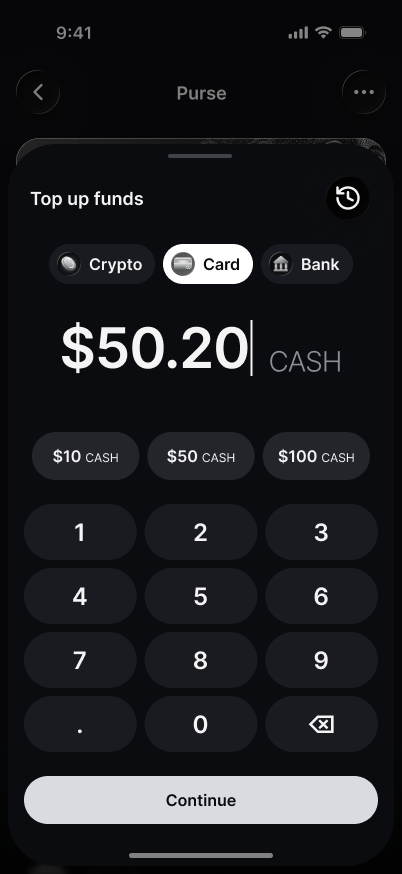
  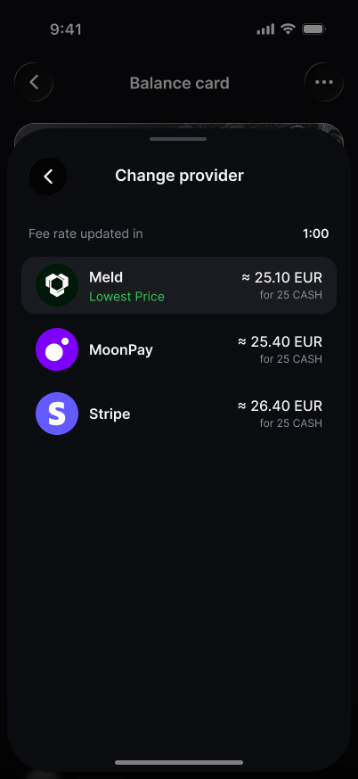
  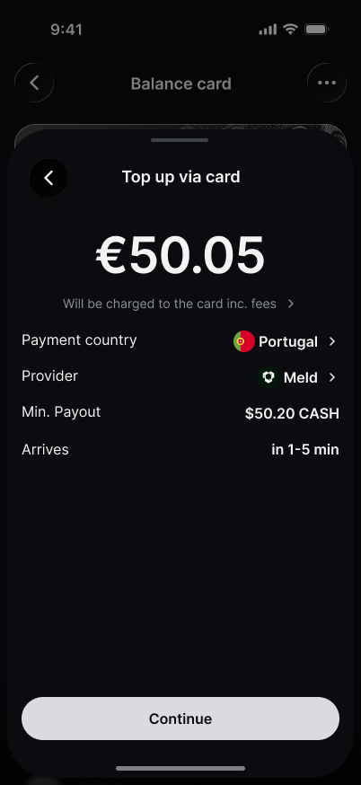
  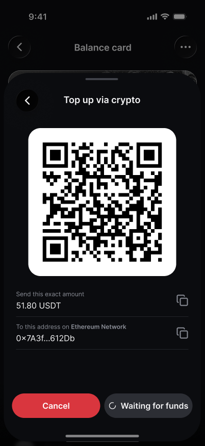

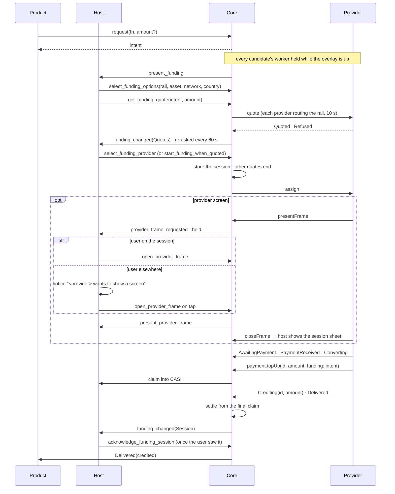

## Withdrawal

  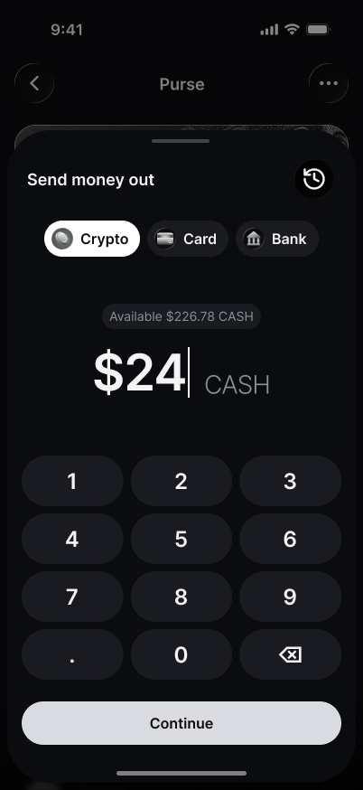

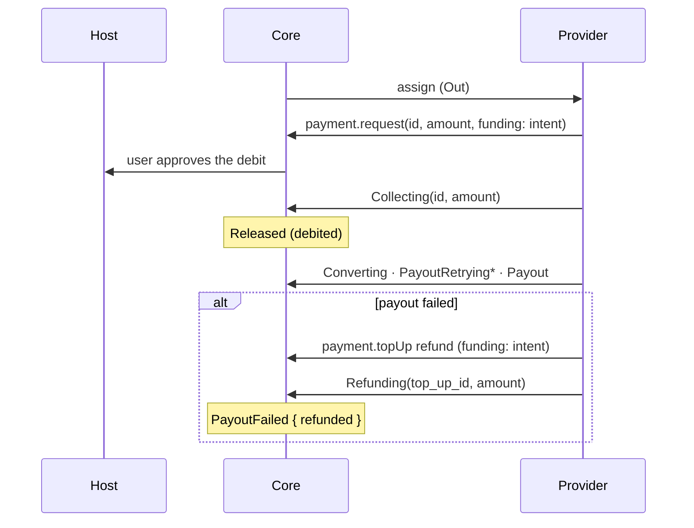

## Session lifecycle

  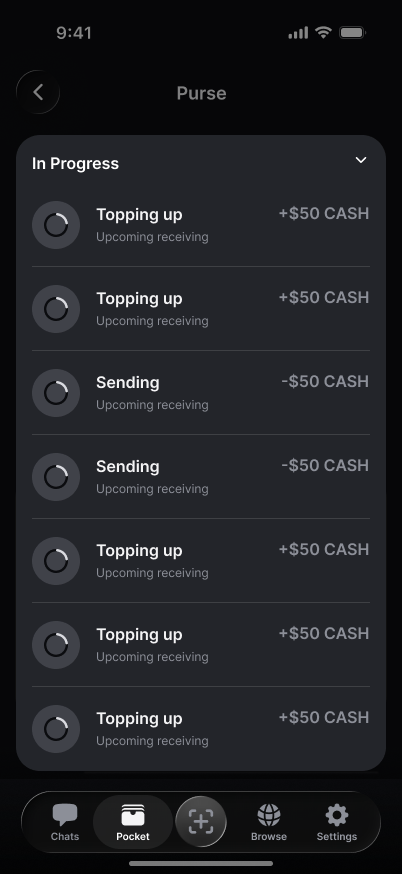

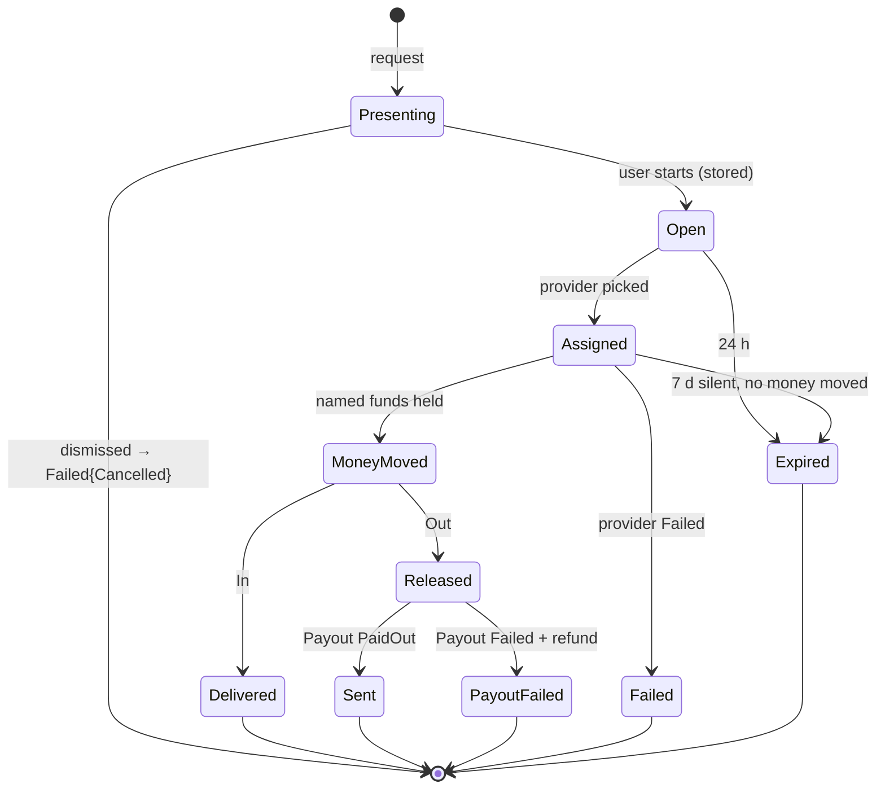

Once money moved, only the provider ends a session. A bank top-up cancelled before paying stays open 7 days for a late
transfer, which is still added.

## Cancel

  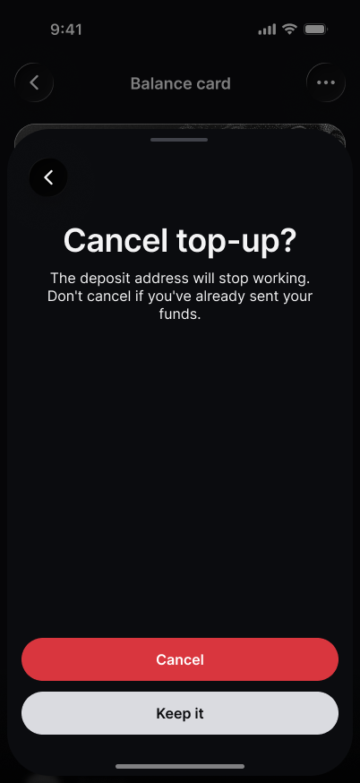

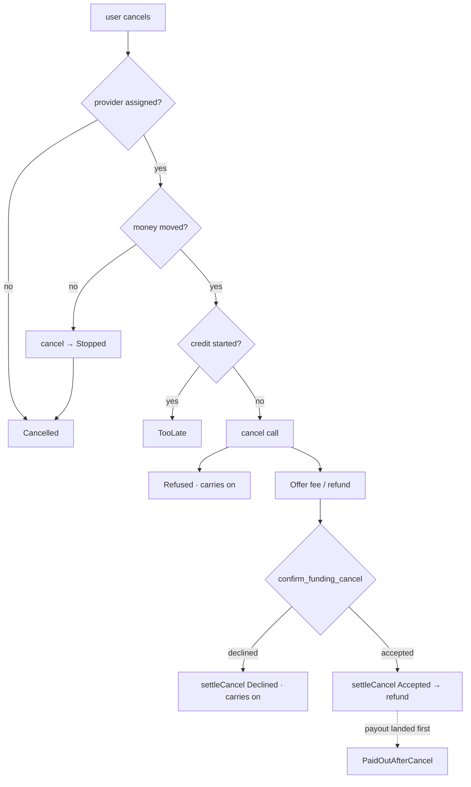

A cancel that moved no money is left out of history.

## Funds a worker moves

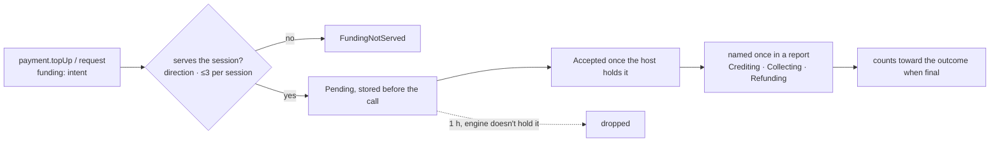

A repeat under the same id must ask the same thing.

## Storage

  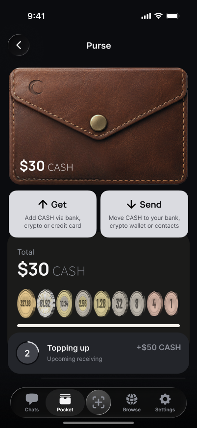

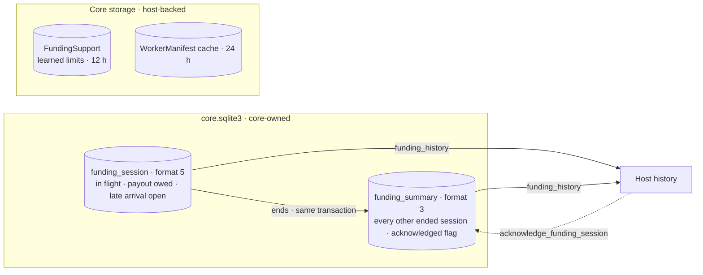

| Row read            | Result                                           |
| ------------------- | ------------------------------------------------ |
| current format      | read                                             |
| older / undecodable | skipped, kept, never written over                |
| newer (downgrade)   | load fails, nothing touched, funding unavailable |

A wasm core has no database and keeps no session.

## Restart and worker crash

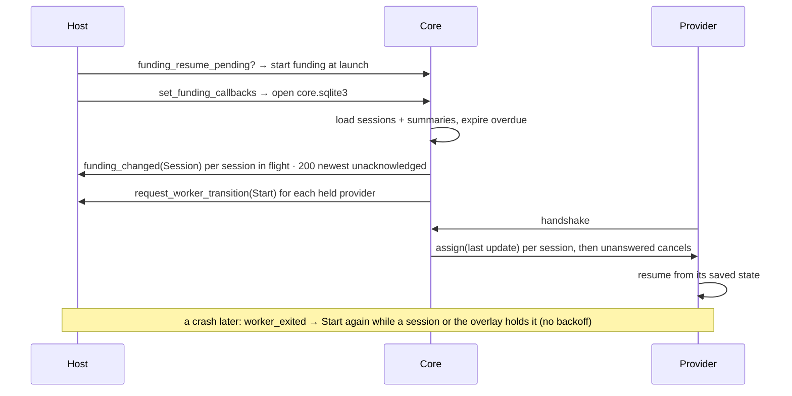

## Numbers

| What                              | Value       |
| --------------------------------- | ----------- |
| quote deadline · refresh          | 10 s · 60 s |
| learned limits, refused country   | 12 h        |
| detected country reuse · retry    | 1 h · 1 min |
| open session expires              | 24 h        |
| assigned, silent, no money moved  | 7 d         |
| late bank transfer after a cancel | 7 d         |
| provider call timeout             | 60 s        |
| unaccepted funds kept             | 1 h         |
| top-ups or payments per session   | 3           |
| `Details` · `Deposit` per session | 8 · 8       |
| unacknowledged re-announced       | 200 newest  |

## Test

`make e2e-funding-cli`: the product and provider battery against the CLI host.
