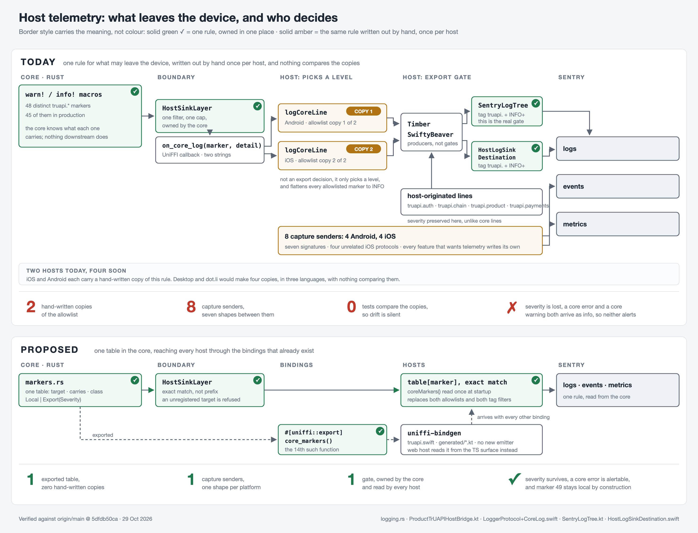

# Host Telemetry: One Table in the Core



## Summary

One table in the core decides which diagnostics may leave a device. Every host reads it rather than keeping its own copy. The table is exposed through a `#[uniffi::export]` function, the same way `parse_navigate` already is, so it reaches hosts over the bindings that exist today with no new emitter and no change to the callback signature.

## Motivation

The rule for which core markers may be exported is written out by hand once per host. iOS keeps it in `LoggerProtocol+CoreLog.swift:9-14` and Android in `ProductTrUAPIHostBridge.kt:448-453`, with a second filter beneath each of them in `HostLogSinkDestination.swift:13,25` and `SentryLogTree.kt:15-16`. Two more restatements sit in prose, in the Android naming guide and the iOS error-handling guide. Nothing compares any of them.

Three things follow from that shape.

**It grows with the host count.** Two hosts mean two copies. Desktop and dot.li would make four, in three languages. Nothing in CI would notice them diverging.

**Prefix matching exports by default.** Each host matches `truapi.chain.` and three sibling prefixes, so a marker added under one of them later is exported with no review and no test change. There are 48 distinct `truapi.*` markers today, 45 of them in production.

**Severity does not survive the crossing.** `ProductTrUAPIHostBridge.kt:441` and `LoggerProtocol+CoreLog.swift:20` both collapse every allowlisted marker to info, so `truapi.tracing.error` and `truapi.tracing.warn` arrive identically and a core error cannot be alerted on. Host-originated lines keep their severity, so two lines under one tag namespace mean different things depending on who raised them.

Identifier formatting also happens at the call site, which makes keeping them out of a detail string a review step rather than a property of the type.

## Current state

The pipeline has two gates in series, and the first one is not the one that governs export.

```
 CORE (rust)                   BOUNDARY          HOST stage 1          HOST stage 2         SENTRY
 ---------------------------   ---------------   ------------------    -----------------    ------
 warn!/info!  --> HostSinkLayer --> on_core_log --> logCoreLine --> Timber / SwiftyBeaver --> logs
  truapi.* or WARN+, capped       (2 strings)      allowlist,        SentryLogTree /
                                                   picks a level     HostLogSinkDestination
                                                                     tag "truapi." + INFO+

 host-originated lines (truapi.auth, truapi.chain, truapi.product)
   join at stage 2 and never cross the boundary -----------------------> logs

 4 Android + 4 iOS capture senders ------------------------------------> events, metrics
```

`logCoreLine` chooses a level. Stage 2 decides export. Drawing them as siblings overstates `logCoreLine`'s authority and hides the gate that actually governs the wire.

Telemetry also leaves through eight capture senders, four per platform, with three different signatures between them (`capture(event: SentryEvent)`, `capture(event: () -> SentryEvent)`, `gauge(key, value, unit)`) and two unrelated protocols on iOS. The pattern is that a feature wanting telemetry writes its own sender.

## Options

All options assume the same core-side registry: one table of markers, each with what it carries and whether it may leave the device, and a `HostSinkLayer` that forwards on an exact match rather than a prefix. They differ only in how the table reaches a host.

### Option 1: convention in the marker name

Encode the class in the string, `truapi.export.chain.budget_reached` against `truapi.local.native.push_notification`. Each host matches one prefix.

**Trade-offs.** No new machinery and a one-line host diff, but it is a convention rather than a guarantee, it renames 45 production markers, and nothing stops the next marker choosing the wrong prefix. That is the failure mode we already have, respelled.

### Option 2: carry the class over the boundary

`on_core_log` gains an argument. Hosts route on it and hold no policy.

**Trade-offs.** The decision becomes data carried with the line, and it reaches the web host too, because the WASM host-callbacks adapter is generated from the same trait. It also puts the class in the signature where a host author cannot miss it. Against that, it changes a boundary signature, so `native/callbacks.rs:37`, both native packages, both app bridges on each platform and every test double update together.

### Option 3: export the table over UniFFI

The core exposes the registry as an exported function. Each host reads it once at startup and matches exactly.

**Trade-offs.** No new emitter, no boundary change, no new CI job, and the table rides `uniffi-bindgen` with every other binding. The core already does this nineteen times; `parse_navigate` at `native.rs:65-68` is the same shape, a pure stateless classifier returning a `uniffi::Enum`. It does not reach the web host on its own, because `pub mod native` is `#[cfg(not(target_arch = "wasm32"))]` at `lib.rs:793-794`, so Desktop and dot.li read the table from the TypeScript surface that `scripts/codegen.sh` already generates instead.

### Option 4: a new codegen emitter

`truapi-codegen` emits the table as a Kotlin object and a Swift enum.

**Trade-offs.** `truapi-codegen` has only a Rust dispatcher emitter and a TypeScript emitter; the Swift and Kotlin bindings come from `uniffi-bindgen-cli`, which is different machinery. This is a new emitter rather than reuse, and a third would be needed for the web host.

## Comparison

| Axis | 1: convention | 2: carried class | 3: exported table | 4: new emitter |
|---|---|---|---|---|
| Single source of truth | No | Yes | Yes | Yes |
| Boundary change | None | UniFFI signature | None | None |
| New machinery | None | None | None | 2 emitters, soon 3 |
| Reaches the web host | By copy | Yes | Through the TS surface | Needs a third emitter |
| Severity preserved | No | Yes | Yes | Yes |
| Cost | 45 renames | 1 PR, 1 repo | 1 function, 2 call sites | 2 emitters |

## Approach

**Option 3, with each host reading the whole table once at startup rather than calling per line.**

It scales to the host count we are heading for. Two hosts mean two hand-written copies today and four hosts would mean four; one table reaching every host through generators that already exist keeps that number at zero however many hosts are added.

The table travels on two transports. `uniffi-bindgen` carries it to Swift and Kotlin for iOS and Android. The TypeScript surface carries it to Desktop and dot.li, which are web and cannot be reached by UniFFI at all. Both emitters exist today, so this is two consumers of one table rather than two sources of truth.

The question that settled it was whether a marker's class is fixed or varies line by line. It is fixed. The case for varying it is `truapi.ws_bridge.*`, where the detail differs every time, but the answer there is to type the detail so it cannot carry what we do not want, not to let the class float. A floating class puts the decision back at the call site, which is where it sits today and what this is meant to move.

Option 2 remains the better shape on one axis, in that the class in the signature is impossible to miss, whereas this relies on a host calling a function it could skip. Both host allowlists are deleted in the same change, so there is nothing to skip to, but that is the real argument against this and it is worth recording.

## Interface

```rust
/// What a marker carries, and whether it may leave the device.
#[derive(uniffi::Record)]
pub struct Marker {
    /// Dotted target, e.g. `truapi.chain.follow_budget_reached`.
    pub target: String,
    /// What the detail may contain. Prose, read by reviewers.
    pub carries: String,
    pub class: MarkerClass,
}

#[derive(uniffi::Enum)]
pub enum MarkerClass {
    /// Stays on the device.
    Local,
    /// May be shipped off-device, at the given severity.
    Export(Severity),
}

#[derive(uniffi::Enum)]
pub enum Severity { Info, Warn, Error }

/// Every host-facing marker and its class. A host reads this once at startup
/// and matches exactly; a target absent from it is `Local`.
#[uniffi::export]
pub fn core_markers() -> Vec<Marker> { /* ... */ }
```

| Change | Effect |
|---|---|
| exact-match lookup replaces prefix match | a marker absent from the table is local |
| `MarkerClass::Export(Severity)` | a core error is no longer a core warning in Sentry |
| unregistered target | refused by the layer, caught in tests |
| both host allowlists and both tag filters | deleted |

## Trade-offs

The cost is that every new marker has to be registered, which is a step the author cannot skip because an unregistered target does not compile once call sites reference registry constants. That is deliberate: it is the same friction that stops a marker shipping off-device without anyone saying what it carries.

The benefit is that the number of places the rule is written stays at one as hosts are added, and that a marker is local until someone states otherwise rather than exported until someone notices.

## Open questions

1. Does the registry belong in `truapi` or `truapi-platform`? It is a host contract, which argues for the latter.
2. Do events and metrics want the same treatment, or is the log channel the only one with a boundary worth policing?

## Delivery

Tracked on #1796, which carries a task per host alongside the Rust ones.
