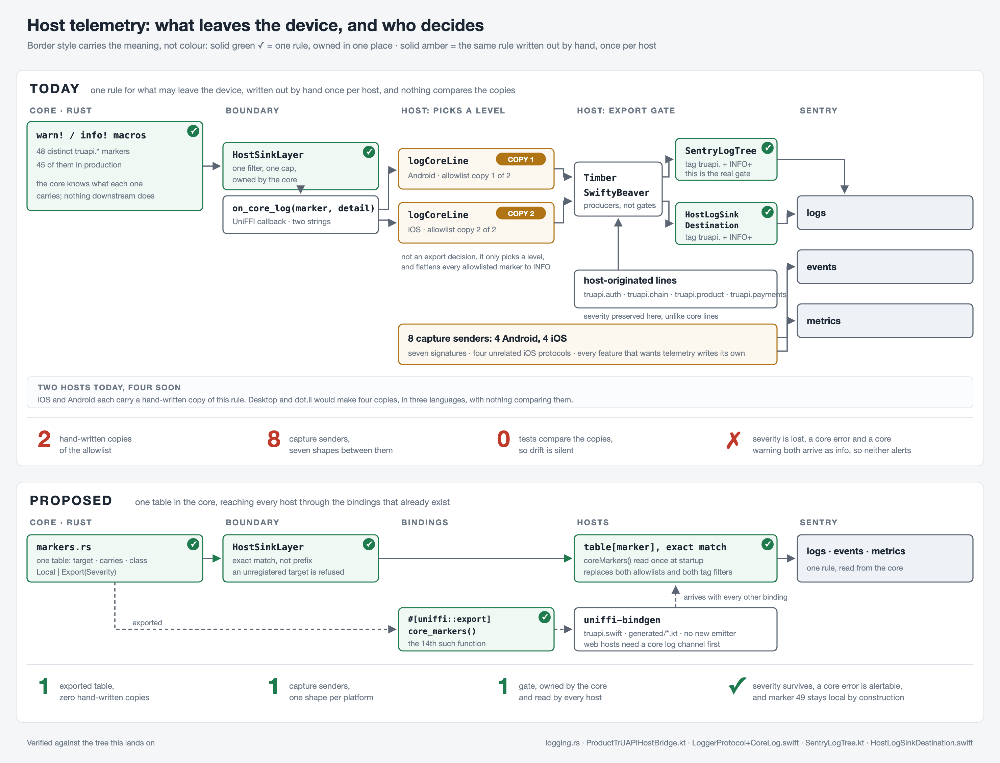

# Host Telemetry: One Table in the Core



## Summary

One table in the core decides which diagnostics may leave a device. Every host reads it rather than keeping its own copy. The table is exposed through a `#[uniffi::export]` function, so it reaches iOS and Android over the bindings that exist today with no new emitter and no change to the callback signature.

## Conventions

These are the standards for anything that sends telemetry from a host, and `AGENTS.md` points here for them. The last part shows what adding one looks like, and the rest of this document is the design these came out of.

**Logs, issues and metrics are three products, not three spellings of one.** Sentry stores and indexes a log line, a captured event and a gauge separately. A diagnostic line goes to the log sink, something that broke goes out as an event, and a device reading goes out as a gauge. Sending one as another leaves it unqueryable beside its own kind.

**A feature reports through the host's capture, never to Sentry.** An Android feature takes `HostEventCapture` and an iOS feature takes `HostEventRecording` or `IssueReporting`. A feature module that depends on the Sentry SDK is itself the defect, because it is a second place deciding what leaves the device.

**Tags are what a captured event is queried on.** Whatever a search, a dashboard or an alert needs to filter by belongs in tags. Extras carry the detail you read once you have already found the event, and `setExtra` is deprecated in favour of structured contexts, so detail that belongs together belongs on a context. On the log path tags and extras flatten into one namespace where everything is searchable and a key spelled as both resolves to the extra, so a mapping still puts what it filters on in tags and the event reads the same way in either product.

**Every captured event sets a fingerprint.** An event that sets none is grouped by the stack trace Sentry attaches, which splits one event name across several groups as its frames drift. One group per event name is the default, and an event supplies its own key only where its grouping is finer than its name, as an issue does on its flow and kind. A log line has no grouping at all, so a signal that leaves as a log is counted by name and its fingerprint never reaches Sentry.

**Severity says whether something broke, and that decides where the signal lands.** A flow that broke carries `error` and a lifecycle step carries `info`. `SentryHostEventRecorder` sends an info event to Sentry Logs and captures anything above it, so a mapping that picks a level is also picking which product its signal is queried in. Android carries a level on `HostEvent` and sends it as the Sentry level of the event, but captures every event whatever its level, so the same lifecycle step arrives as a captured event there.

**The core's marker table decides what may leave the device.** A host matches a target against the table rather than keeping a list of its own, so the question of what is exportable is answered in one reviewable place.

**No free text in a tag.** A tag's value comes from a closed set the code already knows. `CriticalIssue` takes its flow and kind as `StaticString` so an interpolated value cannot become one, and the key a threshold diagnostic counts against stays on the device.

### Adding a signal

**A host event on Android.** The feature takes `HostEventCapture` by constructor injection, and the Hilt binding for it already exists, so there is nothing to wire. It takes `HostEventOriginProvider` as well, and `HostMonotonicTimeProvider` only when the event carries `event.monotonic_ms`, because a wall clock reading is a plain `TimeProvider`. The capture call sits inside `runCatching { ... }.logFailure(...)`, so a telemetry failure cannot reach the feature it is watching. The event is built by an extension that reads `baseTags()` and `baseExtras()` off the origin, either on `HostEventOrigin` or on the feature's own domain event when it has one, as `GameReminderTelemetry.kt` does. It lives beside the feature, and moves to `HostTelemetry.kt` in `:common` only once a second Gradle module raises it.

**A host event on iOS.** The feature takes `any HostEventRecording`, defaulted to `NoopHostEventRecorder()`, and the composition point passes `IssueMonitoringFactory.createHostEventRecorder()`. A feature left on the default builds, runs and sends nothing. The feature holds a `HostEventOrigin` and a monotonic clock, and maps its own domain event onto a `HostEvent` through `HostEvent.make`, which adds the shared tags for it. The level on that mapping is the routing decision, since info leaves as a log line and anything above it is captured, so a lifecycle step is looked for in logs. `record` takes an autoclosure, so a build without reporting support never builds the event at all. `GameReminderDiagnostics.swift` and `GameReminderEvent.swift` are the pair to read, one for the recording and one for the mapping. A flow that broke goes out as a `CriticalIssue` through `IssueReporting` instead, which is what carries `error` and groups on flow and kind.

**Naming one, and testing one.** An event is named `host.<area>.<thing>`, and the name is spelled once in the code, as a constant or as the mapping that derives it, so a test can assert it rather than repeat the string. Every signal in the tree carries a unit test over the event it produces, asserting its name, its tags and its extras. An iOS test pins the level along with them, because that is the field deciding which product the signal lands in. The Android ones add a second test proving the event is not built at all while capture is off, which is the whole reason the call is lazy.

**A core log line.** It starts as an entry in the `markers!` table in `rust/crates/truapi/src/markers.rs`, which carries a constant, its dotted target and its class. The call site then names that constant's `target` field.

```rust
/// A chain refused another follow because the node's budget is spent. Detail
/// names the chain and the budget, never an account or a call.
CHAIN_FOLLOW_BUDGET_REACHED = "truapi.chain.follow_budget_reached" => Export(Warn);

warn!(target: markers::CHAIN_FOLLOW_BUDGET_REACHED.target, "{line}");
```

A marker is `Local` unless its doc comment can say what the detail carries and why that may leave the device, and that comment is what a reviewer reads when deciding. A target the table does not list never reaches a host, though the console still prints it locally. The detail a host receives is cut to `HOST_SINK_DETAIL_MAX_CHARS`, so a line carrying a list gives each entry a share of that room rather than trusting the whole to fit.

**A metric.** A gauge today is a device reading raised by the host's own monitor, `DeviceReadingsMonitor` on iOS and `DeviceReadingsReporter` on Android, and neither surface is open to a feature. A number a feature wants to watch rides on an event instead, rather than through a second caller into Sentry. Counters ride on a context, which only a captured event carries, so a number on an info event goes in extras and arrives as a log attribute.

**Checking it once it ships.** A captured event is found in issues by its name, and an event that left at info is found in logs by the same name, which is both the body and the `event.name` attribute. Those log lines carry `tag` as `host.telemetry` while core and host-originated log lines carry a `truapi.` tag on that same attribute, so a query scoped to one namespace sees none of the other. The fingerprint is the name unless the event supplies a finer key, as an issue does on its flow and kind, so one captured name is one group, and a name arriving as several groups means the grouping key never reached Sentry. `host.platform`, `host.app_variant` and `host.native_app_version` are on every event from either host, and Android adds `host.app_flavor`. iOS sets them centrally in `HostEvent.make` while Android leaves each factory to call `baseTags()`, so an Android event missing them is a factory that forgot. Anything you cannot filter on in issues went to extras when it belonged in tags.

## Motivation

Writing the export rule once per host is the obvious shape, and it does not hold. The same rule has to exist in Swift and in Kotlin, with a restatement in the prose beside each of them, and nothing can compare the copies.

Three things follow from that.

**It grows with the host count.** Two hosts mean two copies. Desktop and dot.li make four, in three languages. Nothing in CI notices them diverging.

**Prefix matching exports by default.** Matching `truapi.chain.` and three sibling prefixes exports a marker added under one of them later, with no review and no test change. There are 48 distinct `truapi.*` markers, 45 of them in production.

**Collapsing severity at the boundary loses the alert.** A host that logs every exported marker at info makes `truapi.tracing.error` and `truapi.tracing.warn` arrive identically, so a core error cannot be alerted on. Host-originated lines keep their severity, so two lines under one tag namespace mean different things depending on who raised them.

The detail string is also built at the call site, so what a marker may carry is decided there rather than by its type. `logging::Account` and `logging::HostText` cover the two values that must not be written out whole, an account and a string a host handed the core, and both redact under `Display` and `Debug` so either sigil is safe to reach for. A value that holds an account inside it redacts in its own `Debug` for the same reason.

## The pipeline

A line travels two stages, and which one governs depends on who raised it.

```
 CORE (rust)                   BOUNDARY          HOST stage 1          HOST stage 2         SENTRY
 ---------------------------   ---------------   ------------------    -----------------    ------
 warn!/info!  --> HostSinkLayer --> on_core_log --> logCoreLine --> Timber / SwiftyBeaver --> logs
  truapi.* or WARN+, capped,      (2 strings)      the table gives     HostLogSinkTree /
  unlisted target refused                          the severity        HostLogSinkDestination
                                                                       tag "truapi." + INFO+

 host-originated lines (truapi.auth, truapi.chain, truapi.payments)
   join at stage 2 and never cross the boundary -----------------------> logs
```

For a core line the table is the decision. `logCoreLine` logs a marker at the severity the table gives it, and a marker the table does not list at debug, and every core line carries the same `truapi.core` tag, so stage 2 only executes what the table already chose.

## What this does not touch

For a host-originated line, stage 2 is the only gate there is. Those lines carry their own tags and their own severities, and nothing upstream filters them, which is why the two tag filters stay (`HostLogSinkTree.kt:30-31`, and `minLevel = .info` plus the same tag guard at `HostLogSinkDestination.swift:35,47`).

Both `HostLogSinkTree` and `HostLogSinkDestination` also limit each tag to 60 lines a minute, and each `truapi.core` marker to 60 of its own. The first line after a minute that dropped lines is preceded by one more that counts them, with the count as a `dropped` attribute and, on `truapi.core`, the marker as a `marker` attribute. A tagged line or core marker stuck in a loop sends at most 60 lines a minute per device plus that count, for as long as it loops. A count that no later line follows, because the tag went quiet or the app stopped, is never sent. Core events are not limited here, whether they reach the sink through `CoreEventLogger` on Android or carry a `CoreEventContext` on iOS.

A product's console output never reaches the sink. `ProductWebChromeClient` on Android and `JSEngineLogger` on iOS log it untagged at its own level. Only a testing build keeps it on the device, in the Android debug log or the iOS testnet log file, and a release build drops it. A product reports to its own Sentry project.

Telemetry also leaves through six senders, three on each host. iOS carries four protocols (`HostEventRecording`, `IssueReporting`, `HostLogSink`, `DeviceReadingsMonitoring`), and the first two reach the backend through one sender, which splits on level so a `CriticalIssue` leaves as a captured event and a lifecycle step leaves as a log. On Android the three are `HostProcessTelemetry`, `DeviceReadingsInitializer` and `SentryHostLogSink`, and both `HostLogSinkTree` and `CoreEventLogger` reach that last one through `HostLogSink`.

**The web host has no core-log channel at all.** `on_core_log` is declared in `native/callbacks.rs:37`, inside `truapi::native`, which is `#[cfg(not(target_arch = "wasm32"))]` at `lib.rs:898`. There is no `onCoreLog` in any TypeScript source, and `truapi-codegen` walks the `platform` modules, never `native`. So Desktop and dot.li receive no core diagnostics, under any design.

## Approach

The core owns a table of every marker it may address to a host, each saying whether it may leave the device and at what severity. What its detail may hold is the doc comment beside it, read by reviewers rather than by anything on a device. It exposes that table through a `#[uniffi::export]` function, the way `parse_navigate` at `native.rs:65-68` is already exposed, so it rides `uniffi-bindgen-cli` with every other binding and needs no new emitter and no new CI job. Each host reads it once at startup and matches a target exactly, instead of keeping a list of exported prefixes of its own.

Exact matching is what makes a marker local by default. A target the table does not hold stays on the device, so a marker added later cannot ship off-device until someone says what it carries. `HostSinkLayer` applies the same rule on the way out, and refuses a host-addressed target the table does not list.

The class is a property of the marker rather than of the line. The case for varying it per line is `truapi.ws_bridge.*`, where the detail differs every time, but the answer there is to type the detail so it cannot carry what we do not want, not to let the class float. A floating class puts the decision back at the call site, which is what the table takes away.

The table reaches Desktop and dot.li as a generated TypeScript module, emitted from the same list, because UniFFI cannot reach a host that runs in a browser. Nothing there reads it yet. They still have no core-log channel, and giving them one is separate work that should read this table rather than start a third copy.

## Interface

```rust
#[cfg_attr(not(target_arch = "wasm32"), derive(uniffi::Enum))]
pub enum MarkerClass {
    /// Stays on the device.
    Local,
    /// May be shipped off-device, at the given severity.
    Export { severity: Severity },
}

#[cfg_attr(not(target_arch = "wasm32"), derive(uniffi::Enum))]
pub enum Severity { Info, Warn, Error }

/// Every marker the core may address to a host, keyed by its dotted target.
/// A host reads this once and looks up each marker it is handed. A target the
/// map does not hold stays on the device.
#[uniffi::export]
pub fn core_markers() -> HashMap<String, MarkerClass> { /* ... */ }
```

The map is the lookup itself rather than a list a host has to index, so the bindings carry no mirror of the registry struct: only the two enums cross, as `[String: MarkerClass]` in Swift and `Map<String, MarkerClass>` in Kotlin.

The web hosts read the same table as `CORE_MARKERS`, a `ReadonlyMap<string, MarkerClass>` that `@parity/truapi-host/markers` exports. It is its own entry point so a package that decides what to forward depends on the table alone and not on the host runtime. `truapi-codegen` links against the registry and writes it out, so the UniFFI surface and the TypeScript one are two spellings of one list.

What a marker may carry is prose for reviewers. It stays in the Rust registry as the doc comment on each entry, and does not cross, because nothing on a device reads it.

An unregistered target is caught three times over, in this order:

| Where | What happens |
|---|---|
| compile time | every call site names a table constant, so a misspelled marker does not build |
| `admits_host_marker` | a target the table does not list is refused on either way out of the core, a literal or a runtime-built one alike |
| host | a target absent from the table it read is treated as `Local` |

That predicate is what actually enforces it. The constants make a typo a build failure rather than a silent drop, and the host check is the backstop for bindings older than the core.

**What the table decides.** A marker absent from it is local, because lookup is exact. `MarkerClass::Export { severity }` is what carries a core error to Sentry as an error rather than as info. The rule exists once, in the core, whatever the host count.

The two tag filters stay. They are the only gate on host-originated lines such as `truapi.payments`, which the core table says nothing about. Deleting them would ship every host debug line on any tag.

## Core events

A marker can name the fields it carries instead of writing them into a detail line. `CoreEvent` builds one in the core and `HostCallbacks::on_core_event` hands it to a host, which gives its reporter attributes it can group and filter by rather than prose it can only store.

```rust
#[cfg_attr(not(target_arch = "wasm32"), derive(uniffi::Record))]
pub struct CoreAttribute {
    pub key: String,
    pub value: CoreAttributeValue,
}

#[cfg_attr(not(target_arch = "wasm32"), derive(uniffi::Enum))]
pub enum CoreAttributeValue {
    Text { value: String },
    Count { value: u64 },
    Flag { value: bool },
}

// Any marker the table lists.
CoreEvent::new(markers::SOME_MARKER)
    .text("outcome", "sent")
    .count("age_ms", age)
    .flag("money_moved", true)
    .emit();
```

Keys are `&'static str` on the builder, so a key is written in the core's own source and nothing at a call site can build one from runtime text. A value is a label, a count, or a condition. A label may be a runtime identifier such as a provider, an asset or a dotNS name, which is why the type cannot be `&'static str` too, so the rule for those is the gate rather than the signature: the caller admits a short plain value and collapses anything else to a fallback, the way an unlisted provider is `other` and an untrusted product is `third_party`. Free text a provider, a product or a manifest wrote goes through that gate or it does not go, for the same reason it does not belong in a detail line.

One marker table gates both paths. `admits_host_marker` is the single predicate the tracing layer's filter and `CoreEvent::emit` ask, so a marker nobody declared reaches a host on neither, and the class the table carries decides what a host may do with an event exactly as it does for a line.

`CoreEvent::emit` writes to the core's own console before it consults the sink, under the live level and at the level the marker's class carries, so a marker reads the same on a build that installs no sink. The browser host and the CLI reach a marker only that way. It also holds the reentrancy flag across the sink call and honours it on the way in, so a host whose two callbacks share one lock cannot be re-entered from inside either.

An attribute's text is bounded by `CORE_EVENT_TEXT_MAX_CHARS` and an event by `CORE_EVENT_MAX_ATTRIBUTES`. The second bound is about cardinality rather than size: a host indexes these, so an event that grew a key per iteration would cost its marker whatever a host can group by, not just its own line.

`HostBridge` defaults the callback to nothing on both hosts, so a host carries structured traffic once it says it wants it.

Both apps send a marker the table exports to Sentry at the table's severity, as a log whose body is the marker, tagged `truapi.core`, with each attribute beside the tag. A marker the table keeps local or does not list never reaches Sentry. On Android both bridges call one injected `CoreEventLogger`, which writes the event to the device log at debug and hands an exported marker to `HostLogSink`, bound to `SentryHostLogSink`. `HostLogSinkTree` forwards the lines it matches to that same sink, so Sentry logs there leave from one place. On iOS both bridges call `logCoreEvent` on the logger they already hold, typed `CoreEventLoggerProtocol`. It logs the event as a `[truapi.core]` line at the marker's level, or at debug when the marker is not exported, and carries the attributes as SwiftyBeaver context. `HostLogSinkDestination`, the one destination that holds the `HostLogSink`, forwards that line at info and above as the marker with the attributes as fields.

## Trade-offs

The cost is that every new marker has to be registered, which the author cannot skip because an unregistered target does not compile. That is deliberate: it is the same friction that stops a marker shipping off-device without anyone saying what it carries.

A host has to call the function to hold the table at all, so a host that never calls it holds no policy. Carrying the class on the callback itself would make that impossible to miss, at the cost of a boundary signature every conformer and test double would follow. There is no per-host fallback underneath it, which is the real weakness here and worth stating.

The benefit is that the number of places the rule is written stays at one as hosts are added, and that a marker is local until someone states otherwise rather than exported until someone notices.

## Funding events

Funding's flow facts leave the core as core events under exported markers. The core emits them; each app's `onCoreEvent` sink hands them to Sentry Logs as the marker with its attributes, so they arrive from builds that are not released, through the gates the hosts already have. No host code is written for them beyond that sink. The apps log only their own UI events, named `host.funding.*`, through their own recorders.

**The markers.** Each fact is a `truapi.funding.*` entry in the `markers!` table, `Export(Info)`, except `truapi.funding.ended_unexpectedly`, which is `Export(Error)` so a fault can be alerted on apart from the rest. The table gates the event path as it does the log path, so an entry missing or local would reach no host. Each entry's doc comment lists the attributes it carries and the closed set each takes.

| Marker | Logged when |
|---|---|
| `overlay_opened` | the overlay opens on a new session |
| `overlay_closed` | it closes: started, dismissed or failed, and how far the user got |
| `quotes_settled` | every provider asked for a quote request answered, or a newer request replaced it |
| `provider_chosen` | the session is handed to a provider on a quote: its rank, fee and time buckets |
| `provider_took` | the provider's worker takes the session, or first fails to |
| `step_reached` | a milestone (received, added, sent) is first reached |
| `status_flag` | taking longer, retrying or retrying a payout first shows |
| `ended`, `ended_unexpectedly` | the provider is done with the session: outcome and reason class |
| `cancel_requested` | the user asks to cancel |
| `cancel_answered` | the provider answers a cancel, or its worker first fails to |
| `cancel_confirmed` | the user answers a cancel offer |
| `frame_requested`, `frame_opened`, `frame_closed` | a provider's screen is asked for, opened, and closed, or dropped before the user opened it |

Each is emitted once, on a change a commit stored or on the call that made it, never on loading sessions after a restart.

**The attributes.** A fact is a `CoreEvent` carrying its own attributes, then `funding.ref`, a random per-session label, the session's labels (direction, opener, first-party product or `third_party`, rail, listed provider, asset and network when a compiled-in list of known ids names them, amount bucket) and the session's `age_ms`. Labels are text, conditions such as `money_moved` are flags, and counts and durations are counts, left off when unknown rather than sent as zero. The facts are built in `runtime/funding_telemetry.rs` on `CoreEvent`'s own builder; its one addition, `tag`, takes a label only from a closed enum or fixed bucket, so a string a provider, a product or a manifest wrote cannot become one. The runtime-built labels (provider, product, asset, network) pass the gate described under core events or collapse to `other`, `third_party` or `none`. Asset and network are strings a provider's manifest wrote, so they are tagged only when a small list of known ids beside the builder names them (`usdt`, `usdc`, `dot`, `polkadot`, `polkadot-asset-hub`, `paseo` and the like) and are `other` otherwise; the product-sdk asset catalog replaces that list later.

```
[truapi] INFO truapi.funding.overlay_opened amount_preset=true funding.ref=V1StGXR8_Z5jdHi6 direction=in opener=host product=none rail=none provider=none asset=none network=none amount_bucket=50-100 age_ms=0
```

That is the core's own console line; a host receives the same as typed attributes.

**Privacy.** No fact carries a session's intent, a quote, transaction or reference id, an address, an exact amount, fee or limit, a provider's own text, or a URL. Amounts are CASH buckets (`<10` to `5k+`), fees basis-point buckets, and a country only its region: `eu`, `uk`, `us`, `other`, or `unset`. The reference is drawn at random per session and kept in memory only, so it joins a session's facts without leading back to the session; a session resumed after a restart draws a new one. Funding's own warnings leave as `truapi.tracing.warn` and name no session either.

**Production.** The hosts' Sentry logs send nothing from release builds, and there is no consent screen behind it. Funding telemetry from production needs consent and a policy decision first.

## Open questions

1. Does the registry belong beside the logging layer in `truapi`, or in the `truapi::platform` module with the other host-facing contracts?
2. Do metrics want the same treatment that events have, or is a count on an event enough? Funding's measures are counts on its core events for now.
3. When Desktop and dot.li get a core-log channel, does it carry the class on each line or read the table the way the native hosts do?
4. Does Android route an info host event to Sentry Logs the way iOS does, now that `HostEvent` carries a level there?

## Delivery

The Rust table lands first, then iOS and Android read it and their own lists go with it. Desktop and dot.li read the same table once they have a core-log channel to carry it on. Tracked on #1796, which carries a task per host alongside the Rust ones.
