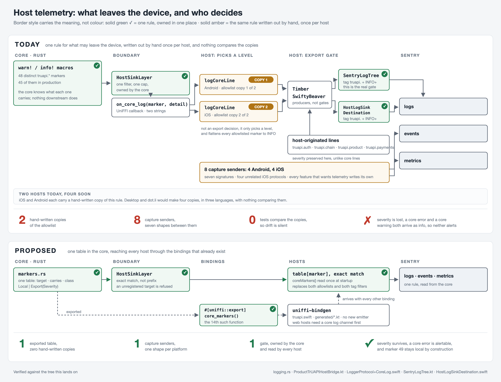

# Host Telemetry: One Table in the Core



## Summary

One table in the core decides which diagnostics may leave a device. Every host reads it rather than keeping its own copy. The table is exposed through a `#[uniffi::export]` function, so it reaches iOS and Android over the bindings that exist today with no new emitter and no change to the callback signature.

## Motivation

The rule for which core markers may be exported is written out by hand once per host, in `LoggerProtocol+CoreLog.swift:9-14` and `ProductTrUAPIHostBridge.kt:448-453`. Two more restatements sit in prose, in `hosts/ios/.claude/docs/code/error-handling.md:47` and `hosts/android/.claude/docs/code/naming-and-hygiene.md:240`. Nothing compares any of them.

Three things follow from that shape.

**It grows with the host count.** Two hosts mean two copies. Desktop and dot.li would make four, in three languages. Nothing in CI would notice them diverging.

**Prefix matching exports by default.** Each host matches `truapi.chain.` and three sibling prefixes, so a marker added under one of them later is exported with no review and no test change. There are 48 distinct `truapi.*` markers today, 45 of them in production.

**Severity does not survive the crossing.** `ProductTrUAPIHostBridge.kt:441` and `LoggerProtocol+CoreLog.swift:20` both collapse every allowlisted marker to info, so `truapi.tracing.error` and `truapi.tracing.warn` arrive identically and a core error cannot be alerted on. Host-originated lines keep their severity, so two lines under one tag namespace mean different things depending on who raised them.

The detail string is also built at the call site, so what a marker may carry is decided there rather than by its type. `account_handle` (`logging.rs:116`) exists for exactly this and shortens an account id before it is formatted. Making that the only shape a detail can take is step 2 of the delivery below.

## Current state

The pipeline has two stages, and which one governs depends on who raised the line.

```
 CORE (rust)                   BOUNDARY          HOST stage 1          HOST stage 2         SENTRY
 ---------------------------   ---------------   ------------------    -----------------    ------
 warn!/info!  --> HostSinkLayer --> on_core_log --> logCoreLine --> Timber / SwiftyBeaver --> logs
  truapi.* or WARN+, capped       (2 strings)      allowlist decides   SentryLogTree /
                                                   info vs debug       HostLogSinkDestination
                                                                       tag "truapi." + INFO+

 host-originated lines (truapi.auth, truapi.chain, truapi.product, truapi.payments)
   join at stage 2 and never cross the boundary -----------------------> logs
```

For a core line, stage 1 is the decision. `logCoreLine` logs an allowlisted marker at info and everything else at debug, and every core line carries the same `truapi.core` tag, so stage 2's `priority >= Log.INFO && tag.startsWith("truapi.")` (`SentryLogTree.kt:15-16`, and `minLevel = .info` plus the same tag guard at `HostLogSinkDestination.swift:13,25`) only executes what the allowlist already chose. Delete the allowlist and every core marker exports.

For a host-originated line, stage 2 is the only gate there is. Those lines carry their own tags and their own severities, and nothing upstream filters them.

Telemetry also leaves through eight capture senders, four per platform, with seven distinct signatures between them and four unrelated protocols on iOS (`HostEventRecording`, `IssueReporting`, `HostLogSink`, `DeviceReadingsMonitoring`). The pattern is that a feature wanting telemetry writes its own sender.

**The web host has no core-log channel at all.** `on_core_log` is declared in `native/callbacks.rs:37`, inside `truapi::native`, which is `#[cfg(not(target_arch = "wasm32"))]` at `lib.rs:793-794`. There is no `onCoreLog` in any TypeScript source, and `truapi-codegen` walks the `platform` modules (`truapi-codegen/src/platform.rs:1-10`), never `native`. So Desktop and dot.li receive no core diagnostics today, under any design.

## Approach

The core owns a table of every marker it may address to a host, each saying whether it may leave the device and at what severity. What its detail may hold is the doc comment beside it, read by reviewers rather than by anything on a device. It exposes that table through a `#[uniffi::export]` function, the way `parse_navigate` at `native.rs:65-68` is already exposed, so it rides `uniffi-bindgen-cli` with every other binding and needs no new emitter and no new CI job. Each host reads it once at startup and matches a target exactly, instead of keeping a list of exported prefixes of its own.

Exact matching is what makes a marker local by default. A target the table does not hold stays on the device, so a marker added later cannot ship off-device until someone says what it carries. `HostSinkLayer` applies the same rule on the way out, and refuses a host-addressed target the table does not list.

The class is a property of the marker rather than of the line. The case for varying it per line is `truapi.ws_bridge.*`, where the detail differs every time, but the answer there is to type the detail so it cannot carry what we do not want, not to let the class float. A floating class puts the decision back at the call site, which is where it sits today and what this is meant to move.

This does not carry itself to Desktop and dot.li, because they have no core-log channel to carry it on. Giving them one is separate work, and when it happens it should read this table rather than start a third copy.

## Interface

```rust
#[cfg_attr(not(target_arch = "wasm32"), derive(uniffi::Enum))]
pub enum MarkerClass {
    /// Stays on the device.
    Local,
    /// May be shipped off-device, at the given severity.
    Export(Severity),
}

#[cfg_attr(not(target_arch = "wasm32"), derive(uniffi::Enum))]
pub enum Severity { Info, Warn, Error }

/// Every marker the core may address to a host, keyed by its dotted target.
/// A host reads this once and looks up each marker it is handed; a target the
/// map does not hold is `Local`.
#[uniffi::export]
pub fn core_markers() -> HashMap<String, MarkerClass> { /* ... */ }
```

The map is the lookup itself rather than a list a host has to index, so the bindings carry no mirror of the registry struct: only the two enums cross, as `[String: MarkerClass]` in Swift and `Map<String, MarkerClass>` in Kotlin.

What a marker may carry is prose for reviewers. It stays in the Rust registry as the doc comment on each entry, and does not cross, because nothing on a device reads it.

An unregistered target is caught three times over, in this order:

| Where | What happens |
|---|---|
| compile time | every call site names a table constant, so a misspelled marker does not build |
| `HostSinkLayer` | a target the table does not list is refused, a literal or a runtime-built one alike |
| host | a target absent from the table it read is treated as `Local` |

The layer is what actually enforces it. The constants make a typo a build failure rather than a silent drop, and the host check is the backstop for bindings older than the core.

**What this changes.** Exact-match lookup replaces prefix matching, so a marker absent from the table is local. `MarkerClass::Export(Severity)` means a core error is no longer a core warning in Sentry. Both host allowlists are deleted.

The two tag filters stay. They are the only gate on host-originated lines such as `truapi.payments`, which the core table says nothing about. Deleting them would ship every host debug line on any tag.

## Trade-offs

The cost is that every new marker has to be registered, which the author cannot skip because an unregistered target does not compile. That is deliberate: it is the same friction that stops a marker shipping off-device without anyone saying what it carries.

A host has to call the function to hold the table at all, so a host that never calls it holds no policy. Carrying the class on the callback itself would make that impossible to miss, at the cost of a boundary signature every conformer and test double would follow. Both host allowlists go in the same change, so there is nothing to fall back to, but that is the real weakness here and it is worth stating.

The benefit is that the number of places the rule is written stays at one as hosts are added, and that a marker is local until someone states otherwise rather than exported until someone notices.

## Open questions

1. Does the registry belong beside the logging layer in `truapi`, or in the `truapi::platform` module with the other host-facing contracts?
2. Do events and metrics want the same treatment, or is the log channel the only one with a boundary worth policing?
3. When Desktop and dot.li get a core-log channel, does it carry the class on each line or read the table the way the native hosts do?

## Delivery

The Rust table lands first. Until a host reads it, both hosts keep their own allowlists and still flatten core severity to info, so nothing about what reaches Sentry changes yet. Tracked on #1796, which carries a task per host alongside the Rust ones.
