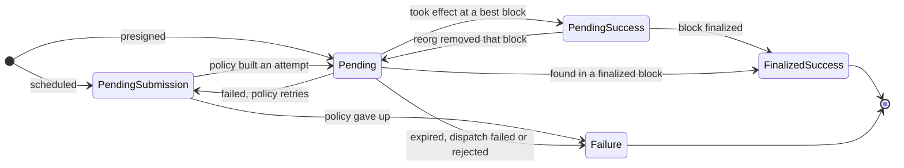

# Transaction Durability Engine

## Problem

A plain submission through `submit_and_watch` can fail in many ways: the connection drops, the phone goes to the background, or the node returns an error. After that, it is hard to keep track of the transaction.

Yet in some cases we have to track a transaction's status until it is settled. For example, coinage transactions must be tracked to keep a consistent local view of the funds.

## Solution

The transaction durability engine is a general-purpose component that takes over the submission and tracking of transactions. It has two main parts:

1. **Low-latency, best-effort submission**: the engine submits a received transaction with `submit_and_watch` and tracks its status through the subscription whenever possible. In the best case, this is enough to follow the transaction all the way to finalization.
2. **Guaranteed recovery**: if something goes wrong in (1), the engine hands tracking over to a recovery layer. This layer combines transaction-specific knowledge, mortality and block search to determine the transaction's status with certainty.

On top of that, the engine offers higher-level features such as transaction grouping, retries and scheduled transactions. The sections below cover the main concepts of the design, the individual features, and how they can be useful.

### Transactions

The engine does not construct or sign transactions itself. It accepts either a presigned transaction or a scheduled one, which a consumer-provided submission policy builds later:

```rust
enum RequestedTransactions {
    /// Signed already: recorded as pending and broadcast once committed.
    Presigned(Vec<DurableSubmission>),
    /// Built later, each through its plan.
    Scheduled(Vec<SubmissionPlan>),
}

pub struct DurableSubmission {
    /// Signed and ready to broadcast.
    pub extrinsic: MortalExtrinsic,
    /// How it is rebuilt, if it is.
    pub plan: Option<SubmissionPlan>,
}

pub struct SubmissionPlan {
    /// The registered policy that builds it.
    pub policy: PolicyId,
    /// Opaque bytes, interpreted by the policy.
    pub params: PolicyParams,
}
```

Use `Presigned` when the consumer can build the transaction before registering it with the engine. Use `Scheduled` when building it is costly and has to happen asynchronously, through a `SubmissionPolicy`. The same policy handles both scheduled submission and retries; see [Submission policies](#submission-policies).

The engine accepts only **mortal** transactions. Mortality is what lets it declare a transaction failed: if its inclusion cannot be observed on chain within the mortality window, it never can be.

#### Transaction statuses

The main purpose of the engine is to track the status of each submitted transaction and expose it to consumers:

```rust
pub enum DurableTxStatus {
    /// Waiting for its policy to build an attempt.
    PendingSubmission,
    /// Submitted or about to be, with no evidence either way.
    Pending,
    /// Took effect at a block that is not finalized yet.
    PendingSuccess { at: HashAndNumber },
    /// Took effect at a finalized block. Terminal.
    FinalizedSuccess { at: Option<HashAndNumber> },
    /// Can no longer take effect. Terminal.
    Failure(DurableTxFailureKind),
}

pub enum DurableTxFailureKind {
    /// Its era ended without it being included.
    Expired,
    /// It was included and its dispatch failed.
    DispatchFailed,
    /// The node refused it before it reached the pool.
    Rejected,
    /// It waited to be built and its policy will never build it.
    Abandoned,
}
```

The diagram below shows the main transitions:



### Composable durability

The engine is built on ACID storage. Any such database would work; we use SQLite. All mutations run inside a database transaction, so when several writes belong together, either all of them succeed or none do.

More importantly, consumers can run their own logic as part of the engine's registration transaction:

```rust
pub async fn execute_with<T, F>(
    self: &Arc<Self>,
    request: DurableRequest,
    on_register: F, // Consumers can run additional logic here
) -> Result<(Vec<DurableTxId>, T), RegistrationError>
```

This makes the engine highly composable. For example, a coinage service built on top of the engine can record its own state (inputs and outputs) in the same registration transaction, check its UTXO invariants, and roll the whole registration back if one is violated.

### Guaranteed transaction tracking

Tracking through `submit_and_watch`, the best-case, low-latency path, is simple: the engine follows the subscription and updates the transaction's state. The recovery layer deserves a closer look.

When `submit_and_watch` fails in a way the tracker cannot confidently identify as a transaction failure, tracking is handed over to the recovery layer.

The simplest way to track a transaction is to check whether any finalized block within its mortality window includes it. This works, but it has two critical gaps:

* **Latency**: waiting for finalization is too slow.
* **Efficiency**: scanning every block of the mortality window by default is wasteful.

To close these gaps, the recovery layer combines three sources of information:

* **Transaction mortality**: a transaction that is not found within its mortality window is a `Failure`.
* **Consumer-provided completion oracle**: consumers help the engine decide a transaction's status by describing its observable side effects, which the engine checks at both best and finalized blocks. See [Completion oracle](#completion-oracle).
* **Block scan**: scanning finalized blocks is the fallback.

Together, these give the engine the following properties:

* **Provable**: every terminal status is proven, either by the transaction's detected inclusion or by its proven absence.
* **Timely**: the engine follows both best and finalized blocks, so it detects `PendingSuccess` as early as possible.
* **Bounded**: as long as chain reads do not keep failing, every transaction reaches a terminal status within a bounded time that depends on its mortality.
* **Fork resilience**: best blocks can be reverted, so separate checks downgrade `PendingSuccess` back to `Pending` when a reorg is detected.
* **Crash resilience**: because the storage is ACID, every write is atomic, and a crash cannot leave the engine in an inconsistent state.

### Background execution

The engine exposes native host callbacks that let the host drive tracking from a platform background worker, so tracking continues while the app is in the background.

### Completion oracle

Transaction mortality and block inclusion alone can drive a transaction to a terminal status. A consumer that needs best-block latency, however, must provide a completion oracle:

```rust
#[async_trait::async_trait]
pub trait CompletionOracle: Send + Sync {
    fn chain(&self) -> H256;

    // Prefetch all the data this oracle needs for the given batch of `transactions`
    async fn open_pass(
        &self,
        transactions: &[DurableTxEntry],
        ledger: &LedgerView,
        heads: &Heads,
    ) -> Result<Box<dyn PassScope>, RuntimeFailure>;
}

pub trait PassScope: Send + Sync {
    /// Positive proof `tx` took effect at `head`
    fn proven_completed(&self, tx: &DurableTxEntry, head: HeadKind) -> bool;

    /// Positive proof `tx` has not taken effect at `head`, and cannot have
    /// taken effect and been undone since
    fn proven_not_completed(&self, _tx: &DurableTxEntry, _head: HeadKind) -> bool {
        false
    }
}
```

The oracle works on batches of transactions so that consumers can read efficiently in bulk, for example when the side effects are storage entries.

`proven_completed` and `proven_not_completed` are separate methods because the oracle's answer has three possible values: completed, not completed, or unknown.

### Submission policies

A submission policy is the mechanism for both scheduled submission and retries: it tells the engine exactly how to build a transaction whenever the engine needs to build or rebuild one:

```rust
pub trait SubmissionPolicy: Send + Sync {
    fn id(&self) -> PolicyId;

    fn can_retry(
        &self,
        entry: &DurableTxEntry,
        params: &PolicyParams,
        failure: VerdictFailureKind,
    ) -> bool;

    async fn prepare(
        &self,
        batch: &[ScheduledDurableTx],
    ) -> Result<HashMap<DurableTxId, Preparation>, PolicyError>;
}

pub enum Preparation {
    Ready(MortalExtrinsic),
    GiveUp,
}
```

`can_retry` and `prepare` are separate because `can_retry` runs on the verdict path, before the engine writes a `Failure`. A transaction that can be retried therefore moves straight to `PendingSubmission`, without briefly showing `Failure`. It is a plain function so that it decides from what it is given and never waits on the chain. It is only asked about a submitted attempt's failure (`VerdictFailureKind`: expired, dispatch failed or rejected), never about an abandoned transaction.

`prepare`, on the other hand, may take as long as it needs to build a transaction and wait until it is actually valid. For example, a policy that builds a ring-VRF proof might wait in `prepare` until the account is included in the ring.

`prepare` can also return `GiveUp`, which abandons the transaction and marks it as `Failure(Abandoned)`.

### Scoping and grouping

The engine offers consumers two ways to organize transactions.

#### Domains

A domain, identified by a `DomainId`, separates features from each other, so one generic engine can serve transactions from completely unrelated features. For example, Coinage has its own domain and NFTs have another.

#### Groups

A group, identified by a `GroupId`, represents a high-level operation that may consist of several on-chain transactions. The engine provides an API to query and watch all transactions in a group. For example, a coinage transfer may consist of several unload transactions. Coinage can put them in one group, watch their statuses together, and derive the status of the whole operation from them.
