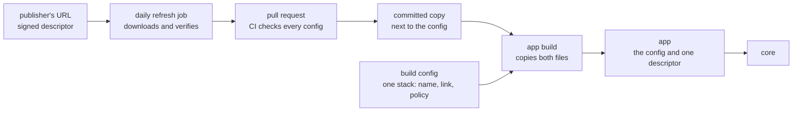

# Trinity stack build config

## Problem

Right now each host decides in code which stack it runs. Every build carries the descriptors of three stacks, and the
code picks one. iOS picks by compiler flags, Android by the `TestnetEnvironment` its build type sets, and dotli by the
network the person selects. If PCF or anyone else wants to ship a different stack, they have to change that code.

The mobile apps take their descriptors from `stacks/` in this repository, where a daily job refreshes them through a
pull request. dotli keeps its own copies in `packages/config/.trinity/`, and its deployment sets `VITE_NETWORKS` to say
which of them the page offers.


[RFC 2](https://github.com/paritytech/trinity-user-agents/pull/1564) moves this choice into the build's configuration.
It says what the configuration holds (the stack's pointer, a bundled copy of its descriptor, and whether the stack may
use reserved values) but it does not say what the file looks like. This page proposes a format for
[#1899](https://github.com/paritytech/trinity-user-agents/issues/1899) and describes what each build system does with
it.

## Proposal

A build config is a small JSON file that names one stack. Each build is pointed at one config. The build copies the
config and the committed copy of that stack's descriptor into the app, and the app starts the core from the two.

Descriptor copies keep getting into the repository the way they do now: a scheduled job downloads each one, verifies it
and opens a pull request. A build only ships what is committed.



## The format

```json
{
  "$v": 1,
  "name": "paseo-next-v2",
  "link": "polkadotapp://stack?key=0x2b89d8ca74aa2e11ab55f5af1168cd6929b88d1998aecd979b42cfc1078d5377&url=https%3A%2F%2Fstack-paseo-next.parity-testnet.parity.io%2F.well-known%2Ftrinity-stack.json",
  "reservedValues": {
    "allowed": false,
    "extraGenesisHashes": [],
    "extraTlds": []
  }
}
```

- `name` matches `[a-z0-9][a-z0-9-]*`. It is the file name of the descriptor copy, `<name>.json`, and does not have to
  equal the descriptor's `id`.
- `link` is the stack's link, which RFC 2 calls its pointer: the descriptor's URL and the publisher's key. The key is
  required, because RFC 2 says a built-in stack must be signed.
- `reservedValues` has the same fields as the core's `ReservedValuesPolicy`. Only `allowed` is required. RFC 2 lets a
  build add to the reserved values. The two lists do that: they name more genesis hashes and TLDs that the build's stack
  may not use. They make no sense together with `allowed: true`, and the core refuses that combination.
- The CLI refuses a config with an unknown field, or with a `$v` other than 1.

For a stack that may use reserved values, RFC 2 says a refresh at run time must not change some fields, such as its
genesis hashes, TLD and contracts. The config does not list them. The core takes them from the bundled descriptor when
it starts. It already does this for the TLD, and [#2202](https://github.com/paritytech/trinity-user-agents/pull/2202)
adds the rest.

These are the builds listed in [#1899](https://github.com/paritytech/trinity-user-agents/issues/1899) and the config
each one would have:

| Build               | `name`          | `allowed` |
| ------------------- | --------------- | --------- |
| Parity nightly      | `paseo-next-v2` | `false`   |
| Parity preview      | `previewnet`    | `false`   |
| Parity mainnet fork | `polkadot-test` | `true`    |
| PCF production      | `polkadot`      | `true`    |

The links for paseo-next-v2, previewnet and polkadot are in `rust/crates/trinity-stack/known-stacks.json`, the list of
stack names and links that the `trinity-stack` crate ships. Nobody publishes a polkadot-test stack yet, so the
mainnet-fork config can only be added later. It needs the stack's key and URL. The stack also needs an entry in
`known-stacks.json`, because the daily refresh only handles the stacks in that list.

## Where the descriptor comes from

The config does not contain the descriptor. The descriptor is the file `<name>.json` in the same directory as the
config, and it is committed like the config itself.

RFC 2 says the build step fetches the descriptor, verifies it and bundles the copy, as `truapi-host stack bundle` does.
It also says the step never lowers `sequence` below the copy it replaces.

We read that step as the scheduled refresh that writes the committed copy. If the step replaces a copy, that copy has to
be kept from one run to the next, and the command's own help says it writes the copy a host build ships. It is also how
the command is used today: `scripts/update-stacks.sh` runs it for every signed stack in `known-stacks.json`, and a daily
workflow puts the result into a pull request. An app build then takes the copy that is in the tree and downloads
nothing.

This departs from the wording of #1899, which asks for a bundling step in the iOS, Android and web builds that uses
`truapi-host stack bundle`. RFC 2 is still in review, so its author can tell us if we read it wrong.

With this reading, an app build needs no network and no `truapi-host` binary, so it still works when a descriptor's
server is down. A new descriptor also reaches a release only through a pull request, where CI can check it before it is
merged.

There are two downsides. The pull request shows a descriptor copy as one line of base64, so whoever approves it cannot
see what changed inside. That includes a change to the contracts of a stack that may use reserved values. And nothing in
an app build checks `expiresAt`. The refresh refuses an expired descriptor, and the core reports a stack as expired when
it starts from one, but a copy that expires after the last refresh still gets bundled. RFC 2 asks the build step to
refuse an expired copy, so here we do less than it says.

During the build, each mobile host copies the config and its descriptor into the place where it keeps its stack files
today. The config gets the fixed name `stack.build.json` so that the app can find it. A `name` cannot contain a dot, so
no descriptor can end up with that file name.

## Selecting a config

Parity's configs would live in `stacks/` next to the descriptor copies: `nightly.build.json`, `preview.build.json` and
later `mainnet-fork.build.json`. Every config there has to name a signed stack from `known-stacks.json`, because the
refresh takes its links from that list and would never update the copy of any other stack.

Each build system gets one setting that holds the path to a config:

| Build system | Setting                                                          | Defaults                                                          |
| ------------ | ---------------------------------------------------------------- | ----------------------------------------------------------------- |
| Xcode        | build setting `TRINITY_STACK_BUILD_CONFIG`                       | Debug, DevCI: preview. Nightly, Safetynet: nightly. Release: none |
| Gradle       | Gradle property `truapi.stackBuildConfig.<buildType>`            | debug: preview. nightly, safetynet: nightly. release: none        |
| Web          | env var `TRINITY_STACK_BUILD_CONFIG`, read by the bundler config | set per deployment                                                |

Debug, DevCI, Nightly and Safetynet keep the stacks they run now.

Release has no default on purpose. Right now Release runs `polkadot` with reserved values allowed, and we don't want a
build to end up with that just because nobody set a config. So a release build with an empty setting fails.

This means Parity's own Release builds need a config before the change can land: the release TestFlight builds, the
Profile and Archive actions of the Xcode schemes, and Android's release unit tests in CI. Which config they get is for
the iOS and Android owners to decide when they move their builds to configs.

PCF would not have to change any host code. It keeps its own `production.build.json` outside this repository, with
`polkadot.json` next to it, and passes the config's path through the same setting. It refreshes `polkadot.json` in its
own pipeline with `truapi-host stack bundle`, as `scripts/update-stacks.sh` does here. Whether that refresh goes through
a review is up to PCF.

## What changes in each host

**iOS.** The xcconfig files in `hosts/ios/Configs/` would set `TRINITY_STACK_BUILD_CONFIG`, and a value passed on the
`xcodebuild` command line overrides them. Today the "Bundle Trinity stacks" build phase copies the files of three
stacks. It would copy the selected config and its descriptor instead, and read the descriptor's file name from the
config with `plutil`. `TrUAPIBundledStack` would then build `BundledStack` from the two files, so it no longer needs its
switch on `UNSTABLE`, `NIGHTLY` and `SAFETYNET`. If the config cannot be decoded, the app behaves the way it already
does when the stack resource is missing: everything that needs the core (products, Pocket cards, images loaded by CID)
fails with an error, and the rest of the app keeps running.

**Android.** `:bindings:truapi-host` has one `syncStacks` task today, which copies three stacks into the assets of every
build type. It would get one task per build type, each copying that build type's config and descriptor into its
`stacks/` assets. `TrUAPIStack` would read `stacks/stack.build.json`, so it no longer has to map `TestnetEnvironment` to
a stack.

**Web.** `@parity/truapi-host` runs in the browser and cannot read files, so the page keeps passing the stack to it in
`ProductRuntimeConfig.stack`. The package only adds the TypeScript type of the config. In dotli, the bundler would read
`TRINITY_STACK_BUILD_CONFIG` and import that config and its descriptor, and the page would build the stack from them.
Today dotli takes the link from `.trinity/stacks.json` and the reserved-values flag from a table in `loadStack.ts`. Both
would come from the config. Its descriptor copies are already committed in `.trinity/`, and someone refreshes them by
hand with `npm run stacks:update`.

polkadot-desktop is not covered here, because [#1899](https://github.com/paritytech/trinity-user-agents/issues/1899)
only names iOS, Android and web.

An app update can ship a different config while the device still has a descriptor stored from the old one. The core
already handles the three cases:

- If the key changed, the stack id is different, so the old stored record is never read.
- If the policy became stricter and the stored copy breaks it, the core ignores the stored copy and runs the bundled
  one.
- If only the URL changed, the stored record is still read, because the stack id is the publisher's key and that did not
  change. The core starts from whichever of the stored and bundled copies has the higher `sequence`, and fetches from
  the new URL from then on.

## What changes in the CLI, scripts and tests

`truapi-host stack bundle` stays as it is. The refresh already uses it, and it needs nothing from the config.

`truapi-host stack verify` gets a `--config <file>` option. With it the command reads the config and the descriptor next
to it and checks them together, without using the network:

- The config is well formed: the name pattern, a link with a key, no unknown fields, and `$v`.
- The descriptor verifies under the key in the config's link and has not expired.
- The descriptor passes the config's policy. The command checks this with the core's own `Stack::bundled`, so it fails
  if, for example, a testnet descriptor starts naming a Polkadot genesis hash. Without this check the core would fail to
  start in the app.
- A config with `allowed: true` is refused if its descriptor does not name any reserved genesis hash or TLD, because
  that stack has no use for the permission. RFC 2 does not ask for this check.

The CLI is the only place that validates the whole format. The readers in the hosts refuse a `$v` they do not know and
otherwise decode the fields they expect, and the core checks the signature and the policy when it starts. If any of that
fails, the core does not start. A publisher whose config is outside this repository, such as PCF, can run
`stack verify --config` in its pipeline to find such a problem before a build.

For the configs in `stacks/` we need a test in `truapi-host-cli` that runs the format, signature and policy checks on
every `stacks/*.build.json`. It leaves out `expiresAt`, because every pull request would otherwise fail on the day a
descriptor expires. The test also checks that each config names a signed stack from `known-stacks.json` and carries the
link that stack has there. A config repeats its stack's link, while the CLI's built-in networks and
`scripts/update-stacks.sh` take theirs from that list, so without the test the two could drift apart.

The test runs on every pull request, including the daily refresh, so a refreshed descriptor that breaks a config's
policy fails CI before anyone merges it. The refresh's pull request carries all stacks at once, and the scheduled job
does not run again while it is open. So someone has to put the failing stack's old copy back on it before the others can
merge.

The hosts have tests of their own today. An iOS test starts the core on each of the three bundled stacks, and an Android
test checks each one's TLD and reserved-values flag. With one stack per build, each of those tests would cover the
config its build selected. That also covers a config outside this repository, because the build that uses it tests it.

`test_stack_copy_signatures` in the `trinity-stack` crate treats every `stacks/*.json` as a descriptor, so it has to
skip `*.build.json`. `scripts/write-refresh-changeset.sh` should skip them too, although the refresh never changes a
config. `scripts/update-stacks.sh` needs no change. It writes the `.link` and `.json` of each signed known stack and
deletes that pair for any other `.link` it finds, so it never touches a `*.build.json`.

## Alternatives we rejected

- **Downloading the descriptor during every app build.** This is what #1899 asks for as written. Every build would then
  need the `truapi-host` binary and network access, and a new descriptor would reach a release without going through a
  pull request.
- **Several stacks in one config.** #1899 and RFC 2 speak of a build's stacks in the plural, but RFC 2 also says that
  each build still runs one stack, and every build in its table has one. Among the hosts covered here, the only ones
  that offer more are one development deployment of dotli and its Docker image. Whether those take one config per
  network or keep choosing their networks the way they do now is up to dotli.
- **Taking the link from `known-stacks.json`, so that the config only has the stack's name.** The link carries the
  publisher's key. If the config only had a name, a config that says `allowed: true` would not show who gets that
  permission, and a publisher outside this repository would have to add its stack to Parity's list before it could
  build. With the link in the config, the permission and the key it applies to are reviewed together. The cost is that a
  known stack's link is written by hand in two places, `known-stacks.json` and the config, which is why the test above
  compares them.
- **Extending `.trinity/stacks.json`.** `@parity/trinity-stack` defines that file's format and writes it for any
  project, host or not. Its values are plain link strings, so adding a policy would change a published format for
  readers that have no use for it.
