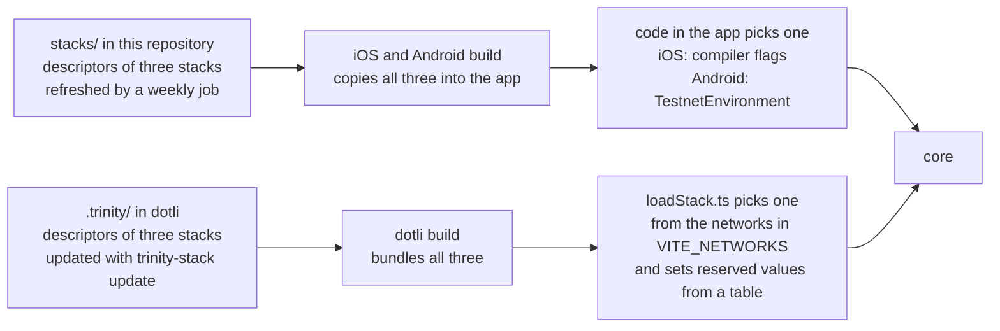
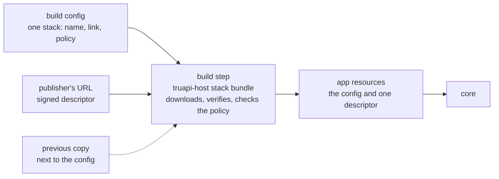

# Trinity stack build config

## Problem

Right now each host decides in code which stack it runs. iOS switches on compiler flags, Android maps
`TestnetEnvironment` to a stack, and dotli keeps a hand-written table. If PCF or anyone else wants to ship a different
stack, they have to change that code.

This is how a stack gets into a host today. All three hosts work the same way: the build carries the descriptors of
three stacks, and code picks one of them at run time. The mobile apps take their descriptors from `stacks/` in this
repository. dotli keeps its own copies in `packages/config/.trinity/`, and its deployment sets `VITE_NETWORKS` to say
which of them the page offers.



[RFC 2](https://github.com/paritytech/trinity-user-agents/pull/1564) moves this choice into the build's configuration.
It says what the configuration holds (the stack's pointer, a bundled copy of its descriptor, and whether the stack may
use reserved values) but it does not say what the file looks like. This page proposes a format for
[#1899](https://github.com/paritytech/trinity-user-agents/issues/1899) and describes what each build system does with
it.

## Proposal

A build config is a small JSON file that names one stack. Each build is pointed at one config. During the build we
download that stack's descriptor, verify it, and put both the descriptor and the config into the app, which starts the
core from them.



The app no longer chooses anything. It has one stack, and that stack is the one its config names.

## The format

```json
{
  "$v": 1,
  "name": "paseo-next-v2",
  "link": "polkadotapp://stack?key=0x2b89d8ca74aa2e11ab55f5af1168cd6929b88d1998aecd979b42cfc1078d5377&url=https%3A%2F%2Fstack-paseo-next.parity-testnet.parity.io%2F.well-known%2Ftrinity-stack.json",
  "reservedValues": {
    "allowed": false,
    "extraGenesisHashes": [],
    "extraTlds": []
  }
}
```

- `name` matches `[a-z0-9][a-z0-9-]*`. It is also the file name of the descriptor copy, `<name>.json`.
- `link` is the stack link. It has to include the key, because RFC 2 requires a built-in stack to be signed.
- `reservedValues` has the same fields as `ReservedValuesPolicy` in
  [#2024](https://github.com/paritytech/trinity-user-agents/pull/2024). Only `allowed` is required. The two lists
  reserve more genesis hashes and TLDs on top of the ones the core already reserves, so the stack may not name those
  either. They make no sense together with `allowed: true`, and the core refuses that combination.
- A config with an unknown field, or with a `$v` other than 1, is refused.

RFC 2 also pins some values for a stack that may use reserved values, such as its genesis hashes, TLD and contracts.
Those are not repeated in the config, because the core takes them from the bundled descriptor.

These are the builds listed in #1899 and the config each one would have:

| Build               | `name`          | `allowed` | Link                                   |
| ------------------- | --------------- | --------- | -------------------------------------- |
| Parity nightly      | `paseo-next-v2` | `false`   | same as `stacks/paseo-next-v2.link`    |
| Parity preview      | `previewnet`    | `false`   | same as `stacks/previewnet.link`       |
| Parity mainnet fork | `polkadot-test` | `true`    | nobody publishes a polkadot-test stack |
| PCF production      | `polkadot`      | `true`    | same as `stacks/polkadot.link`         |

## The build step

Every host runs the same command as part of its build:

```sh
truapi-host stack bundle --config <config> --out <build output directory>
```

The command validates the config, downloads the descriptor from the URL in the link and verifies its signature with the
key in the link. It then checks the descriptor against the config's policy, using the core's own `Stack::bundled`. If
all of that passes, it writes two files into the output directory: `stack.build.json`, which is the config, and
`<name>.json`, which is the descriptor. The build ships both as app resources. Since a `name` cannot contain a dot, a
descriptor can never be written over `stack.build.json`.

If the descriptor cannot be downloaded, is not signed, is signed with a different key, has expired or breaks the policy,
the command fails and so does the build.

The command also looks for a `<name>.json` next to the config and treats it as the previous copy. The new descriptor is
refused if its `sequence` is lower or its TLD is different. Nothing is written next to the config, so building does not
change the source tree. The copies in `stacks/` are still updated by `scripts/update-stacks.sh`.

The price of this is that every build needs the `truapi-host` binary and network access. CI can install the binary with
`.github/actions/install-truapi-host`, and developers with `scripts/truapi-host-installer.sh`.

## Selecting a config

Parity's configs would live in `stacks/`, next to the descriptor copies, as `nightly.build.json`, `preview.build.json`
and `mainnet-fork.build.json`. Each build system gets one setting that holds the path to a config:

| Build system | Setting                                                          | Defaults                                                          |
| ------------ | ---------------------------------------------------------------- | ----------------------------------------------------------------- |
| Xcode        | build setting `TRINITY_STACK_BUILD_CONFIG`                       | Debug, DevCI: preview. Nightly, Safetynet: nightly. Release: none |
| Gradle       | Gradle property `truapi.stackBuildConfig.<buildType>`            | debug: preview. nightly, safetynet: nightly. release: none        |
| Web          | env var `TRINITY_STACK_BUILD_CONFIG`, read by the bundler config | set per deployment                                                |

Debug, DevCI, Nightly and Safetynet keep the stacks they run now.

Release has no default on purpose. Right now Release runs `polkadot` with reserved values allowed, and we don't want a
build to end up with that just because nobody set a config. So a release build with an empty setting fails.

This means Parity's own Release builds need a config before the change can land, and we have not decided which one
(question 4 below). Release is what the TestFlight build, the Profile and Archive actions of the Xcode scheme, and
Android's release unit tests in CI use.

PCF would keep its own `production.build.json` outside this repository, together with the last `polkadot.json` it
bundled, and pass the path through the same setting. Its stack and its key appear only in that file, so PCF can build
the host without changing any code.

## What changes in each host

**iOS.** The xcconfig files in `hosts/ios/Configs/` set `TRINITY_STACK_BUILD_CONFIG`, and a value passed on the
`xcodebuild` command line overrides them. The "Bundle Trinity stacks" build phase runs the build step and writes into
the app's `trinity-stack/` resources. `TrUAPIBundledStack` then builds `BundledStack` from `stack.build.json` and the
descriptor, and no longer needs its switch on `UNSTABLE`, `NIGHTLY` and `SAFETYNET`. If the config cannot be decoded,
the app behaves the way it already does when the stack resource is missing: products do not start, but the rest of the
app works.

**Android.** `:bindings:truapi-host` gets one `syncStacks` task per build type. Each task runs the build step and writes
into that build type's `stacks/` assets. `TrUAPIStack` reads `stacks/stack.build.json`, so it no longer has to map
`TestnetEnvironment` to a stack.

**Web.** `@parity/truapi-host` runs in the browser and cannot read files, so the page keeps passing the stack to it in
`ProductRuntimeConfig.stack`. The package only adds the TypeScript type of the config. In dotli, the build runs the
build step and the app loads the bundled config and descriptor. This replaces dotli's hand-written table and
`.trinity/stacks.json`.

`reservedValues` depends on #2024. Until that merges, a host can pass `allowed` to the core as `allowsReservedValues`
and refuse any config that fills in one of the lists.

We also checked what happens when an app update ships a different config while the device still has a descriptor stored
from the old one. The core already handles all three cases:

- If the key changed, the stack id is different, so the old stored record is never read.
- If the policy became stricter and the stored copy breaks it, the core ignores the stored copy and runs the bundled
  one.
- If only the URL changed, the core keeps using the stored copy.

## What changes in the CLI, scripts and tests

`truapi-host stack bundle` gets a `--config <file>` option, and with it `--out` is a directory instead of a file. It
does everything `bundle <link>` does now, plus two new checks:

- The descriptor has to pass the config's policy. If a testnet descriptor starts naming a Polkadot genesis hash, for
  example, the build fails. Without this check we would only find out when the app fails to start.
- A config with `allowed: true` is refused if its descriptor does not name any reserved genesis hash or TLD, because
  that stack has no use for the permission.

The CLI is the only place that validates the whole format (the name pattern, the key in the link, unknown fields and
`$v`). The Swift, Kotlin and TypeScript readers just decode the file and refuse it if that fails.

We also need a new test in `truapi-host-cli` that goes over every `stacks/*.build.json`, validates it, and runs
`Stack::bundled` with its link, its policy and the descriptor next to it. At the moment the app tests start the core on
every bundled stack. Once a build carries one stack they would only cover that one, and this test makes up for it.

The CLI's built-in networks keep reading `stacks/<name>.link`, which means the paseo-next-v2 and previewnet links end up
in two files each. The same test checks that both files have the same link.

Two scripts need a small change. `scripts/update-stacks.sh` has to refresh the descriptor for each `stacks/*.build.json`
as well. `scripts/write-refresh-changeset.sh` treats every `stacks/*.json` as a descriptor, so it has to skip
`*.build.json`.

## Alternatives we rejected

- **TOML instead of JSON.** The app reads the config at start, and Foundation, the Android SDK and browsers can all
  decode JSON out of the box. None of them can decode TOML.
- **Keeping the link in a separate `.link` file.** Then the file that sets `allowed: true` would not show which key gets
  that permission.
- **Several stacks in one config.** RFC 2 has one stack per build. The only hosts that offer more are one development
  deployment of dotli and its Docker image.
- **One file that lists all builds.** PCF would have to edit a file that Parity owns, and every build would carry the
  entries of all the others.
- **Committing the descriptors and not downloading during the build.** A build could then ship a descriptor that expired
  after the last refresh.
- **Putting the descriptor inside the config.** Every refresh would rewrite a file that people review by hand.
- **Extending `.trinity/stacks.json`.** That file is part of the published `@parity/trinity-stack` package. Its values
  are plain link strings, and projects that are not hosts read it too.

## Open questions

For the RFCs:

1. [RFC 3, Running more than one stack](https://github.com/paritytech/trinity-user-agents/pull/1565) lets a build choose
   whether it accepts Imported stacks. Should that choice be a field in this file?

For iOS and Android:

2. A build without network access fails. Should a debug build be allowed to fall back to the copy next to the config,
   with a warning?
3. Which version of `truapi-host` should a build use: the latest stable release, or one pinned next to the config?
4. Which config should Parity's Release builds get, and which configuration is the mainnet-fork build? Release runs
   `polkadot` now, and nothing runs polkadot-test.
5. `UNSTABLE`, `NIGHTLY` and `SAFETYNET` on iOS and `TestnetEnvironment` on Android will still select Firebase keys and
   chain tables. Should a build fail when they do not match the config?
6. Does PCF build iOS from this tree or from polkadot-ios-community? The second one has no `stacks/` directory.

For web:

7. One development deployment of dotli offers two networks, and the Docker image only learns its networks when the
   container starts. Should such a build take several configs, or should its choice of networks stay outside this
   format?
8. dotli can run pcf-devnet with reserved values allowed, but the table in #1899 does not list it. Does it get a config?
9. dotli is a separate repository and has no `stacks/` directory. Where should its config and previous copy live? And
   should its build run the `truapi-host` binary, or should `trinity-stack update` learn `--config`?
10. Should polkadot-desktop read the same file?

About the stacks themselves:

11. Who will publish polkadot-test, and under which key and URL? We cannot write the mainnet-fork config until we know.
12. Does `name` have to equal the descriptor's `id`? They are equal in all four copies in `stacks/`.

Two things in this proposal have not been tried yet:

- Running `truapi-host` with network access from an Xcode script phase and from a Gradle task, in every CI job that
  builds an app.
- Per-build-type assets in the Android bindings module.
