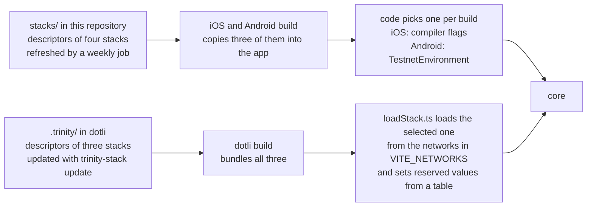
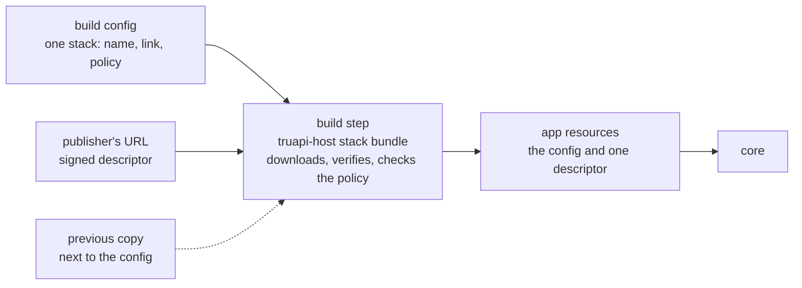

# Trinity stack build config

## Problem

Right now each host decides in code which stack it runs. iOS switches on compiler flags, Android maps
`TestnetEnvironment` to a stack, and dotli keeps a hand-written table. If PCF or anyone else wants to ship a different
stack, they have to change that code.

This is how a stack gets into a host today. Each build carries the descriptors of three stacks, and code decides which
one runs: iOS by compiler flags, Android by a constant set per build type, and dotli by the network the person selects.
The mobile apps take their descriptors from `stacks/` in this repository. dotli keeps its own copies in
`packages/config/.trinity/`, and its deployment sets `VITE_NETWORKS` to say which of them the page offers.



[RFC 2](https://github.com/paritytech/trinity-user-agents/pull/1564) moves this choice into the build's configuration.
It says what the configuration holds (the stack's pointer, a bundled copy of its descriptor, and whether the stack may
use reserved values) but it does not say what the file looks like. This page proposes a format for
[#1899](https://github.com/paritytech/trinity-user-agents/issues/1899) and describes what each build system does with
it.

## Proposal

A build config is a small JSON file that names one stack. Each build is pointed at one config. During the build we
download that stack's descriptor, verify it, and put both the descriptor and the config into the app, which starts the
core from them.



## The format

```json
{
  "$v": 1,
  "name": "paseo-next-v2",
  "link": "polkadotapp://stack?key=0x2b89d8ca74aa2e11ab55f5af1168cd6929b88d1998aecd979b42cfc1078d5377&url=https%3A%2F%2Fstack-paseo-next.parity-testnet.parity.io%2F.well-known%2Ftrinity-stack.json",
  "reservedValues": {
    "allowed": false,
    "extraGenesisHashes": [],
    "extraTlds": []
  }
}
```

- `name` matches `[a-z0-9][a-z0-9-]*`. It is used only as the file name of the descriptor copy, `<name>.json`, so it
  does not have to equal the descriptor's `id`, although it does in all four copies in `stacks/`.
- `link` is the stack link. It has to include the key, because RFC 2 requires a built-in stack to be signed.
- `reservedValues` has the same fields as `ReservedValuesPolicy` in
  [#2024](https://github.com/paritytech/trinity-user-agents/pull/2024). Only `allowed` is required. The two lists
  reserve more genesis hashes and TLDs on top of the ones the core already reserves, so the stack may not name those
  either. They make no sense together with `allowed: true`, and the core refuses that combination.
- A config with an unknown field, or with a `$v` other than 1, is refused.

RFC 2 also pins some values for a stack that may use reserved values, such as its genesis hashes, TLD and contracts.
Those are not repeated in the config, because RFC 2 has the build take them from the bundled descriptor. The core does
that once [#2201](https://github.com/paritytech/trinity-user-agents/pull/2201) and
[#2202](https://github.com/paritytech/trinity-user-agents/pull/2202) merge.

These are the builds listed in [#1899](https://github.com/paritytech/trinity-user-agents/issues/1899) and the config
each one would have:

| Build               | `name`          | `allowed` | Link                                   |
| ------------------- | --------------- | --------- | -------------------------------------- |
| Parity nightly      | `paseo-next-v2` | `false`   | same as `stacks/paseo-next-v2.link`    |
| Parity preview      | `previewnet`    | `false`   | same as `stacks/previewnet.link`       |
| Parity mainnet fork | `polkadot-test` | `true`    | nobody publishes a polkadot-test stack |
| PCF production      | `polkadot`      | `true`    | same as `stacks/polkadot.link`         |

The mainnet-fork config can be added later, once someone publishes a polkadot-test stack and we know its key and URL.
Nothing else in this proposal depends on it.

## The build step

iOS and Android run the same command as part of their build. dotli runs it too, or an equivalent, depending on the last
open question:

```sh
truapi-host stack bundle --config <config> --out <build output directory>
```

The command validates the config, downloads the descriptor from the URL in the link and verifies its signature with the
key in the link. It then checks the descriptor against the config's policy, using the core's own `Stack::bundled`. If
all of that passes, it writes two files into the output directory: `stack.build.json`, which is the config, and
`<name>.json`, which is the descriptor. The build ships both as app resources. Since a `name` cannot contain a dot, a
descriptor can never be written over `stack.build.json`.

If the descriptor cannot be downloaded, is not signed, is signed with a different key, has expired or breaks the policy,
the command fails and so does the build.

The step has to run on every build. Xcode and Gradle both skip a step whose inputs have not changed, and here that would
put an old descriptor into the app.

The command also looks for a `<name>.json` next to the config and treats it as the previous copy. The new descriptor is
refused if its `sequence` is lower, or if its TLD or `id` is different. Nothing is written next to the config, so
building does not change the source tree. The copies in `stacks/` are still updated by `scripts/update-stacks.sh`.

The price of downloading during the build is that every build needs the `truapi-host` binary and network access. We
soften that in two ways.

A debug build can still be built offline. When the descriptor cannot be downloaded, the command falls back to the copy
next to the config and prints a warning. It verifies that copy the same way and refuses it if it has expired. A release
build never falls back.

The version of `truapi-host` is pinned in this repository, so a new CLI release cannot change a build on its own. CI
installs that version with `.github/actions/install-truapi-host`, and developers with
`scripts/truapi-host-installer.sh`. Both already take a version. None of the workflows that build the iOS and Android
apps installs the CLI yet, so each of them needs that step.

## Selecting a config

Parity's configs would live in `stacks/`, next to the descriptor copies, as `nightly.build.json` and
`preview.build.json`, and later `mainnet-fork.build.json`. Each build system gets one setting that holds the path to a
config:

| Build system | Setting                                                          | Defaults                                                          |
| ------------ | ---------------------------------------------------------------- | ----------------------------------------------------------------- |
| Xcode        | build setting `TRINITY_STACK_BUILD_CONFIG`                       | Debug, DevCI: preview. Nightly, Safetynet: nightly. Release: none |
| Gradle       | Gradle property `truapi.stackBuildConfig.<buildType>`            | debug: preview. nightly, safetynet: nightly. release: none        |
| Web          | env var `TRINITY_STACK_BUILD_CONFIG`, read by the bundler config | set per deployment                                                |

Debug, DevCI, Nightly and Safetynet keep the stacks they run now.

Release has no default on purpose. Right now Release runs `polkadot` with reserved values allowed, and we don't want a
build to end up with that just because nobody set a config. So a release build with an empty setting fails.

This means Parity's own Release builds need a config before the change can land, and we have not decided which one
(question 1 below). Release is used by the release TestFlight builds, by the Profile and Archive actions of the Xcode
schemes, and by Android's release unit tests in CI.

PCF would keep its own `production.build.json` outside this repository and pass the path through the same setting. Next
to it PCF keeps a `polkadot.json` as the previous copy, and refreshes it itself with
`truapi-host stack bundle <link> --out polkadot.json`, the way `scripts/update-stacks.sh` does for the copies here. PCF
changes only its own config, so it can build the host without changing any code.

## What changes in each host

**iOS.** The xcconfig files in `hosts/ios/Configs/` set `TRINITY_STACK_BUILD_CONFIG`, and a value passed on the
`xcodebuild` command line overrides them. The "Bundle Trinity stacks" build phase runs the build step and writes into
the app's `trinity-stack/` resources. `TrUAPIBundledStack` then builds `BundledStack` from `stack.build.json` and the
descriptor, and no longer needs its switch on `UNSTABLE`, `NIGHTLY` and `SAFETYNET`. If the config cannot be decoded,
the app behaves the way it already does when the stack resource is missing: everything that needs the core fails with an
error (products, Pocket cards, images loaded by CID), and the rest of the app keeps running.

**Android.** `:bindings:truapi-host` gets one `syncStacks` task per build type. Each task runs the build step and writes
into that build type's `stacks/` assets. `TrUAPIStack` reads `stacks/stack.build.json`, so it no longer has to map
`TestnetEnvironment` to a stack.

**Web.** `@parity/truapi-host` runs in the browser and cannot read files, so the page keeps passing the stack to it in
`ProductRuntimeConfig.stack`. The package only adds the TypeScript type of the config. In dotli, the build runs the
build step and the app loads the bundled config and descriptor. This replaces dotli's hand-written table and
`.trinity/stacks.json`.

`reservedValues` depends on [#2024](https://github.com/paritytech/trinity-user-agents/pull/2024). Until that merges, the
CLI refuses a config that fills in one of the lists, and a host passes `allowed` to the core as `allowsReservedValues`.

polkadot-desktop is not covered here, because [#1899](https://github.com/paritytech/trinity-user-agents/issues/1899)
only names iOS, Android and web.

We also checked what happens when an app update ships a different config while the device still has a descriptor stored
from the old one. The core already handles all three cases:

- If the key changed, the stack id is different, so the old stored record is never read.
- If the policy became stricter and the stored copy breaks it, the core ignores the stored copy and runs the bundled
  one.
- If only the URL changed, the stored record is still read, because the stack id is the key. The core starts from
  whichever of the stored and bundled copies has the higher `sequence`, and fetches from the new URL from then on.

## What changes in the CLI, scripts and tests

`truapi-host stack bundle` gets a `--config <file>` option, and with it `--out` is a directory instead of a file. It
does everything `bundle <link>` does now, plus two new checks:

- The descriptor has to pass the config's policy. If a testnet descriptor starts naming a Polkadot genesis hash, for
  example, the build fails. Without this check the core would fail to start in the app.
- A config with `allowed: true` is refused if its descriptor does not name any reserved genesis hash or TLD, because
  that stack has no use for the permission. RFC 2 does not ask for this check.

The CLI is the only place that validates the whole format (the name pattern, the key in the link, unknown fields and
`$v`). The Swift, Kotlin and TypeScript readers just decode the file and refuse it if that fails.

We also need a new test in `truapi-host-cli` that goes over every `stacks/*.build.json`, validates it, and runs
`Stack::bundled` with its link, its policy and the descriptor next to it. At the moment an iOS test starts the core on
each of the three bundled stacks, and an Android test checks each one's TLD and reserved-values flag. Once a build
carries one stack those tests can only cover that one, so this test replaces them.

The CLI's built-in networks keep reading `stacks/<name>.link`, which means the paseo-next-v2 and previewnet links end up
in two files each. The same test checks that both files have the same link.

`scripts/update-stacks.sh` already refreshes the descriptors next to the nightly and preview configs, because both
stacks have a `.link` file. It needs a change only for a config whose stack has none.
`scripts/write-refresh-changeset.sh` reads every changed `stacks/*.json` as a descriptor, so it should skip
`*.build.json`.

## Alternatives we rejected

- **Several stacks in one config.** #1899 and RFC 2 speak of a build's stacks in the plural, but RFC 2 also says that
  each build still runs one stack, and every build in its table has one. The only hosts that offer more are one
  development deployment of dotli and its Docker image, which the third open question is about.
- **Keeping the link in a separate `.link` file, so that the config only has the stack's name.** The link carries the
  publisher's key. If it lived in another file, a config that says `allowed: true` would not show who gets that
  permission, and someone could swap the key in the `.link` file without touching the config. With the link in the
  config, the permission and the key it applies to are reviewed together. The cost is that the paseo-next-v2 and
  previewnet links are written in two files, which is why the test above compares them.
- **Extending `.trinity/stacks.json`.** `@parity/trinity-stack` defines that file's format and writes it for any
  project, host or not. Its values are plain link strings, so adding a policy would change a published format for
  readers that have no use for it.

## Open questions

For the iOS and Android owners:

1. Which config should Parity's Release builds get, and which configuration is the mainnet-fork build? Release runs
   `polkadot` now, and nothing runs polkadot-test.
2. Does PCF build the apps from this tree, or from polkadot-ios-community and polkadot-android-community? Those two have
   no `stacks/` directory.

For the dotli owners:

3. One development deployment of dotli offers two networks, and the Docker image only learns its networks when the
   container starts. Should such a build take several configs, or should its choice of networks stay outside this
   format?
4. dotli is a separate repository and has no `stacks/` directory. Where should its config and previous copy live? And
   should its build run the `truapi-host` binary, or should `trinity-stack update` learn `--config`?
