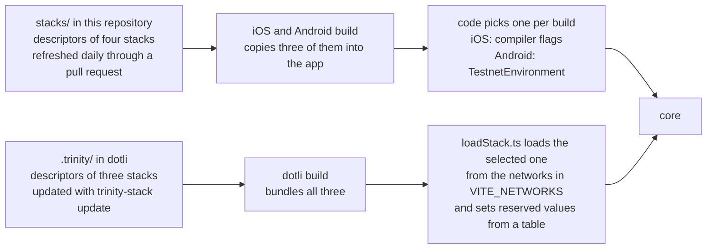
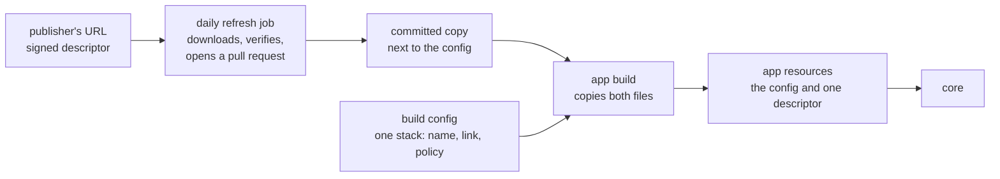

# Trinity stack build config

## Problem

Right now each host decides in code which stack it runs. iOS switches on compiler flags, Android maps
`TestnetEnvironment` to a stack, and dotli keeps a hand-written table. If PCF or anyone else wants to ship a different
stack, they have to change that code.

This is how a stack gets into a host today. Each build carries the descriptors of three stacks, and code decides which
one runs: iOS by compiler flags, Android by a constant set per build type, and dotli by the network the person selects.
The mobile apps take their descriptors from `stacks/` in this repository, where a daily job refreshes them through a
pull request. dotli keeps its own copies in `packages/config/.trinity/`, and its deployment sets `VITE_NETWORKS` to say
which of them the page offers.



[RFC 2](https://github.com/paritytech/trinity-user-agents/pull/1564) moves this choice into the build's configuration.
It says what the configuration holds (the stack's pointer, a bundled copy of its descriptor, and whether the stack may
use reserved values) but it does not say what the file looks like. This page proposes a format for
[#1899](https://github.com/paritytech/trinity-user-agents/issues/1899) and describes what each build system does with
it.

## Proposal

A build config is a small JSON file that names one stack. Each build is pointed at one config. The build copies the
config and the committed copy of that stack's descriptor into the app, and the app starts the core from the two.

Descriptors keep arriving the way they do now. A scheduled job downloads each one, verifies it and opens a pull request,
so a build only ships a copy that went through review.



## The format

```json
{
  "$v": 1,
  "name": "paseo-next-v2",
  "link": "polkadotapp://stack?key=0x2b89d8ca74aa2e11ab55f5af1168cd6929b88d1998aecd979b42cfc1078d5377&url=https%3A%2F%2Fstack-paseo-next.parity-testnet.parity.io%2F.well-known%2Ftrinity-stack.json",
  "reservedValues": {
    "allowed": false,
    "extraGenesisHashes": [],
    "extraTlds": []
  }
}
```

- `name` matches `[a-z0-9][a-z0-9-]*`. It is used only as the file name of the descriptor copy, `<name>.json`, so it
  does not have to equal the descriptor's `id`, although it does in all four copies in `stacks/`.
- `link` is the stack link. It has to include the key, because RFC 2 requires a built-in stack to be signed.
- `reservedValues` has the same fields as `ReservedValuesPolicy` in
  [#2024](https://github.com/paritytech/trinity-user-agents/pull/2024). Only `allowed` is required. The two lists
  reserve more genesis hashes and TLDs on top of the ones the core already reserves, so the stack may not name those
  either. They make no sense together with `allowed: true`, and the core refuses that combination.
- A config with an unknown field, or with a `$v` other than 1, is refused.

RFC 2 also pins some values for a stack that may use reserved values, such as its genesis hashes, TLD and contracts.
Those are not repeated in the config, because RFC 2 has the build take them from the bundled descriptor. The core does
that once [#2201](https://github.com/paritytech/trinity-user-agents/pull/2201) and
[#2202](https://github.com/paritytech/trinity-user-agents/pull/2202) merge.

These are the builds listed in [#1899](https://github.com/paritytech/trinity-user-agents/issues/1899) and the config
each one would have:

| Build               | `name`          | `allowed` |
| ------------------- | --------------- | --------- |
| Parity nightly      | `paseo-next-v2` | `false`   |
| Parity preview      | `previewnet`    | `false`   |
| Parity mainnet fork | `polkadot-test` | `true`    |
| PCF production      | `polkadot`      | `true`    |

The links for paseo-next-v2, previewnet and polkadot are the ones in `rust/crates/trinity-stack/known-stacks.json`.
Nobody publishes a polkadot-test stack yet, so the mainnet-fork config can only be added later, once we know its key and
URL. Nothing else in this proposal depends on it.

## Where the descriptor comes from

The config does not contain the descriptor. The descriptor is the file `<name>.json` in the same directory as the
config, and it is committed like the config itself.

RFC 2 says the build step fetches and verifies the descriptor and bundles the copy, as `truapi-host stack bundle` does.
We read that step as the refresh that writes the committed copy, because that is what `stack bundle` is used for today.
`scripts/update-stacks.sh` runs it for every signed stack in `known-stacks.json`, and a daily workflow puts the result
into a pull request. An app build does not download anything. It takes the copy that is in the tree.

We prefer this reading for two reasons. A build needs no network and no extra tool, so it still works when a
descriptor's server is down. And a changed descriptor can only reach a release through a commit that someone reviewed.
That matters most for a stack that may use reserved values, because RFC 2 counts on the bundled copy to pin its
contracts and genesis hashes, and a copy downloaded on the day of the build could change them with nobody seeing the
diff.

During the build, each host copies two files into the app's resources: the config, under the name `stack.build.json`,
and its descriptor, `<name>.json`. A `name` cannot contain a dot, so a descriptor can never be written over
`stack.build.json`.

## Selecting a config

Parity's configs would live in `stacks/`, next to the descriptor copies, as `nightly.build.json` and
`preview.build.json`, and later `mainnet-fork.build.json`. Each build system gets one setting that holds the path to a
config:

| Build system | Setting                                                          | Defaults                                                          |
| ------------ | ---------------------------------------------------------------- | ----------------------------------------------------------------- |
| Xcode        | build setting `TRINITY_STACK_BUILD_CONFIG`                       | Debug, DevCI: preview. Nightly, Safetynet: nightly. Release: none |
| Gradle       | Gradle property `truapi.stackBuildConfig.<buildType>`            | debug: preview. nightly, safetynet: nightly. release: none        |
| Web          | env var `TRINITY_STACK_BUILD_CONFIG`, read by the bundler config | set per deployment                                                |

Debug, DevCI, Nightly and Safetynet keep the stacks they run now.

Release has no default on purpose. Right now Release runs `polkadot` with reserved values allowed, and we don't want a
build to end up with that just because nobody set a config. So a release build with an empty setting fails.

This means Parity's own Release builds need a config before the change can land, and we have not decided which one (see
the open question about Release builds). Release is used by the release TestFlight builds, by the Profile and Archive
actions of the Xcode schemes, and by Android's release unit tests in CI.

PCF would keep its own `production.build.json` outside this repository, with `polkadot.json` next to it, and pass the
config's path through the same setting. It refreshes that copy in its own pipeline with
`truapi-host stack bundle <link> --out polkadot.json`, which is the command `scripts/update-stacks.sh` runs here. PCF
changes only its own config, so it can build the host without changing any code.

## What changes in each host

**iOS.** The xcconfig files in `hosts/ios/Configs/` set `TRINITY_STACK_BUILD_CONFIG`, and a value passed on the
`xcodebuild` command line overrides them. The "Bundle Trinity stacks" build phase copies the files of three stacks
today. It would copy the selected config and its descriptor instead, reading the descriptor's file name from the config
with `plutil`. `TrUAPIBundledStack` then builds `BundledStack` from the two files, and no longer needs its switch on
`UNSTABLE`, `NIGHTLY` and `SAFETYNET`. If the config cannot be decoded, the app behaves the way it already does when the
stack resource is missing: everything that needs the core fails with an error (products, Pocket cards, images loaded by
CID), and the rest of the app keeps running.

**Android.** `:bindings:truapi-host` has one `syncStacks` task today, which copies three stacks into the assets of every
build type. It would get one task per build type, and each task copies that build type's config and descriptor into its
`stacks/` assets. `TrUAPIStack` reads `stacks/stack.build.json`, so it no longer has to map `TestnetEnvironment` to a
stack.

**Web.** `@parity/truapi-host` runs in the browser and cannot read files, so the page keeps passing the stack to it in
`ProductRuntimeConfig.stack`. The package only adds the TypeScript type of the config. dotli already keeps committed
copies in `.trinity/` and refreshes them with `trinity-stack update`, so descriptors reach it the same way as they do
here. What changes for dotli is that the link and the reserved-values flag come from the config, in place of the table
in `loadStack.ts`.

`reservedValues` depends on [#2024](https://github.com/paritytech/trinity-user-agents/pull/2024). Until that merges, the
CLI refuses a config that fills in one of the lists, and a host passes `allowed` to the core as `allowsReservedValues`.

polkadot-desktop is not covered here, because [#1899](https://github.com/paritytech/trinity-user-agents/issues/1899)
only names iOS, Android and web.

We also checked what happens when an app update ships a different config while the device still has a descriptor stored
from the old one. The core already handles all three cases:

- If the key changed, the stack id is different, so the old stored record is never read.
- If the policy became stricter and the stored copy breaks it, the core ignores the stored copy and runs the bundled
  one.
- If only the URL changed, the stored record is still read, because the stack id is the key. The core starts from
  whichever of the stored and bundled copies has the higher `sequence`, and fetches from the new URL from then on.

## What changes in the CLI, scripts and tests

`truapi-host stack bundle` stays as it is. The refresh already uses it, and it needs nothing from the config.

`truapi-host stack verify` gets a `--config <file>` option. With it the command reads the config and the descriptor next
to it and checks them together, without using the network:

- The config is well formed: the name pattern, a link with a key, no unknown fields, and `$v`.
- The descriptor verifies under the key in the config's link and has not expired.
- The descriptor passes the config's policy, using the core's own `Stack::bundled`. If a testnet descriptor starts
  naming a Polkadot genesis hash, for example, the command fails. Without this check the core would fail to start in the
  app.
- A config with `allowed: true` is refused if its descriptor does not name any reserved genesis hash or TLD, because
  that stack has no use for the permission. RFC 2 does not ask for this check.

A publisher whose config is outside this repository, such as PCF, runs this command in its pipeline before a build. The
CLI is the only place that validates the whole format. The Swift, Kotlin and TypeScript readers just decode the file and
refuse it if that fails.

For the configs in `stacks/` we need a test in `truapi-host-cli` that runs the format, signature and policy checks on
every `stacks/*.build.json`. It runs on every pull request, including the daily refresh, so a refreshed descriptor that
breaks a config's policy fails CI before anyone merges it. At the moment an iOS test starts the core on each of the
three bundled stacks, and an Android test checks each one's TLD and reserved-values flag. Once a build carries one stack
those tests can only cover that one, so this test replaces them.

The same test compares links. `known-stacks.json` already holds the links of the known stacks, and both the CLI's
built-in networks and `scripts/update-stacks.sh` read them from there. A config repeats the link of its stack, so the
test checks that a config whose `name` is a known stack carries the same link.

Two existing checks treat every `stacks/*.json` as a descriptor and have to skip `*.build.json`: the test
`test_stack_copy_signatures` in the `trinity-stack` crate, and `scripts/write-refresh-changeset.sh`.
`scripts/update-stacks.sh` needs no change, because it only touches the files of known stacks.

## Alternatives we rejected

- **Downloading the descriptor during every app build.** #1899 can be read this way, since it asks for a bundling step
  in the iOS, Android and web builds. Every build would then need the `truapi-host` binary and network access, and a
  release could ship a descriptor that nobody reviewed. For a stack that may use reserved values, someone with a stolen
  publisher key could change the contracts that way.
- **Several stacks in one config.** #1899 and RFC 2 speak of a build's stacks in the plural, but RFC 2 also says that
  each build still runs one stack, and every build in its table has one. The only hosts that offer more are one
  development deployment of dotli and its Docker image, which one of the open questions is about.
- **Taking the link from `known-stacks.json`, so that the config only has the stack's name.** The link carries the
  publisher's key. If the config only had a name, a config that says `allowed: true` would not show who gets that
  permission, and a publisher outside this repository would have to add its stack to Parity's list before it could
  build. With the link in the config, the permission and the key it applies to are reviewed together. The cost is that
  the links of the known stacks are written twice, which is why the test above compares them.
- **Extending `.trinity/stacks.json`.** `@parity/trinity-stack` defines that file's format and writes it for any
  project, host or not. Its values are plain link strings, so adding a policy would change a published format for
  readers that have no use for it.

## Open questions

For the iOS and Android owners:

1. Which config should Parity's Release builds get, and which configuration is the mainnet-fork build? Release runs
   `polkadot` now, and nothing runs polkadot-test.
2. Does PCF build the apps from this tree, or from polkadot-ios-community and polkadot-android-community? Those two have
   no `stacks/` directory.

For the dotli owners:

3. One development deployment of dotli offers two networks, and the Docker image only learns its networks when the
   container starts. Should such a build take several configs, or should its choice of networks stay outside this
   format?
4. dotli keeps its descriptor copies in `packages/config/.trinity/`, a directory the `trinity-stack` tool writes. Can
   its build configs live there next to the copies? And should `trinity-stack` take the link from a config, so that it
   is not written in `.trinity/stacks.json` as well?
