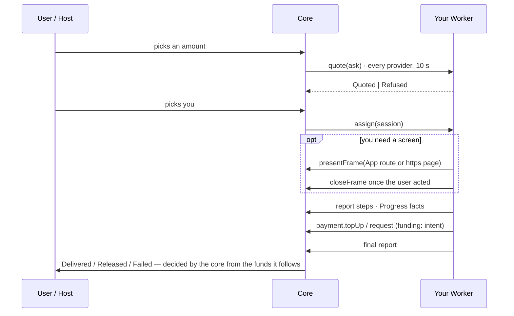
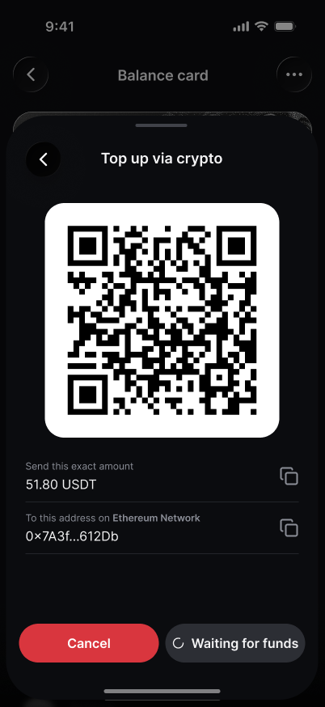
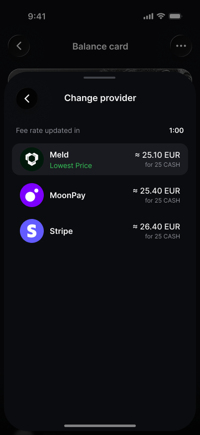
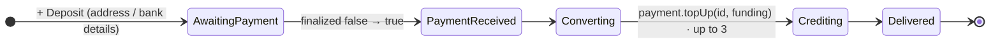
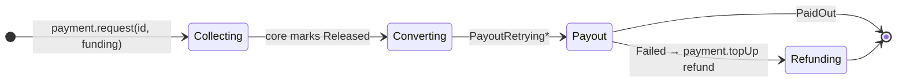
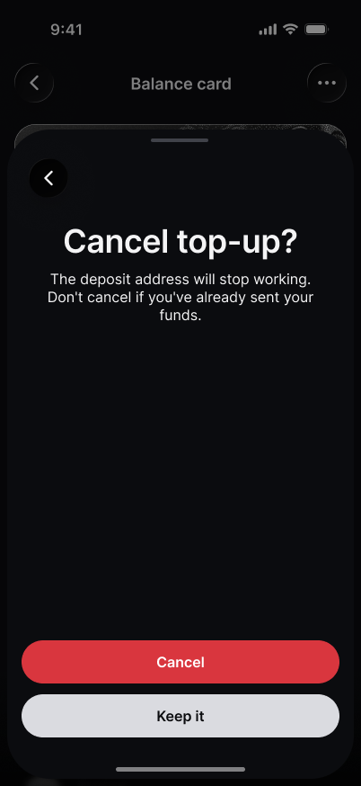
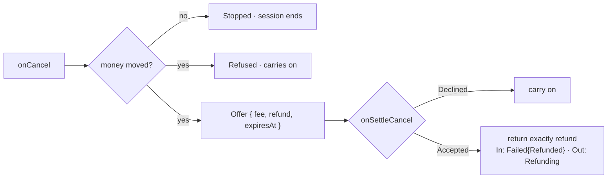
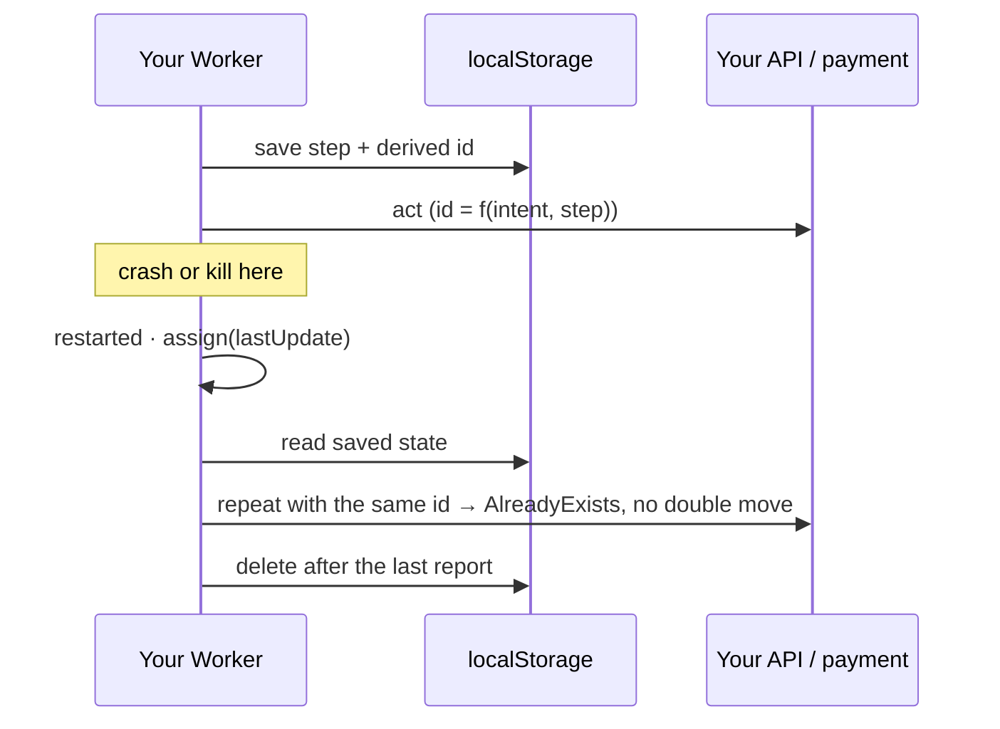

# Building a funding provider

A funding provider turns a card, bank or crypto payment into CASH (inbound), or CASH into a payout (outbound). You build
a TrUAPI product with a Worker; the host draws every funding screen except your own, and the core decides how each
session ends. Full contract: [RFC](../rfcs/funding-modality.md) · system view:
[design doc](../design/funding-modality.md).

## The whole flow



| You build                           | You don't build                                           |
| ----------------------------------- | --------------------------------------------------------- |
| quotes, the session, your API calls | overlay, provider list, session sheet, history            |
| your screens, if any                | wording: the host words every step in the user's language |
| saving state so a restart resumes   | the outcome: never declared by you                        |

## 1. Pick a screen shape

<p>
  
  
</p>

| Shape               | You publish                  | Your Worker shows a screen with                      |
| ------------------- | ---------------------------- | ---------------------------------------------------- |
| **Worker only**     | the Worker                   | nothing: the host's session sheet is enough (crypto) |
| **App on dotNS**    | Worker + App under your name | `App { route }`: a relative route in your own App    |
| **Self-hosted app** | the Worker; site stays yours | `Page { url, returnUrl }`: https, address shown      |

An `App` route never leaves your App (`https://…`, `//other.dot` → `InvalidUrl`); a provider with no App gets `NoApp`.

## 2. Declare funding in the Worker manifest

```json
{
  "$v": 1,
  "kind": "worker",
  "entrypoint": "index.js",
  "includes": {
    "funding": {
      "routes": [
        { "mode": "CARD", "directions": ["In"], "assets": ["EUR", "USD"], "countries": ["DE", "FR", "US"] },
        { "mode": "CRYPTO", "directions": ["In", "Out"], "assets": ["USDT"], "networks": ["polkadot", "ethereum"] }
      ]
    }
  }
}
```

One mode per route · fiat assets are ISO 4217, crypto assets are symbols · countries ISO 3166-1 alpha-2. Routes only
narrow who is asked; your quotes are what count. Publishing is not listing: each host offers the providers its operator
lists, so ask to be added.

## 3. Register four handlers at start

```ts
const client = await truapi();
client.fundingProvider.onQuote(({ ask }) => ok(price(ask)));
client.fundingProvider.onAssign(({ session }) => {
  run(session);
  return ok(undefined);
});
client.fundingProvider.onCancel(({ intent }) => answerCancel(intent).then(ok));
client.fundingProvider.onSettleCancel(({ intent, decision }) => settle(intent, decision).then(() => ok(undefined)));
```

Calls can repeat and arrive in any order: key everything by `intent`, make every handler idempotent.

## 4. Quote

<p>
  
</p>

```ts
{ tag: "Quoted", value: { quote: { quoteId, sendAmount, receiveAmount, providerFee, networkFee, etaSecs, expiresAt, assetDecimals } } }
{ tag: "Refused", value: { reason: { tag: "BelowMinimum", value: { min } } } }   // AboveMaximum · CountryUnsupported · Unavailable · Other
```

| Rule                                                                    | Break it and                |
| ----------------------------------------------------------------------- | --------------------------- |
| answer within 10 s                                                      | you show as unavailable     |
| In: `receiveAmount` = ask · Out: `sendAmount` = ask                     | unavailable                 |
| amounts > 0 · fees ≤ `sendAmount` · `quoteId` ≤ 128 chars · not expired | unavailable                 |
| `etaSecs` set                                                           | a silent session shows late |
| `BelowMinimum` / `AboveMaximum` carry your limit                        | the host learns it for 12 h |

## 5. Run a session

`assign` hands you `intent`, `direction`, `amount`, the chosen `quote` and `lastUpdate`, where to resume after a
restart. Steps go out wrapped by direction: `{ tag: "In", value: step }` or `{ tag: "Out", value: step }`.

**Inbound**



**Outbound**



| Any time                               | Limit                                              |
| -------------------------------------- | -------------------------------------------------- |
| `Details { transactionId, reference }` | 8 per session                                      |
| `Deposit` (inbound, until funds move)  | 8 per session · payment URIs only (BIP21, EIP-681) |
| `Failed { reason }`                    | only before funds move                             |
| `PaymentReceived { mismatch }`         | what arrived, when less or another asset           |

Every text is one plain line, ≤ 80 characters (`InvalidDetail` otherwise). Reports only move forward (`OutOfOrder`);
`NotFound` means the session is over, so drop its state.

## 6. Show your screens

```ts
await client.fundingProvider.presentFrame({
  intent,
  target: { tag: "App", value: { route: "/card?intent=fs_abc123" } },
});
await client.fundingProvider.presentFrame({ intent, target: { tag: "Page", value: { url, returnUrl } } });
await client.fundingProvider.closeFrame({ intent }); // the user did what the screen was for
```

`presentFrame` answers when the frame closes: `Closed` · `Dismissed` · `Returned { url }` (the page reached `returnUrl`,
query included). A page can't call TrUAPI: your Worker reads the result and moves the funds.

| The user is…             | Your screen                                                      |
| ------------------------ | ---------------------------------------------------------------- |
| on the session (overlay) | opens at once                                                    |
| elsewhere in the app     | waits behind a notice "<you> wants to show a screen" until a tap |

So `presentFrame` can take minutes to answer. One request waits per session: a new one replaces it (the old answers
`Dismissed`), and `closeFrame` drops it (`Closed`).

## 7. Say what is happening within a step

Report a `Progress` fact while a step takes time; the host words it, so you never need the user's language.

```ts
report({
  tag: "Progress",
  value: { detail: { fact: { tag: "Confirmations", value: { done: 2, required: 3 } }, atMs: lastBlockMs } },
});
```

| Fact                           | Typically shown as                    | `atMs`           |
| ------------------------------ | ------------------------------------- | ---------------- |
| `Checked`                      | Checked with the provider 12s ago     | when you checked |
| `Confirmations{done,required}` | Confirmation 2 of 3 (crypto)          | last block       |
| `PriceChecked`                 | Price checked · 3s ago                | when you checked |
| `Parts{done,total}`            | Part 2 of 4                           | last part        |
| `Scheduled`                    | About 12s left                        | when it is due   |
| `SentByBank`                   | Sent by your bank · Tue 14:02         | when it was sent |
| `ExpectedBy`                   | Expected by Thu 3 Nov                 | the expected day |
| `InReview`                     | The provider is reviewing the payment | review start     |
| `Attempt{n,of}`                | Attempt 2 of 3                        | next try         |
| `Other{text}`                  | your text, untranslated (≤ 80 chars)  | when it happened |

## 8. Cancels

<p>
  
</p>



Offers: inbound before the credit, outbound after release.

## 9. Survive restarts



- Save before every external action; derive ids from intent + step; resume from `lastUpdate`, never the start.
- Retry transient failures with a growing wait.
- Once money moved, only you end the session: nothing expires it, so a silent provider holds it for good.

## 10. Test it

- `make e2e-funding-cli`: the funding battery against the CLI host.
- A fake host that refuses out-of-order reports, so ordering bugs fail your tests.
- Kill the Worker after every external action and before the next save; the resumed session must finish and move funds
  once.
- On testnet, a switch for each ending: declined payment, refund, retried payout, late arrival.

## Checklist

- [ ] `includes.funding` declared, routes match what you quote
- [ ] One screen shape; `closeFrame` once the user acted
- [ ] Four handlers at start, idempotent
- [ ] Quotes within 10 s, `etaSecs` set, refusals carry limits
- [ ] Every top-up and payment passes `funding: intent` and is named in a report
- [ ] State saved before every external action, ids derived
- [ ] `Progress` facts during long steps
- [ ] Cancels answered; accepted offers refunded exactly
- [ ] Every session ends with your last report
