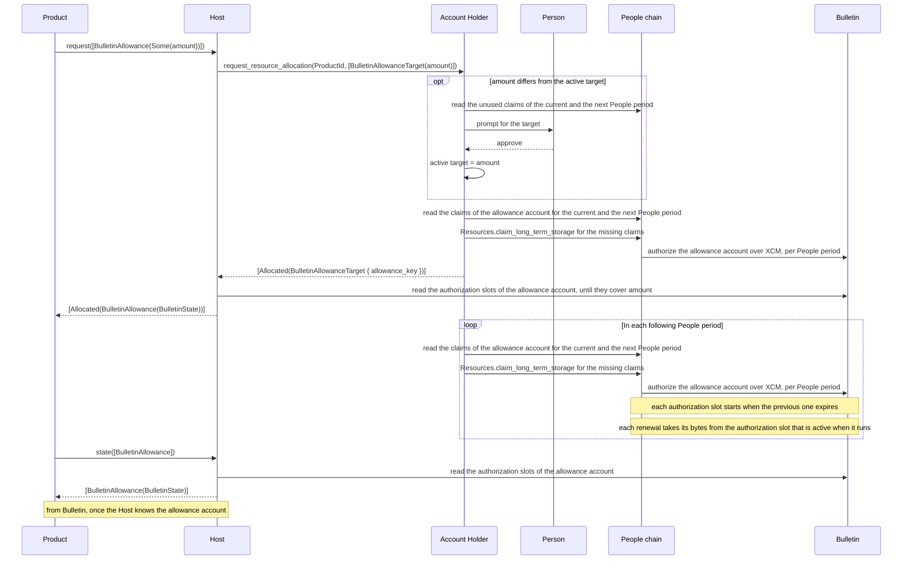
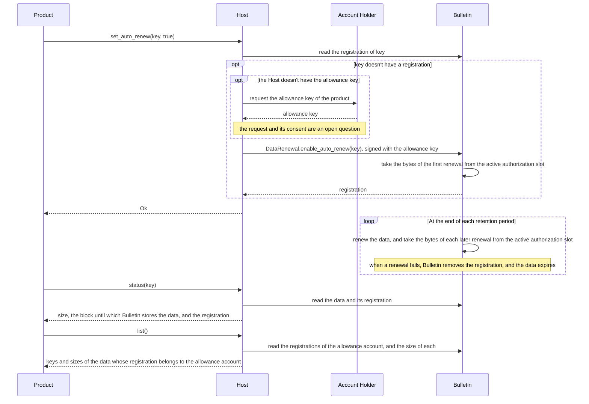

# RFC — Bulletin allowance target and auto-renew

## Summary

A product requests an allowance target from the [Host][terms]. The target is the amount of Bulletin bytes and
transactions that the product requires per People period to store its data persistently with auto-renew. A product that
doesn't store data persistently requests a target as well. For that product, the target determines only whether the
product can submit data and the priority of its transactions. A product can also request one allocation without a
target, as in RFC-0010.

The Host passes the request to the [Account Holder][terms], which stores the amount of bytes and transactions that
the person approved for the product, as the product's active target. In each People period, the Account Holder claims
up to the active target for the product's [allowance account][terms] for the current People period and, at the same
time, for the next one. The claim for the next People period avoids a gap between the Bulletin authorization slots.

The Host doesn't store the amount of bytes and transactions that the product requested. `request` goes to the Account
Holder, which prompts only for a target that differs from the active one and claims only what is missing, so a
repeated request for the active target doesn't prompt the person or claim again. The claims exist on Bulletin as the
allowance account's authorization slots. The Host returns them with `Allocated`, and a product reads them with
`state`.

New `Preimage` methods turn auto-renew on or off for data on Bulletin, read how long Bulletin stores it, and list the
data for which the product turned auto-renew on.

## Motivation

Bulletin stores data for a retention period, and auto-renew extends it by another retention period, which requires an
active authorization slot of the allowance account on Bulletin with enough bytes left for the renewal. TrUAPI doesn't
have calls to:

- turn auto-renew on or off for a product's data,
- request the Bulletin bytes and transactions that long-term storage claims have to provide for the renewals,
- read the authorization slots of the product's allowance account.

The product's allowance account receives authorizations from long-term storage claims on the People chain. A person has
a limited number of claims in each People period, and the claims not yet made in a People period are the person's
unused claims. An authorization also has an expiration time. The Account Holder claims only when a product submits
data or allocates a resource, and doesn't claim again when the authorization expires. Bulletin renews data only while
the allowance account has an active authorization with enough bytes left, so a renewal that runs after the
authorization expires and before the product's next claim fails, and the data expires.

Requirements:

- **Offline.** The Account Holder can be offline, so the Host answers `state` and `list` from Bulletin once it knows
  the product's allowance account.
- **Consent.** The person approves every change in the claims for a product.
- **Idempotence.** A repeated request for the active target doesn't cause a prompt or an extra claim.
- **Separation.** Each product has a separate allowance account, and a call doesn't reveal what another product
  requested.
- **Compatibility.** A product on a Host without the new request version, and a Host paired with an Account Holder
  without target support, each receive a defined result.

## Approach

The design depends on six runtime changes:

- The People chain accepts a long-term storage claim for the next People period
- The People chain sends each claim's authorization with a window in relay-chain block numbers, derived from the
  People period boundary: a claim for the current People period opens an authorization slot that is active now and
  expires at the boundary, and a claim for the next People period opens an authorization slot from that boundary for
  one full People period.
- The People chain stores the allowance account of each long-term storage claim that authorized the account, as it does
  for statement-store allowances, so that the Account Holder can read the claims of each account per People period.
- Bulletin stores authorizations as authorization slots. An authorization slot has the window of relay-chain blocks
  over which it is valid, its caps, and the counters of what submissions, registrations and renewals used. Grants for
  the same window add up in one authorization slot but the proposal here doesn't create overlapping authorization slots
- Bulletin lets the account that registered auto-renew turn it off before the prepaid first renewal has run
- Bulletin indexes auto-renew registrations by the account that registered them, so that `list` reads the registrations
  of one account.

The design has five parts:

- A target in the `BulletinAllowance` resource and a `state` method in `ResourceAllocation`.
- Auto-renew methods in `Preimage`.
- The [Host][terms] doesn't store the amount that the product requested. `request` sends the target to the Account
  Holder, and returns the allowance account's authorization slots on Bulletin with `Allocated`. `state` returns the
  authorization slots.
- The Account Holder stores each product's active target, and makes automatic claims up to it for the current and the
  next People period.
- Changes to [RFC-0010][rfc-0010].

### ResourceAllocation

Changes to the `ResourceAllocation` trait and its types. `request` has `V2` variants with the changed
`AllocatableResource` and `AllocationOutcome`:

```diff
 pub trait ResourceAllocation: Send + Sync {
     #[wire(id = 0)]
     async fn request(&self, cx: &CallContext, request: HostRequestResourceAllocationRequest) -> …;
+
+    /// Returns the state of each requested resource, read from the chain, and requires no permission. Contacts the
+    /// Account Holder only for what a read needs, such as the account of a product that didn't allocate on this
+    /// Host.
+    #[wire(id = 1)]
+    async fn state(&self, cx: &CallContext, request: HostResourceAllocationStateRequest)
+        -> Result<HostResourceAllocationStateResponse, CallError<…>>;
 }
+
+pub struct HostResourceAllocationStateRequest {
+    pub resources: Vec<ResourceKind>,
+}
+
+pub struct HostResourceAllocationStateResponse {
+    /// One state per requested resource, in the same order.
+    pub states: Vec<ResourceState>,
+}
+
+pub enum ResourceKind {
+    BulletinAllowance,
+}
+
+pub enum ResourceState {
+    BulletinAllowance(BulletinState),
+}

 pub enum AllocatableResource {
     StatementStoreAllowance,
-    BulletinAllowance,
+    /// `None` requests one allocation, as in RFC-0010. `Some` requests a target: bytes and transactions per
+    /// People period, where zero stops automatic claims.
+    BulletinAllowance(Option<BulletinAmount>),
     SmartContractAllowance(DerivationIndex),
     AutoSigning,
 }

 pub enum AllocationOutcome {
-    Allocated,
+    Allocated(AllocatedResource),
     Rejected,
     NotAvailable,
 }
+
+/// The data of an allocated resource, with one variant per `AllocatableResource` variant.
+pub enum AllocatedResource {
+    StatementStoreAllowance,
+    BulletinAllowance(BulletinState),
+    SmartContractAllowance,
+    AutoSigning,
+}
+
+pub struct BulletinAmount {
+    pub bytes: u64,
+    pub transactions: u32,
+}
+
+pub struct BulletinState {
+    /// The allowance account's authorization slots on Bulletin that haven't expired, in order of expiration.
+    pub slots: Vec<BulletinAuthorizationSlot>,
+}
+
+pub struct BulletinAuthorizationSlot {
+    /// Relay-chain block at which the authorization slot starts, inclusive.
+    pub starts_at: u32,
+    /// Relay-chain block at which the authorization slot expires, exclusive.
+    pub expires_at: u32,
+    pub caps: BulletinAmount,
+    /// Bytes that submissions used.
+    pub stored_bytes: u64,
+    /// Bytes that registrations and renewals used. A renewal fails when `renewed_bytes` plus the size of the renewal
+    /// exceeds `caps.bytes`.
+    pub renewed_bytes: u64,
+    /// Transactions that submissions, registrations and renewals used.
+    pub transactions: u32,
+}
```

Versions:

- Each method has its own version. `request` gets `V2` request and response types with the changed
  `AllocatableResource` and `AllocationOutcome`, and `state` is a new method whose types start at `V1`. The Host runs
  each method on the latest types and converts at its edges.
- A `V1` `BulletinAllowance` upgrades to `BulletinAllowance(None)`, so a product with a `V1` client requests one
  allocation and receives the RFC-0010 outcomes. `Allocated(BulletinAllowance(state))` downgrades to `Allocated`, and a
  `V1` product never sees a target.
- A product's client sends one version per method. A Host without `V2` answers a `V2` request with
  `UnsupportedVersion`, and a Host without `state` answers it with `UnsupportedMessage`. The client reports both as the
  `Unsupported` error, without a second attempt on `V1`.

Targets:

- An authorization slot covers the target when its caps are at least the target's bytes and transactions, and the
  claims of a People period cover the target when the authorization slot that they grant does.
- A higher target adds claims to the authorization slots of the current and the next People period. A lower target
  applies from the first People period that the Account Holder hasn't claimed yet, because claims that it already made
  remain valid. A target of zero therefore stops automatic claims from that People period on.
- `request` sends the target to the Account Holder and returns its answer. The Account Holder answers `Allocated`
  after the claims for the current and the next People period cover the target, and the Host returns `Allocated` after
  the authorization slots on Bulletin cover it, so `Allocated` means that the product can submit now. The call ends
  earlier only when the product's deadline passes, or when the product cancels the call.



What a target request returns:

| Case | Result |
| --- | --- |
| The target is the active one | `Allocated` with the authorization slots, without a prompt, after the claims that are missing for the current and the next People period |
| The person approved the target | `Allocated` with the authorization slots, after the claims that it needs for the current and the next People period |
| The person declined the target | `Rejected`, and the active target doesn't change |
| The person doesn't have enough unused claims for the target | `NotAvailable`, without a prompt, and the active target doesn't change |
| A claim failed before the answer | `NotAvailable`. The target is the active one from now on, and a repeated request claims what is missing, without a prompt |
| The product's deadline passes before the answer, or before the authorization slots on Bulletin cover the target | The call fails with the client's timeout error, and the Host sends a withdrawal for an open request to the Account Holder, with the limits the Host section describes |
| The Host doesn't support the `V2` request | The call fails with the `Unsupported` error |
| The Account Holder doesn't support targets | The call fails with the `Unknown` error, together with its other resources |

Reading the state:

- The active authorization slot is the one whose window contains the current relay-chain block, one at a time in the
  People flow. Its `caps` are what the People period's claims granted, in whole claims, so they can exceed the target.
- An authorization slot that starts at the active one's expiration is the next People period's authorization slot.
  Without such an authorization slot, the next People period isn't claimed yet.
- A product's registrations renew when the sum of their sizes, from `list`, fits in `caps.bytes` of the authorization
  slot in which they renew, and `renewed_bytes` is the part of that already spent. Submissions count against
  `caps.bytes` separately, in `stored_bytes`. Transactions count both, in `transactions`.
- The windows are relay-chain blocks, and `stored_until` from `status` is a Bulletin block, on a different clock. How
  a product compares the two is an open question.

### Preimage

New `Preimage` methods:

| Method | What it does |
| --- | --- |
| `set_auto_renew` | Turns Bulletin auto-renew on or off for the data under a key, in a transaction from the product's allowance account |
| `status` | Returns the size of the data under a key, the Bulletin block until which it is stored, and its auto-renew registration |
| `list` | Returns the keys and sizes of the data whose auto-renew registration belongs to the product's allowance account |

Changes to the `Preimage` trait and its types:

```diff
 pub trait Preimage: Send + Sync {
     #[wire(id = 0)]
     async fn lookup_subscribe(&self, cx: &CallContext, request: RemotePreimageLookupSubscribeRequest) -> …;

     #[wire(id = 1)]
     async fn submit(&self, cx: &CallContext, request: RemotePreimageSubmitRequest) -> …;
+
+    /// Requires the `PreimageSubmit` permission.
+    #[wire(id = 2)]
+    async fn set_auto_renew(&self, cx: &CallContext, request: RemotePreimageSetAutoRenewRequest)
+        -> Result<RemotePreimageSetAutoRenewResponse, CallError<RemotePreimageSetAutoRenewError>>;
+
+    /// Reads Bulletin, and requires no permission.
+    #[wire(id = 3)]
+    async fn status(&self, cx: &CallContext, request: RemotePreimageStatusRequest)
+        -> Result<RemotePreimageStatusResponse, CallError<RemotePreimageStatusError>>;
+
+    /// Reads Bulletin, and requires no permission. Contacts the Account Holder only for the allowance account of a
+    /// product that didn't allocate on this Host.
+    #[wire(id = 4)]
+    async fn list(&self, cx: &CallContext, request: RemotePreimageListRequest)
+        -> Result<RemotePreimageListResponse, CallError<RemotePreimageListError>>;
 }
+
+pub struct RemotePreimageSetAutoRenewRequest {
+    pub key: Vec<u8>,
+    pub enabled: bool,
+}
+
+pub struct RemotePreimageSetAutoRenewResponse {}
+
+pub enum RemotePreimageSetAutoRenewError {
+    NoAuthorization,
+    AuthorizationExceeded,
+    ChainFull,
+    AlreadyRegistered,
+    NotOwner,
+    NotFound,
+    Unknown { reason: String },
+}
+
+pub struct RemotePreimageStatusRequest {
+    pub key: Vec<u8>,
+}
+
+pub struct RemotePreimageStatusResponse {
+    pub size: u64,
+    /// Bulletin block at which the data expires: the block of its last store or renewal plus the retention period.
+    pub stored_until: u32,
+    pub registration: Option<AutoRenewRegistration>,
+}
+
+pub struct AutoRenewRegistration {
+    /// The account that turned auto-renew on.
+    pub account: [u8; 32],
+    /// Whether the first renewal is still prepaid.
+    pub prepaid: bool,
+}
+
+pub enum RemotePreimageStatusError {
+    NotFound,
+    Unknown { reason: String },
+}
+
+pub struct RemotePreimageListRequest {}
+
+pub struct RemotePreimageListResponse {
+    pub items: Vec<AutoRenewItem>,
+}
+
+pub struct AutoRenewItem {
+    pub key: Vec<u8>,
+    /// Size of the data, which each renewal takes from the active authorization slot.
+    pub size: u64,
+}
+
+pub enum RemotePreimageListError {
+    Unknown { reason: String },
+}
```

- Turning auto-renew on takes the bytes of the first renewal from the active authorization slot.
- `set_auto_renew` requires the `PreimageSubmit` permission, submits a transaction only when the registration differs
  from the requested state, and never claims. It signs with the allowance key, which the Host has from an allocation
  that it made, or requests from the Account Holder, as the Host section describes.
- `status` and `list` read Bulletin and require no permission. `list` needs the product's allowance account, which the
  Host knows from an allocation or requests from the Account Holder, as the Host section describes.
- Each renewal takes its bytes from the authorization slot that is active when it runs, so a target's bytes have to be
  at least the sum of the sizes of the data that renews in a People period. Each registration renews once per
  retention period, which is as long as a People period, and the registration itself takes the size once, from the
  authorization slot that is active when it happens, with the first renewal prepaid. So the sum of the sizes from
  `list` is the most that a product's registrations take from one authorization slot.

Turning auto-renew on, the renewals that follow, and the `status` and `list` calls:



What `set_auto_renew` returns:

| Case | Result |
| --- | --- |
| The registration already matches the requested state | `Ok`, without a transaction |
| Bulletin registered auto-renew or removed the registration | `Ok` |
| The allowance account doesn't have an active authorization slot | `NoAuthorization` |
| The Host doesn't have the allowance key, because the product allocated on another Host | One of the results above, after the Host received the key from the Account Holder |
| The active authorization slot doesn't have enough bytes left for the first renewal | `AuthorizationExceeded` |
| Bulletin's permanent storage is full | `ChainFull` |
| An account other than the product's allowance account registered auto-renew for the data | `AlreadyRegistered` |
| The product tried to turn off a registration of another account | `NotOwner` |
| Bulletin doesn't store data under the key | `NotFound` |

After `NoAuthorization` or `AuthorizationExceeded`, the product raises its target, because `set_auto_renew` never
claims.

Periods and gaps:

- In the Polkadot People runtime, a People period is 14 days of chain time. On Bulletin, the default authorization
  window and the retention period are 201,600 blocks each, 14 days at one block per 6 seconds. The window counts
  relay-chain blocks, and the retention counts Bulletin blocks, which is why the authorization slot windows in `state`
  and `stored_until` are on different clocks. A product that needs a date derives it from the block number and
  the block time. Both chains target one block per 6 seconds, and a missed relay-chain slot makes the real time later,
  so a derived time is a lower bound.
- A renewal that runs while the allowance account has no active authorization slot fails. Bulletin removes the
  registration, and the data expires at the end of its retention period, which starts at its last renewal.
- After such a gap, `list` doesn't contain the key, and `status` returns the data without a registration while Bulletin
  still stores it. While it does, `set_auto_renew(key, true)` registers the data again once the allowance account has an
  active authorization slot, because Bulletin registers only data that it stores. After the data expired, `status`
  returns `NotFound`, and the product submits the data again.

### Host

- The Host doesn't store the amount of bytes and transactions that the product requested. The claims exist on Bulletin
  as the allowance account's authorization slots, which the Host reads from storage, not from the runtime API, because
  the runtime API folds the active authorization slots into one and leaves out the authorization slot of the next
  People period.
- The Host knows a product's allowance account and allowance key from an allocation that it made, whose answer
  contains the key. For a product that allocated on another Host, it requests the allowance key from the Account
  Holder when `state`, `list` or `set_auto_renew` needs the account or the key, and caches it. The request contains no
  amount, so the active target doesn't change. It waits for the Account Holder like any other request, and the call
  fails with the client's timeout error when the product's deadline passes first. The shape of the request and
  whether it prompts are an open question.
- `request` sends the target to the Account Holder. When the Account Holder answers `Allocated`, the Host reads the
  authorization slots until they cover the target, because the authorization arrives on Bulletin over XCM after the
  claims, and returns `Allocated` with them. It returns any other outcome as is.
- `request` with `BulletinAllowance(None)` goes to the Account Holder as RFC-0010's `BulletinAllowance`, with the
  `on_existing` policy, and the Host returns `Allocated` with the authorization slots as for a target.
- `request` returns when the Account Holder's answer arrives and the authorization slots cover the target. When the
  product's deadline passes first, or the product cancels the call, the client withdraws the request, and the Host
  sends the withdrawal to the Account Holder as [SSO request cancellation][sso-cancellation] describes. The withdrawal
  reaches the Account Holder only while the request is the newest one on the channel, a withdrawal after the person's
  approval stops only the claims not yet started, and claims made before it remain valid. The client's default
  deadline is two minutes, and a product that expects slower approvals raises it with `requestTimeoutMs`.
- A product that reloads during a request calls `request` again, and the Account Holder answers without a prompt when
  the target is the active one.
- When the Account Holder acknowledges a request with `DecodingFailed`, the call fails with the `Unknown` error, as
  for any request that the Account Holder doesn't decode.
- `state` returns the authorization slots that haven't expired at the relay-chain block of the read, in order of
  expiration. Bulletin removes an expired authorization slot only on its next write to the account, so storage can
  still list one.
- The Host doesn't show its own confirmation for a target, and `on_existing` doesn't apply to a target.

### Account Holder

- The Account Holder stores one target per product on the device, the active target, and replaces it only after the
  person approves a new target. Without an active target for the product, for example on a new device, it prompts for
  the target as for a new one.
- The Account Holder prompts the person for a target that differs from the active one, including a lower target and a
  target of zero, and doesn't prompt for the active target again. A declined target doesn't change the active one, so a
  request for it prompts again.
- The Account Holder translates a target into a number of claims. Each claim grants a fixed amount of bytes and
  transactions, which the People chain's runtime sets per membership, so the number of claims for a target is the
  larger of two quotients, bytes over the claim's bytes and transactions over the claim's transactions, each rounded
  up. The Host doesn't count claims. It sends and reads bytes and transactions.
- Before it prompts for a new or higher target, the Account Holder counts the claims that all targets, including the
  new one, still need in the current and the next People period. When the person doesn't have enough unused claims for
  them, the Account Holder answers `NotAvailable`, and doesn't prompt or claim.
- The Account Holder answers `Allocated` after the claims for the current and the next People period cover the target.
  When a claim fails before the answer, it answers `NotAvailable`, and the claims that it made remain valid, so a
  repeated request claims only what is missing.
- When a target request arrives, and at least once in each People period while its app runs, the Account Holder reads
  the claims of each product's allowance account on the People chain for the current and the next People period. When
  the claims for a People period don't cover the target, the Account Holder makes claims for that People period until
  they cover it.
- The Account Holder claims with the person's `People` (full-person) membership, and with the `LitePeople` membership
  only when the person doesn't have a `People` membership.
- An Account Holder without target support doesn't decode the new variant, so it acknowledges a request that contains a
  target with `DecodingFailed`, and the call fails.

### Changes to RFC-0010

- `ApAllocatableResource` has a new variant next to `BulletinAllowance`, `BulletinAllowanceTarget`, with the amount.
  `ApAllocatedResource` has a new variant, `BulletinAllowanceTarget`, which contains the allowance key.
- The Host sends a target in the same `ResourceAllocationRequest` as the other resources. An Account Holder without
  target support acknowledges that request with `DecodingFailed`, and the call fails together with its other
  resources.
- The Account Holder makes automatic claims only for a product with a target, which replaces the rule "Renewal is not
  a product concern" for Bulletin.
- For a product with an active target, the Account Holder answers a `BulletinAllowance` request as with the `Ignore`
  policy, whatever policy the Host sent: it returns the allowance key and doesn't claim. A product with a target gets
  claims only through the target. RFC-0010's `Increase` for a repeated request applies only to a product without a
  target.
- The Account Holder claims long-term storage for the current and the next People period.
- Long-term storage claims are counters within a People period, and a new claim doesn't evict an older one. The Account
  Holder answers `NotAvailable` when the person doesn't have enough unused claims for a higher target, in place of
  RFC-0010's eviction prompt.

## Trade-offs

- `request` goes to the Account Holder every time, so the Account Holder has to be online for it, and the product's
  deadline bounds the wait. `state` and `list` read Bulletin without the Account Holder once the Host knows the
  allowance account.
- `set_auto_renew` never claims, so a product without an active authorization slot sets a target first.
- On an Account Holder without target support, a request that contains a target fails together with its other
  resources, so a product that uses the other resources on such an Account Holder requests the target in a call of its
  own.
- The Host learns the state of the claims from the chain, so `state` shows a missing authorization slot without a
  reason. A product learns the reason of a failed claim only from the answer to a target request.
- A failed claim leaves the claims made before it on the chain. Claims outside targets, for example for a
  `BulletinAllowance` request without a target or for a data submission, use the same unused claims, so an automatic
  claim in a later People period can still fail.
- `request` blocks until the person's decision, the first claims and the authorization on Bulletin, so a target request
  can take minutes. The product's deadline bounds it. A withdrawal closes the person's prompt only while the request is
  the newest one on the channel, and the Account Holder can still make claims that the withdrawal arrived too late to
  stop.
- The Account Holder's app has to run at least once in every People period. If it doesn't run during a People period,
  the next People period starts without an authorization slot. When the app runs again, the Account Holder claims that
  People period as the current one, but every renewal before that claim fails, and the data of a failed renewal
  expires.

## Open questions

- Host confirmation: should the Host confirm a target before it sends it? Without a Host confirmation, the person
  approves a target only on the Account Holder.
- Declined targets: should the Account Holder remember a target that the person declined, and answer `Rejected`
  without a prompt when the product requests it again? Without such a memory, a product that requests a declined
  target on every start prompts the person on every start.
- Reload during a request: when a product reloads while its request is open on the Account Holder, the second
  `request` is a newer request on the channel, after which the first one can't be withdrawn and keeps prompting. Should
  the Host withdraw the first request when the product's client disconnects, before it sends the second one, so that
  the second one prompts again, or should the Account Holder answer both requests with one decision?
- Allowance key on another Host: a Host that didn't allocate for a product has neither its allowance account nor its
  allowance key, and `state`, `list` and `set_auto_renew` need one or the other. The Host can't derive the account,
  because it is hard-derived from the root key, so it has to contact the Account Holder anyway, and a request for the
  key would return the account with it. The key is secret material, so the consent-free rule that
  [RFC-0022][rfc-0022] applies to the product subtree's public key doesn't apply to it, and RFC-0010 returns an
  existing key only through an allocation request with the `Ignore` policy. Should the Accounts Protocol get a request
  for the allowance key, and does it prompt?
- Allowance keys at pairing: should the Host request the allowance keys of the products with a target at pairing, as
  the SSO background availability model that [RFC-0024][rfc-0024] refers to prefetches, so that `state`, `list` and
  `set_auto_renew` on a new Host don't wait for the Account Holder? The Account Holder knows those products from their
  active targets, and a product without a target would still need the request on first use.
- Comparing `stored_until` with the authorization slots: `stored_until` is a Bulletin block, and `starts_at` and
  `expires_at` of an authorization slot are relay-chain blocks, so a product can't tell from the numbers alone in which
  authorization slot a renewal runs. Bulletin makes at most one block per relay-chain block, so the offset between the
  two clocks changes over time. Should `state` and `status` report the Bulletin block and the relay-chain block of
  their read, so that a product converts between the clocks, or should the Host convert `stored_until` to a relay-chain
  block?
- Implicit targets from `set_auto_renew`: should turning auto-renew on raise the product's target by the item's size per
  People period, and turning it off lower it, as RFC-0010's implicit allocation does for a submission without an
  allowance, with `request` as the explicit form of the same change? The person approves every change of the claims,
  so each `set_auto_renew(key, true)` that needs more claims would prompt on the Account Holder in the middle of the
  Preimage call, once per item, and the call would block until the decision and the claims, as `request` does. Open
  with it: whether the prompt shows the item or the new target, whether the Host confirms as well, how a product that
  turns auto-renew on for many items avoids one prompt per item, and what `set_auto_renew` returns when the person
  declines, since Bulletin can't register the item without an active authorization slot.
- Persistent submissions: should `submit` get a `persistent` flag that stores the data and turns auto-renew on in one
  call, and raises the target implicitly as above? The same prompt questions apply. A submission without an allowance
  already claims implicitly under RFC-0010, with a prompt, so one call could prompt twice: once for the allowance and
  once for the target.
- Claims per People period: should the People chain provide a batch claim, or should the Account Holder submit single
  claims in parallel? A target needs several claims in each People period, and each claim is one unsigned transaction
  with one ring-VRF proof for the context of its People period and counter.

[rfc-0010]: 0010-allowance.md
[rfc-0022]: 0022-account-derivations.md
[rfc-0024]: 0024-personhood-as-product.md
[sso-cancellation]: sso-request-cancellation.md
[terms]: 0010-allowance.md#terminology
