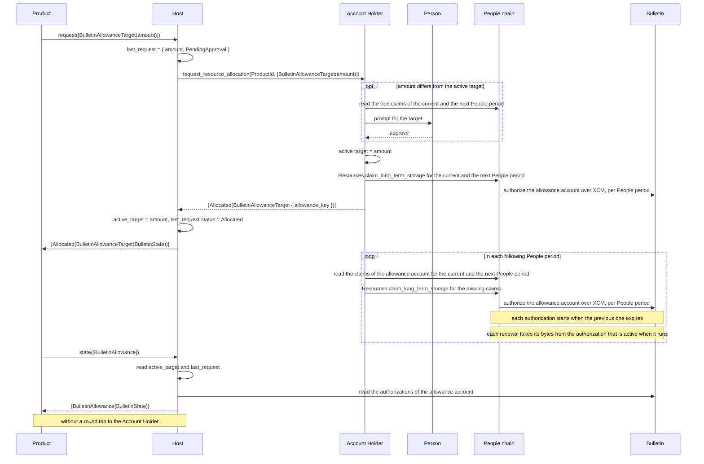
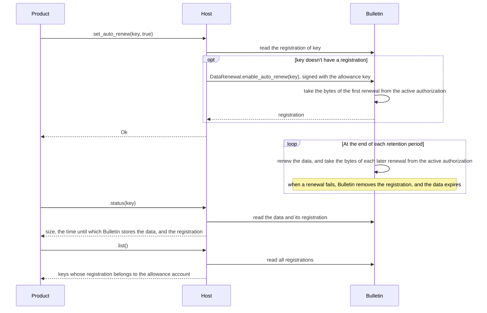

# RFC — Bulletin allowance target and auto-renew

## Summary

A product requests an allowance target from the [Host][terms]. The target is the amount of Bulletin bytes and
transactions that the product requires per People period to store its data persistently with auto-renew. A product that
doesn't store data persistently also requests a target. For that product, the target determines only whether the product
can submit data and the priority of its transactions.

The Host passes the request to the [Account Holder][terms], which stores the target. In each People period, the Account
Holder claims up to the target amount for the product's [allowance account][terms], for that period and for the next
one, so that each authorization starts when the previous one expires. A renewal during a gap between two authorizations
fails, and the data expires.

The Host stores the product's active target, which is the last target that the Account Holder accepted, and the
product's last target request with its status. The Host updates both from the Account Holder's answers. A product reads
them from the Host, together with its authorizations on Bulletin, without a round trip to the Account Holder.

New `Preimage` methods turn auto-renew on or off for data on Bulletin, read how long Bulletin stores it, and list the
data for which the product turned auto-renew on.

## Motivation

Bulletin stores data for a retention period, and auto-renew extends it. TrUAPI doesn't have calls to turn auto-renew on
or off for a product's data, to request the Bulletin bytes and transactions that long-term storage claims have to cover
for the renewals, or to read the product's authorization.

The product's allowance account receives authorizations from long-term storage claims on the People chain. A person has
a limited number of claims in each People period, and an authorization also has an expiration time. The Account Holder
claims only when a product submits data or allocates a resource, and doesn't renew Bulletin allowances. Bulletin renews
data only while the allowance account has an active authorization with enough bytes left, so a renewal that runs after
the authorization expires and before the product's next claim fails, and the data expires.

Requirements:

- **Offline.** The Account Holder can be offline, so the Host provides a product's current Bulletin allowance state.
- **Consent.** The person approves every change in the claims for a product.
- **Idempotence.** A repeated request for the same target doesn't cause a prompt or an extra claim.
- **Separation.** Each product has a separate allowance account, and a call doesn't reveal what another product
  requested.
- **Compatibility.** A peer that doesn't support a new variant or method produces a defined result within the
  existing timeouts.

## Approach

The design depends on five runtime changes:

- The People chain accepts a long-term storage claim for the next People period.
- The People chain derives the start and expiry of each authorization from the People period boundaries, so that the
  Bulletin authorization periods match the People periods. An authorization for the current People period expires when
  that period ends, and an authorization for the next People period covers exactly that period.
- The People chain records the allowance account of each long-term storage claim, as it does for statement-store
  allowances, so that the Account Holder can read the claims of each account per People period.
- Bulletin stores several authorizations per account, each with its own start and expiry, so that the authorization for
  the next People period can exist before the current one expires.
- Bulletin lets the owner turn auto-renew off before the prepaid first renewal has run, so that a product can turn
  auto-renew on and off for an item within one People period.

The design has five parts:

- A target resource and a `state` method in `ResourceAllocation`.
- Auto-renew methods in `Preimage`.
- On the [Host][terms], a record of each product's active target and last target request, which the Host updates from
  the Account Holder's answers.
- On the Account Holder, a record of each product's active target, and automatic claims up to that target for the
  current and the next People period.
- Changes to [RFC-0010][rfc-0010].

### ResourceAllocation

Changes to the `ResourceAllocation` trait and its types. `request` has `V2` variants with the changed
`AllocatableResource` and `AllocationOutcome`:

```diff
 pub trait ResourceAllocation: Send + Sync {
     #[wire(id = 0)]
     async fn request(&self, cx: &CallContext, request: HostRequestResourceAllocationRequest) -> …;
+
+    /// Reads the Host's record and Bulletin, and doesn't contact the Account Holder.
+    #[wire(id = 1)]
+    async fn state(&self, cx: &CallContext, request: HostResourceAllocationStateRequest)
+        -> Result<HostResourceAllocationStateResponse, CallError<…>>;
 }
+
+pub struct HostResourceAllocationStateRequest {
+    pub resources: Vec<ResourceKind>,
+}
+
+pub struct HostResourceAllocationStateResponse {
+    /// One state per requested resource, in the same order.
+    pub states: Vec<ResourceState>,
+}
+
+pub enum ResourceKind {
+    BulletinAllowance,
+}
+
+pub enum ResourceState {
+    BulletinAllowance(BulletinState),
+}

 pub enum AllocatableResource {
     StatementStoreAllowance,
     BulletinAllowance,
     SmartContractAllowance(DerivationIndex),
     AutoSigning,
+    /// Bytes and transactions per People period. Zero stops automatic claims.
+    BulletinAllowanceTarget(BulletinAmount),
 }

 pub enum AllocationOutcome {
-    Allocated,
+    Allocated(AllocatedResource),
     Rejected,
     NotAvailable,
+    /// Target requests only: the Account Holder's answer hasn't arrived.
+    PendingApproval,
 }
+
+/// The data of an allocated resource, with one variant per `AllocatableResource` variant.
+pub enum AllocatedResource {
+    StatementStoreAllowance,
+    BulletinAllowance(BulletinState),
+    SmartContractAllowance,
+    AutoSigning,
+    BulletinAllowanceTarget(BulletinState),
+}
+
+pub struct BulletinAmount {
+    pub bytes: u64,
+    pub transactions: u32,
+}
+
+pub struct BulletinState {
+    /// The last target that the Account Holder accepted.
+    pub active_target: Option<BulletinAmount>,
+    pub last_request: Option<TargetRequest>,
+    /// Caps and usage of the active authorization.
+    pub authorization: Option<BulletinAuthorization>,
+    /// End of the last People period that has an authorization, in milliseconds since the Unix epoch.
+    pub authorized_until: Option<u64>,
+}
+
+pub struct TargetRequest {
+    pub amount: BulletinAmount,
+    pub status: TargetRequestStatus,
+    /// Time of the Account Holder's answer, in milliseconds since the Unix epoch. `None` before the answer.
+    pub answered_at: Option<u64>,
+}
+
+pub enum TargetRequestStatus {
+    PendingApproval,
+    Allocated,
+    /// The Account Holder accepted the target, and some claims failed. It retries them with its automatic claims.
+    ClaimFailure,
+    /// The person's free claims don't cover the target, and the active target doesn't change.
+    NoMoreClaims,
+    Rejected,
+    NotAvailable,
+}
+
+pub struct BulletinAuthorization {
+    pub caps: BulletinAmount,
+    pub stored_bytes: u64,
+    /// A renewal fails when `renewed_bytes` plus the size of the renewal exceeds `caps.bytes`.
+    pub renewed_bytes: u64,
+    pub transactions: u32,
+}
```

- A product that sends a `V1` request receives the RFC-0010 outcomes.
- A higher target adds claims to the authorizations of the current and the next People period. A lower target applies
  from the first People period that the Account Holder hasn't claimed yet, because claims that it already made remain
  valid. A target of zero therefore stops automatic claims from that People period on.



What a target request returns:

| Case | Outcome |
| --- | --- |
| The Account Holder recorded the target, and the authorizations of the current and the next People period cover it | `Allocated` |
| The Account Holder recorded the target, and a claim failed | `Allocated`, and its `BulletinState` contains `ClaimFailure` |
| The person's free claims don't cover the target | `NotAvailable`, `state` returns `NoMoreClaims`, and the active target doesn't change |
| The person declined the target | `Rejected`, and the active target doesn't change |
| The Account Holder's answer hasn't arrived | `PendingApproval` |
| The Host doesn't support the `V2` request | The call fails with the `Unsupported` error |
| The Account Holder doesn't support targets | `NotAvailable`, or `PendingApproval` when it doesn't answer |

### Preimage

New `Preimage` methods:

| Method | What it does |
| --- | --- |
| `set_auto_renew` | Turns Bulletin auto-renew on or off for the data under a key, in a transaction from the product's allowance account |
| `status` | Returns the size of the data under a key, the time until which Bulletin stores it, and its auto-renew registration |
| `list` | Returns the keys whose auto-renew registration belongs to the product's allowance account |

- Turning auto-renew on takes the bytes of the first renewal from the active authorization.
- `set_auto_renew` requires the `PreimageSubmit` permission, submits a transaction only when the registration differs
  from the requested state, and never claims.
- Each renewal takes its bytes from the authorization that is active when it runs, so the bytes of a target have to
  cover the data that renews in each People period.

Turning auto-renew on, the renewals that follow, and the `status` and `list` calls:



What `set_auto_renew` returns:

| Case | Result |
| --- | --- |
| The registration already matches the requested state | `Ok`, without a transaction |
| Bulletin registered auto-renew or removed the registration | `Ok` |
| The allowance account doesn't have an active authorization, or the Host doesn't have the allowance key | `NoAuthorization` |
| The active authorization doesn't have enough bytes left for the first renewal | `AuthorizationExceeded` |
| Bulletin's permanent storage is full | `ChainFull` |
| Another account registered auto-renew for the data | `AlreadyRegistered` |
| The product turns off a registration of another account | `NotOwner` |
| Bulletin doesn't store data under the key | `NotFound` |

After `NoAuthorization` or `AuthorizationExceeded`, the product raises its target, because `set_auto_renew` never
claims.

### Host

- The Host stores a record per product, next to the product's allowance key, with two entries:
  - The active target.
  - The last target request, its status, and the time of the Account Holder's answer, so that a product can see how old
    the entry is. The status is `PendingApproval` until the answer arrives. When the Account Holder accepts the target,
    both entries contain the same target, and the status is `Allocated`, or `ClaimFailure` when some claims failed.
- `request` sends the target to the Account Holder in these cases, and otherwise returns the status of the last target
  request:
  - The last target request doesn't contain the same target.
  - The status of the last target request is `NoMoreClaims` or `ClaimFailure` from an earlier People period.
  - The status of the last target request is `PendingApproval`, and the Accounts Protocol session doesn't contain a
    pending request for the target, for example after a newer request replaced it.
- The Host doesn't show its own confirmation for a target, and `on_existing` doesn't apply to a target.
- When the Account Holder's answer doesn't arrive within the Host's timeout, `request` returns `PendingApproval`. The
  Host doesn't withdraw the request, and updates the record and stores the allowance key when the answer arrives.

### Account Holder

- The Account Holder stores one target record per product on the device, with the active target, and writes a new target
  to the record only after the person approves it.
- The Account Holder prompts the person for a target that differs from the target in the record, including a lower
  target and a target of zero, and doesn't prompt for the same target again.
- Before it prompts for a higher target, the Account Holder counts the claims that all targets, including the higher
  one, still need in the current and the next People period. When the person's free claims don't cover them, the
  Account Holder answers `NoMoreClaims`, and doesn't prompt or claim.
- When a target request arrives, and each time the Account Holder renews its other allowances, the Account Holder
  reads the claims of each product's allowance account on the People chain for the current and the next People period.
  When the claims for a People period don't cover the target, the Account Holder makes claims for that People period
  until they cover it.
- The Account Holder claims with the person's `People` (full-person) membership, and with the `LitePeople` membership
  only when the person doesn't have a `People` membership.
- An Account Holder without target support either acknowledges the request and doesn't send an answer, so `request`
  returns `PendingApproval`, or acknowledges it with `DecodingFailed`, so `request` returns `NotAvailable`.

### Changes to RFC-0010

- `ApAllocatableResource` has a new variant, `BulletinAllowanceTarget`, with the amount. `ApAllocatedResource` has a
  new variant, `BulletinAllowanceTarget`, which contains the allowance key, and `ClaimFailure` when some claims failed.
  `ApAllocationOutcome` has a new variant, `NoMoreClaims`, which only a target request returns.
- The Account Holder renews a Bulletin allowance only for a product with a target, which replaces the rule "Renewal is
  not a product concern" for Bulletin.
- For a product with an active target in the Host's record, the Host sends `BulletinAllowance` with the `Ignore`
  policy. The Account Holder then returns the allowance key, and makes one claim only when the allowance account
  doesn't have an authorization that allows another submission. RFC-0010's `Increase` for a repeated request applies
  only to a product without an active target.
- The Account Holder claims long-term storage for the current and the next People period.
- Long-term storage claims are counters within a People period, and a new claim doesn't evict an older one. The Account
  Holder answers `NoMoreClaims` when the person's free claims don't cover a higher target, in place of RFC-0010's
  eviction prompt.

## Trade-offs

- Each Host stores its own record, so two Hosts, or one Host after the person clears its site data, can report different
  active targets for a product. The Account Holder remains the source of truth for the active target.
- `set_auto_renew` never claims, so a product without an active authorization sets a target first.
- Bulletin doesn't index auto-renew registrations by account, so `list` reads all of them.
- When an automatic claim fails, the Host receives the reason only with the answer to the next target request, so
  `state` can show an expired authorization without a reason.
- A failed claim transaction leaves the claims made before it, so `ClaimFailure` remains a partial result. Claims
  outside targets, for example for a `BulletinAllowance` request or a data submission, use the same free claims, so an
  automatic claim in a later People period can still fail.
- The Account Holder's app has to run at least once in every People period. If it doesn't run during a period, the next
  People period starts without an authorization. When the app runs again, the Account Holder claims that period as the
  current one, but every renewal before that claim fails, and the data of a failed renewal expires.

## Open questions

- Separate request: should the Host send a target in a separate Accounts Protocol request? An Account Holder that
  doesn't support targets can't decode a request that contains a target, and the other resources of that request fail
  too. The Accounts Protocol doesn't negotiate capabilities: each message contains a version, but the Account Holder's
  pairing answer doesn't list the messages and versions that it decodes, so the Host can't check for target support
  before it sends a target. A separate request avoids the failure of the other resources, and costs a second round trip
  and a second prompt when a call contains other resources and a target that differs from the Host's record.
  A capability list in the pairing answer, or a capability request that doesn't prompt the person, would let the Host
  send a target together with the other resources.
- Host confirmation: should the Host confirm a target before it sends it? Without a Host confirmation, the person
  approves a target only on the Account Holder.
- Record sync: should the Host update its active target from the Account Holder, so that every Host reports the Account
  Holder's target for a product? The Host could request the target from the Account Holder without a prompt, for
  example when the Host doesn't have a record and once in each People period. A sync doesn't change the last target
  request, because that request exists only on the Host that sent it. The Account Holder can be offline, and the Host
  can recognize that by a request that the Account Holder doesn't acknowledge. While the Account Holder is offline, the
  Host would answer `state` from its own record and update the active target when the answer arrives.
- Restoring targets: should the Account Holder's backup include the target records? Without them, an Account Holder on a
  new or reset device doesn't have the targets, and a Host doesn't send a target again after an `Allocated` answer
  without a reason, so automatic claims stop until the product changes its target.

[rfc-0010]: 0010-allowance.md
[terms]: 0010-allowance.md#terminology
