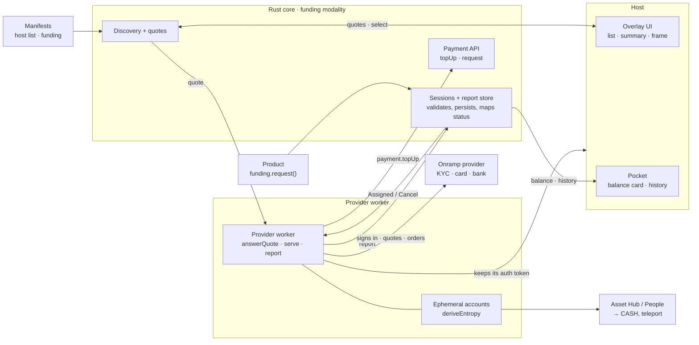

# RFC — Funding modality: the provider worker

## Summary

A funding provider moves value into or out of the user's balance. Its Worker runs each session end to end: it takes the
user's payment on its own rail, converts it, and credits the user with `payment.topUp`, or collects with
`payment.request` and pays out. The core assigns sessions, asks every provider for quotes, stores what the worker
reports, and decides the outcome itself from the top-ups and payments the worker names.

This RFC covers the worker's side, the `FundingProvider` trait. A product opens a session with `funding.request` and
the host draws the overlay; those are defined with the `Funding` trait and the host's `FundingPlatform`. The Worker
manifest's `includes.funding` is defined in the [product manifest RFC](product-manifest.md#funding-configuration).

## Motivation

Onramps differ in every step that matters: the rails they take, their KYC, how they convert and pay out, and the
countries they serve. Hard-coding each one in the core, or in every host, does not scale and has to be redone per
platform. A provider's own worker can follow its service's steps, while the core keeps what must not depend on a
provider: who is asked, which session a provider may report on, and whether value actually moved.

## Approach



A provider signs in to its own API itself and keeps its tokens with the host; the Worker manifest names no backend.
The worker prices quotes and runs sessions against that API.

## The `FundingProvider` trait

Products keep `Funding`; the worker side is a trait of its own because execution gating applies to a whole trait.

```rust
#[wire_trait(id = 24)]
#[service(required_execution = Worker)]
pub trait FundingProvider {
    #[wire(id = 0)] // sessions in flight first, then new items
    async fn serve_subscribe(&self, cx) -> Subscription<HostFundingServeSubscribeItem, _>;
    #[wire(id = 1)] // stored before it answers
    async fn report(&self, cx, request: HostFundingReportRequest) -> Result<(), HostFundingReportError>;
    #[wire(id = 2)] // an App route or an external https page, answers once the frame closes
    async fn present_frame(&self, cx, request: HostFundingPresentFrameRequest)
        -> Result<HostFundingPresentFrameResponse, HostFundingPresentFrameError>;
    #[wire(id = 3)]
    async fn answer_quote(&self, cx, request: HostFundingAnswerQuoteRequest) -> Result<(), HostFundingAnswerQuoteError>;
    #[wire(id = 4)] // at most 4 KiB
    async fn save(&self, cx, request: HostFundingSaveRequest) -> Result<(), HostFundingSaveError>;
}
```

### `serve_subscribe`

```rust
enum HostFundingServeSubscribeItem {
    Assigned { session: FundingAssignment },  // chosen for this provider, or still in flight on open
    Cancel { intent: String },                // the user asked to cancel
    CancelAccepted { intent: String },        // the user accepted the provider's CancelOffer
    CancelDeclined { intent: String },        // the user declined it, or it lapsed
    Quote { ask_id: String, ask: FundingQuoteAsk },
}

struct FundingAssignment {
    intent: String,
    direction: FundingDirection,             // In | Out
    amount: Option<u128>,                    // None: the user picks it on the provider's screens
    expires_at: Option<u64>,                 // Unix ms; None once funds move
    last_update: Option<FundingUpdate>,      // where a restarted worker resumes
    quote: Option<FundingQuote>,             // the quote the user chose
    saved: Option<Vec<u8>>,                  // what `save` last stored
}
```

The stream replays every session still in flight and every unanswered ask when it opens, so a restarted worker carries
on without its own bookkeeping, including a cancel it has not answered and the user's answer to its offer. Before money
moved, a worker answers `Cancel` by reporting `Failed { Cancelled }` if it can still stop. After, it answers with
`CancelOffer` or `CancelRefused` (see [Cancel](#cancel)).

### `answer_quote`

The core sends every ask to every funding provider, whatever its manifest declares. The worker prices it from its own
API and answers by `ask_id`.

```rust
struct FundingQuoteAsk {
    direction: FundingDirection,
    rail: FundingRail,                       // Card | Bank | Crypto
    asset: String,                           // symbol paid (In) or received (Out)
    network: Option<String>,                 // Crypto only, such as "polkadot"
    amount: u128,                            // balance units, credited (In) or debited (Out)
    country: Option<String>,                 // ISO 3166-1 alpha-2, when known
}

enum FundingQuoteAnswer {
    Quoted { quote: FundingQuote },
    Refused { reason: FundingQuoteRefusal }, // CountryUnsupported | BelowMinimum { min }
                                             // | AboveMaximum { max } | Unavailable | Other { message }
}

struct FundingQuote {
    quote_id: String,
    send_amount: u128,                       // asset units (In), balance units (Out)
    receive_amount: u128,                    // balance units (In), asset units (Out)
    provider_fee: u128,                      // in the unit of send_amount
    network_fee: u128,
    eta_secs: Option<u64>,
    expires_at: Option<u64>,
}
```

An ask unanswered after 10 seconds shows as timed out. An answer is reused for 30 seconds. What answers show about a
provider, served or refused for a country the ask named, is kept for 12 hours and folded into its manifest's routes
while that manifest serves Funding. Quotes are asked of, and a session can be handed to, exactly the providers whose
manifest serves Funding, whatever routes it declares: one still waiting for its manifest, or whose manifest is withdrawn
or stops serving Funding, is neither asked nor chosen.

The user picks a provider by one of its quotes for the session. When the session has an amount, the quote must price
it: `receive_amount` inbound, `send_amount` outbound, both in balance units. A session opened without an amount takes
the quote's.

### `report`

```rust
enum FundingUpdate {
    AwaitingPayment,                                  // In
    PaymentReceived { finalized: bool, mismatch: Option<FundingReceived> }, // In
    Converting,                                       // In; Out: once, after release, before Payout
    Crediting { top_up_id: [u8; 32], amount: u128 },  // In, up to 3
    Delivered,                                        // In: no more top-ups
    Collecting { payment_id: [u8; 32], amount: u128 },// Out
    Failed { reason: FundingFailure },                // before funds move
    Deposit { deposit: FundingDeposit },              // In, until funds move, outside the order
    Details { transaction_id: Option<String>, reference: Option<String> }, // any time, outside the order
    Payout { outcome: FundingPayout },                // Out: once, after release
    CancelRefused { reason: String },                 // answers a Cancel, outside the order
    CancelOffer { fee: u128, refund: u128, expires_at: Option<u64> }, // answers a Cancel, outside the order
}

enum FundingDeposit {
    Crypto { address, network, asset, amount, decimals, exact: bool, uri: Option<String>, expires_at: Option<u64> },
    Bank { amount, currency, decimals, beneficiary, account, bank_code, reference, expires_at },
}
```

- Only the provider a session is assigned to may report on it, and updates only move forward. Otherwise the report
  fails with `NotFound` or `OutOfOrder`.
- The core stores each report before answering and keeps the session until the host has written it to its history. After that it keeps the newest 64 recorded sessions per product in full and compacts older ones into a session pack it never trims (intent, owner, direction, amounts, outcome and times), so a product watching any session it opened gets its terminal item instead of `NotFound`, and `funding_history` gives the host every recorded session, full or compacted, to rebuild its own history if it was lost.
- The core records every top-up and payment request a provider's worker starts while it serves an open session in
  that direction, with the amount: on the one such session asking for that amount when exactly one does, otherwise
  on each of them (the report names which). `Crediting` must name a recorded
  top-up and `Collecting` a recorded payment request, at the recorded amount, once across the provider's sessions;
  anything else fails with `NotStarted`. Funds started before the session was assigned were never recorded for it.
- A report on a session the user chose a provider for while the overlay is still up is stored like any other.
- `Deposit` and `Details` carry what the host draws: where and what the user pays, and the provider's references. The
  latest of each is shown.

### `present_frame`

The host shows provider screens in a frame it owns: an iframe in a browser host, a WebView in a native one.

```rust
struct HostFundingPresentFrameRequest { intent: String, target: FundingFrameTarget }

enum FundingFrameTarget {
    App { route: String },                              // a route of the provider's own App
    Page { url: String, return_url: Option<String> },   // an external https page, such as an onramp's widget
}

enum FundingFrameOutcome {
    Closed,                                             // the screen finished and closed itself
    Dismissed,                                          // the user closed it
    Returned { url: String },                           // the page reached `return_url`; the full URL, query included
}
```

- A page and its return URL must be https URLs with a host and no credentials; anything else fails with `InvalidUrl`
  before the host sees it. Any https origin is allowed, since onramps hand users on to changing sub-providers.
- The host shows the page's origin in its own chrome, with a close button, and allows what KYC and card checks need:
  scripts, forms, popups and the camera.
- When the page navigates to `return_url`, the host closes the frame and hands the URL back, so the worker reads the
  result from its query. This works the same in an iframe and a native WebView, where a page has no parent to post to.

### `save`

`save` stores opaque state for a session, such as the provider's order id, and replaces what was saved before. It
comes back in `Assigned.saved` and is dropped when the session ends.

## Outcome

- **The core decides success, never the worker.** An inbound session is `Delivered { credited }` with the recorded
  amounts of its named top-ups whose claims are final (`Claimed { finalized: true }`), what a partial claim reports, or
  nothing for one not claimed. An outbound session is `Released { debited }` with the recorded amount once its named
  payment completes. Nothing moved ends the session as failed.
- **Undecided statuses are read again.** A claim that is not final, a status stream that ends or fails first, or a
  top-up or payment the host does not know yet leaves the session open, and the core reads the status again with
  backoff. One the host still does not know an hour after the report named it, the time a payment can wait on the
  user's approval, counts as nothing moved.
- **Money moving locks the session.** Money moved once the provider started a top-up or payment request for the
  session, named or not, or reported `PaymentReceived`. From then on only the provider ends the session: it cannot
  fail it once funds started, no cancel ends it and nothing expires it. A worker can stop between starting funds and
  naming them, so a recorded start locks the session as a named one does.
- **Expiry** ends a session as `Failed { Expired }`: 24 hours after it opened while no provider has taken it, and 7
  days after the provider's last update while it is assigned and no money moved, so a provider that went silent cannot
  hold it. A bank transfer can take days, so a provider that keeps reporting keeps the session.
- **Closing the overlay after choosing a provider** keeps the session as started, since the provider may already be
  working on it, and asks the provider to stop unless money moved.
- **Ids are scoped.** The core hashes the provider's product into every top-up and payment id it hands the host, and
  follows them under the same id.

## Cancel

`cancel_funding` answers `Ended`, `Requested`, `Pending`, `TooLate` or `Refused` (ended, or its overlay is up).

- **No provider serves the session:** it ends as `Failed { Cancelled }`.
- **Before money moved:** the provider gets `Cancel` and stops with `Failed { Cancelled }`. Asked again, the session
  ends as `Failed { Cancelled }` and the worker is let go, so a provider that went silent cannot hold it.
- **After money moved:** a cancel is a request and never ends the session. The provider answers `CancelRefused
  { reason }`, and the session carries on, or, on an inbound session whose credit has not started, `CancelOffer { fee,
  refund, expires_at }`: amounts in the user's balance units, `fee + refund` at most the session amount. The host shows
  the offer from the session's `cancel` and answers it with `confirm_funding_cancel(intent, terms)`, passing the fee and
  refund it showed to accept or `None` to decline. The provider hears `CancelAccepted` or `CancelDeclined`; while an
  offer is open it is not sent `Cancel` again. The answer is `Changed` when the provider replaced the offer since the
  host showed it, and nothing is accepted; `TooLate` when the credit started meanwhile, and the offer is declined; and
  `Lapsed` past `expires_at`. A user who declined or was refused may ask again. On `CancelAccepted` the provider returns
  the user's payment and ends the session with `Failed`. An outbound session is refunded only once refunds of a released
  withdrawal exist, so until then its provider can only refuse.
- **Inbound after its credit started:** too late. `cancel_funding` answers `TooLate`, the host tells the user, and the
  provider is not asked.

## Trade-offs

- **Every provider is asked for every quote.** Manifests lag behind what a provider serves, so routes only narrow the
  list the host draws before quotes arrive, never which provider can be chosen; the cost is one ask per provider per
  quote.
- **The worker holds the provider's flow.** Ephemeral accounts, conversion and payout live in the worker
  (`deriveEntropy` under the provider's product), so the core needs no XCM, swap or provider-specific code, and signs
  no funding transaction.
- **No backend in the manifest.** A provider signs in to its own API and keeps its tokens with the host, so the
  manifest only says what the provider moves.
