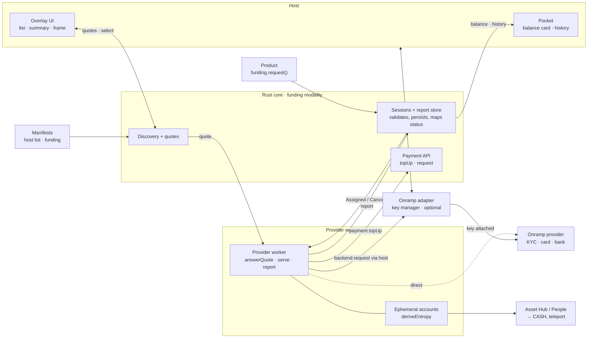

# RFC — Funding modality: the provider worker

## Summary

A funding provider moves value into or out of the user's balance. Its Worker runs each session end to end: it takes the
user's payment on its own rail, converts it, and credits the user with `payment.topUp`, or collects with
`payment.request` and pays out. The core assigns sessions, asks every provider for quotes, stores what the worker
reports, and decides the outcome itself from the top-ups and payments the worker names.

This RFC covers the worker's side, the `FundingProvider` trait. A product opens a session with `funding.request` and
the host draws the overlay; those are defined with the `Funding` trait and the host's `FundingPlatform`. The Worker
manifest's `includes.funding` is defined in the [product manifest RFC](product-manifest.md#funding-configuration).

## Overall schema



The onramp adapter holds the provider's API keys and is only needed when the provider's API requires one. Otherwise the
worker calls the provider directly. Keys never reach the core or the worker.

## The `FundingProvider` trait

Products keep `Funding`; the worker side is a trait of its own because execution gating applies to a whole trait.

```rust
#[wire_trait(id = 24)]
#[service(required_execution = Worker)]
pub trait FundingProvider {
    #[wire(id = 0)] // sessions in flight first, then new items
    async fn serve_subscribe(&self, cx) -> Subscription<HostFundingServeSubscribeItem, _>;
    #[wire(id = 1)] // stored before it answers
    async fn report(&self, cx, request: HostFundingReportRequest) -> Result<(), HostFundingReportError>;
    #[wire(id = 2)] // answers once the frame closes
    async fn present_frame(&self, cx, request: HostFundingPresentFrameRequest)
        -> Result<HostFundingPresentFrameResponse, HostFundingPresentFrameError>;
    #[wire(id = 3)]
    async fn answer_quote(&self, cx, request: HostFundingAnswerQuoteRequest) -> Result<(), HostFundingAnswerQuoteError>;
    #[wire(id = 4)] // at most 4 KiB
    async fn save(&self, cx, request: HostFundingSaveRequest) -> Result<(), HostFundingSaveError>;
}
```

### `serve_subscribe`

```rust
enum HostFundingServeSubscribeItem {
    Assigned { session: FundingAssignment },  // chosen for this provider, or still in flight on open
    Cancel { intent: String },                // the user asked to stop
    Quote { ask_id: String, ask: FundingQuoteAsk },
}

struct FundingAssignment {
    intent: String,
    direction: FundingDirection,             // In | Out
    amount: Option<u128>,                    // None: the user picks it on the provider's screens
    expires_at: u64,                         // Unix ms
    last_update: Option<FundingUpdate>,      // where a restarted worker resumes
    quote: Option<FundingQuote>,             // the quote the user chose
    saved: Option<Vec<u8>>,                  // what `save` last stored
}
```

The stream replays every session still in flight and every unanswered ask when it opens, so a restarted worker carries
on without its own bookkeeping. A worker answers `Cancel` by reporting `Failed { Cancelled }` if it can still stop.

### `answer_quote`

The core sends every ask to every funding provider, whatever its manifest declares. The worker prices it through its
own API, directly or through the onramp adapter, and answers by `ask_id`.

```rust
struct FundingQuoteAsk {
    direction: FundingDirection,
    rail: FundingRail,                       // Card | Bank | Crypto
    asset: String,                           // symbol paid (In) or received (Out)
    network: Option<String>,                 // Crypto only, such as "polkadot"
    amount: u128,                            // balance units, credited (In) or debited (Out)
    country: Option<String>,                 // ISO 3166-1 alpha-2, when known
}

enum FundingQuoteAnswer {
    Quoted { quote: FundingQuote },
    Refused { reason: FundingQuoteRefusal }, // CountryUnsupported | BelowMinimum { min }
                                             // | AboveMaximum { max } | Unavailable | Other { message }
}

struct FundingQuote {
    quote_id: String,
    send_amount: u128,                       // asset units (In), balance units (Out)
    receive_amount: u128,                    // balance units (In), asset units (Out)
    provider_fee: u128,                      // in the unit of send_amount
    network_fee: u128,
    eta_secs: Option<u64>,
    expires_at: Option<u64>,
}
```

An ask unanswered after 10 seconds shows as timed out. An answer is reused for 30 seconds. What answers show about a
provider, served or refused for a country, is kept for 12 hours and folded into its manifest's routes.

### `report`

```rust
enum FundingUpdate {
    AwaitingPayment,                                  // In
    PaymentReceived { finalized: bool, mismatch: Option<FundingReceived> }, // In
    Converting,                                       // In; Out: once, after release, before Payout
    Crediting { top_up_id: [u8; 32], amount: u128 },  // In, up to 3
    Delivered,                                        // In: no more top-ups
    Collecting { payment_id: [u8; 32], amount: u128 },// Out
    Failed { reason: FundingFailure },                // before funds move
    Deposit { deposit: FundingDeposit },              // In, until funds move, outside the order
    Details { transaction_id: Option<String>, reference: Option<String> }, // any time, outside the order
    Payout { outcome: FundingPayout },                // Out: once, after release
}

enum FundingDeposit {
    Crypto { address, network, asset, amount, decimals, exact: bool, uri: Option<String>, expires_at: Option<u64> },
    Bank { amount, currency, decimals, beneficiary, account, bank_code, reference, expires_at },
}
```

- Only the provider a session is assigned to may report on it, and updates only move forward. Otherwise the report
  fails with `NotFound` or `OutOfOrder`.
- The core stores each report before answering and keeps the session until the host has written it to its history.
- `Crediting` names a top-up the worker started with `payment.topUp`, `Collecting` a payment it requested with
  `payment.request`. An id another of the provider's sessions names fails with `DuplicateId`.
- `Deposit` and `Details` carry what the host draws: where and what the user pays, and the provider's references. The
  latest of each is shown.

### `present_frame` and `save`

`present_frame` shows a route of the provider's App, such as KYC or card entry, in a frame the host owns, and answers
`Closed` or `Dismissed`. `save` stores opaque state for a session, such as the provider's order id, and replaces what
was saved before. It comes back in `Assigned.saved` and is dropped when the session ends.

## Outcome

- **The core decides success, never the worker.** An inbound session is `Delivered { credited }` with what its named
  top-ups claimed: the full amount, a partial claim, or nothing. An outbound session is `Released { debited }` once its
  named payment completes. Nothing moved ends the session as failed.
- **Funds moving locks the session.** Once a top-up or payment request is named, the provider can no longer fail the
  session and the user can no longer cancel it.
- **Cancel** ends a session no provider serves, asks the assigned provider otherwise, and is refused once the user's
  payment reached the provider.
- **Expiry** applies only to a session no provider has taken, 24 hours after it opened. An assigned session waits for
  its provider, since a bank transfer can take days.
- **Ids are scoped.** The core hashes the provider's product into every top-up and payment id it hands the host, and
  follows them under the same id.

## Trade-offs

- **Every provider is asked for every quote.** Manifests lag behind what a provider serves, so routes only narrow the
  list; the cost is one ask per provider per quote.
- **The worker holds the provider's flow.** Ephemeral accounts, conversion and payout live in the worker
  (`deriveEntropy` under the provider's product), so the core needs no XCM, swap or provider-specific code, and signs
  no funding transaction.
- **No provider keys in the worker.** A provider whose API needs a key depends on an onramp adapter the host connects
  to.
