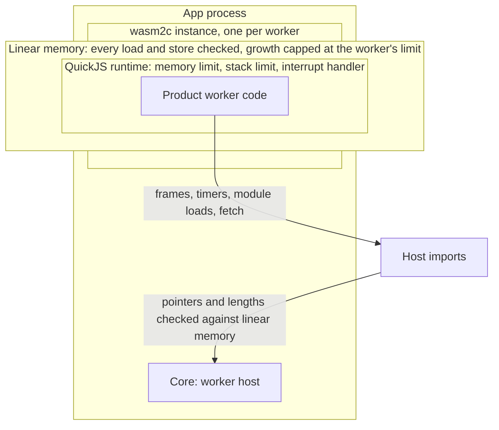

# RFC — QuickJS product workers

## Summary

Native hosts run a product's worker executable in QuickJS instead of a hidden web view. On iOS and Android, QuickJS is
compiled to WebAssembly, translated to C by wasm2c and compiled into the app, so a fault in the engine stays inside the
worker's own memory without a process of its own. Workers get the same small JavaScript environment on both, and
products keep using `@parity/truapi` unchanged.

## Motivation

The [Product Manifest Format](product-manifest.md) defines the worker as a product's single background process, and
[Worker Lifecycle](worker-lifecycle.md) says when it runs. On iOS and Android that process is a hidden web view today,
which fails the lifecycle in three ways:

- The system reclaims a web view's content process apart from the app, on iOS whenever the app is in the background, so
  a referenced worker dies with no signal to the host.
- A web view costs about 13 MiB per worker on an iPhone XS, 7.8 MiB on an Android phone and 17 MiB on a Mac, most of it
  in its content process, and iOS caps how many content processes an app may hold.
- The host cannot cap a web view's memory or stop a script that does not return.

### Requirements

1. **Contained.** A memory-safety bug in the JavaScript engine cannot read or write host memory outside the worker.
2. **Bounded.** The host caps each worker's memory and the CPU time of each turn.
3. **Resident.** A worker runs inside the app's own process, so it lives exactly as long as the host keeps it.
4. **Uniform.** A worker gets the same JavaScript environment on every native host.
5. **Additive.** Nothing is added to the TrUAPI protocol, and products need no change.

## Approach

The design has three parts:

- **Environment**: what a worker script can use.
- **Transport**: how frames reach the core.
- **Engine**: what runs the script and how it is contained.

### Environment

The worker's entry module and everything it imports load as ES modules from the worker executable's directory. A
specifier resolves only to a file inside that directory, and a bare specifier fails, so a product bundles its
dependencies. The global object offers timers, `queueMicrotask`, `console`, `performance.now`, `crypto.getRandomValues`,
`TextEncoder` and `TextDecoder`, `fetch`, and the transport. The DOM, Web Storage, IndexedDB, `WebSocket`,
`XMLHttpRequest`, `EventSource` and `WebAssembly` are absent; each named global exists and throws `ApiUnavailableError`
when used, so feature detection still works. State that must survive a stop goes through host storage, as
[Worker Lifecycle](worker-lifecycle.md) requires.

### Transport

The core opens one in-process frame channel per worker execution and carries the same frames a web view exchanged. The
worker finds the channel as `__HOST_API_TRANSPORT__` on the global object, where `getClientSync()` in `@parity/truapi`
looks for it when there is no window.

### Engine

On iOS and Android, QuickJS-NG and the environment code are compiled to `wasm32`, translated to C by wasm2c with an
explicit bounds check on every load and store, and compiled into the core with every core build. Only the engine is
built in. A product's worker code is data the host loads at run time; QuickJS compiles it to its own bytecode and
interprets it inside the sandbox, so nothing is compiled to native code at run time, which iOS does not allow. Each
worker is a new instance of the same module, with its own linear memory, in the app's own process. Hosts without a
phone's constraints, such as desktop tools and tests, may run the same environment code on natively compiled QuickJS
behind the same engine interface in the core.

Two layers contain a worker. QuickJS enforces limits from inside and turns them into errors a script can handle. The
wasm boundary enforces them from outside, so they hold even when a bug in QuickJS ignores its own.

| Concern            | QuickJS, from inside                                                | wasm boundary, from outside                                                               |
| ------------------ | ------------------------------------------------------------------- | ----------------------------------------------------------------------------------------- |
| Memory             | A memory limit a little below the worker's: catchable out-of-memory | Linear memory cannot grow past the worker's limit; an access past its current size traps  |
| Stack              | A stack size limit: catchable `RangeError`                          | A call depth limit: trap                                                                  |
| Time               | The interrupt handler checks the turn budget and stops the script   | None                                                                                      |
| A fault in QuickJS | Not contained                                                       | Reads and writes only the worker's own memory; a trap ends the worker and the app runs on |

The guest declares a maximum memory of 32 MiB, and the host may give a worker a lower limit. The runtime reserves the
worker's maximum as address space when it creates the instance and grows in place; physical memory is used only as the
worker touches it. A turn is the work one inbound frame, one timer or one job queue drain causes. Each turn has a CPU
time budget, measured on the worker's thread so a suspended app does not spend it. On a trap or a budget overrun the
host frees the worker's instance and counts a crash; the app and its other workers keep running.

## Measurements

Every engine replayed the same 401-frame conversation, recorded from the real `@parity/truapi` client rendering the
playground's renderer tree, and returned every reply byte for byte. Medians; memory is the growth of the app's footprint
per live worker across ten, plus, for a web view, its content process.

On an iPhone XS (A12, the oldest supported iPhone), iOS 18.7:

| iPhone XS                   | QuickJS native   | wasm2c, bounds checks        | WKWebView                    | Boa                  | wasmi                   |
| --------------------------- | ---------------- | ---------------------------- | ---------------------------- | -------------------- | ----------------------- |
| Contains an engine fault    | no               | yes                          | content process              | prevents most (Rust) | yes                     |
| Render round trip p50 / p95 | 0.37 / 0.46 ms   | 0.72 / 0.75 ms               | 0.66 / 0.86 to 1.19 ms       | 1.59 / 2.76 ms       | 9.1 / 9.4 ms            |
| Start to idle               | 14 ms            | 24 ms                        | 69 to 87 ms, 346 ms at first | 118 ms               | 203 ms                  |
| Memory per worker           | 1.9 MiB          | 2.5 MiB                      | about 13 MiB                 | 3.1 MiB              | 3.5 MiB                 |
| Memory cap                  | heap limit       | catchable out-of-memory      | none                         | none                 | catchable out-of-memory |
| Out-of-bounds read          | reads app memory | traps, a fresh worker starts | content process              | not testable         | not run                 |

Inside an Android app on a Galaxy A26 (Exynos 1380), Android 16, with the WebView the app runs workers in today:

| Galaxy A26                  | QuickJS native   | wasm2c, bounds checks  | wasm2c, guard pages    | WebView                      | Boa            | wasmi          |
| --------------------------- | ---------------- | ---------------------- | ---------------------- | ---------------------------- | -------------- | -------------- |
| Render round trip p50 / p95 | 0.59 / 0.73 ms   | 1.29 / 1.35 ms         | 0.72 / 0.82 ms         | 0.89 / 1.50 ms               | 4.06 / 11.7 ms | 10.4 / 10.5 ms |
| Start to idle               | 24 ms            | 41 ms                  | 25 ms                  | 41 to 48 ms, 293 ms at first | 216 ms         | 287 ms         |
| Memory per worker           | 2.0 MiB          | 2.45 MiB               | 2.4 MiB                | about 7.8 MiB                | 6.3 MiB        | 3.6 MiB        |
| Out-of-bounds read          | reads app memory | traps, the app runs on | traps, the app runs on | renderer process             | not testable   | not run        |

On an Apple M5 Pro Mac, with the engines the phone runs did not cover:

| Mac                         | WKWebView      | QuickJS native | wasm2c, guard pages | wasm2c, bounds checks | Cranelift      | wasmi          | Boa            |
| --------------------------- | -------------- | -------------- | ------------------- | --------------------- | -------------- | -------------- | -------------- |
| Render round trip p50 / p95 | 0.18 / 0.28 ms | 0.15 / 0.16 ms | 0.19 / 0.20 ms      | 0.31 / 0.38 ms        | 0.39 / 0.41 ms | 4.43 / 4.81 ms | 0.65 / 1.27 ms |
| Start to idle               | 54 to 115 ms   | 7.0 ms         | 7.8 ms              | 11 to 12 ms           | 13.8 ms        | 98 ms          | 55 to 69 ms    |
| Memory per worker           | 17.2 MiB       | 2.1 MiB        | 2.5 MiB             | 2.5 MiB               | 2.5 MiB        | 3.7 MiB        | 5.6 MiB        |

The harnesses, raw results and the iOS and Android bench apps are on the `spike/qjs-bench` branch under
`spikes/qjs-bench/`: `scripts/compare-wasm2c.sh` reruns the Mac table, `scripts/build-ios.sh` with
`scripts/run-ios-device.sh` the iPhone table, `scripts/measure-ios-webcontent.py` its WKWebView memory, and
`scripts/build-android-app.sh` with `scripts/run-android-app.py` the Galaxy A26 table.

## Trade-offs

- Both phones pay about twice native QuickJS in CPU for the boundary, and about 0.5 to 0.6 MiB more per worker.
- The turn budget is enforced inside the sandbox, so a worker that first exploits an engine fault can disable it and
  keep a thread busy; the host can then only abandon the thread and count a crash.
- An Android isolated process would contain even code execution in the engine and could be killed, but needs a service,
  a Binder relay and a standalone engine library; wasm2c in the app gives Android the same boundary as iOS without IPC.
- Guard pages run at about 1.3 times native but reserve 8 GiB of address space per worker. An iPhone XS grants no such
  reservation without the Extended Virtual Addressing entitlement; 64-bit Android grants it, and guard pages work there
  inside the app.
- Native QuickJS inside the app is the fastest option and has no boundary.
- A web view renders slightly faster than wasm2c on the iPhone XS, because its content process has a JIT, but starts a
  worker three times slower and costs about five times the memory.
- Boa prevents most engine faults by being written in Rust, but renders at four to seven times and starts at eight to
  nine times native QuickJS, cannot cap memory or interrupt a script, and needs a slower value representation on
  Android.
- wasmi is an audited interpreter with the same boundary, at 17 to 25 times native render time and a 200 to 290 ms
  start.
- Cranelift compiles wasm close to native speed, but needs a JIT, which iOS forbids, and takes 2.3 s to compile the
  module on an Android phone.
- The iOS and Android core builds need wasi-sdk and WABT and compile about 13 MB of generated C.

## Open questions

- Which origins a worker's `fetch` may reach: any HTTPS origin, or only origins its manifest declares.
