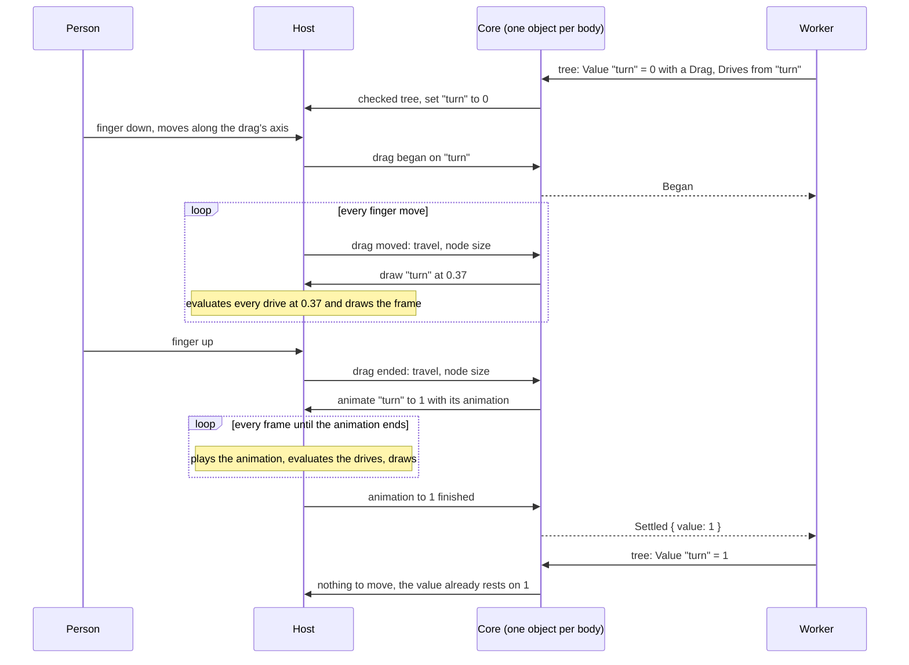
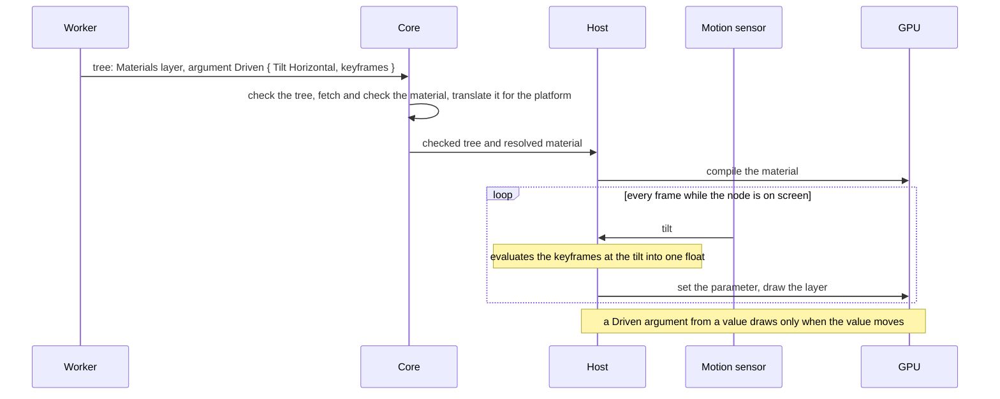

# RFC — Renderer motion

## Summary

A product-drawn body declares how it moves, once, inside its tree: values the host keeps on the device, the inputs that
move them (a tap, a drag, a scratch that erases a node to reveal what is under it), and drives that compute node
properties and material arguments from a value, the device's tilt or a clock every frame. A transition animates a node
in, out or between trees. The core decides every outcome a product can observe, the host draws every frame, and the
product receives discrete events on the [Unified Renderer](unified-renderer.md)'s action stream.

## Motivation

Products have several kinds of motion usecases: a state change that animates, a gesture such as a tap or a pan that
moves part of the card, a material whose look follows the device's tilt and time, and content hidden under a cover that
a tap or a scratch reveals.

A product cannot drive any of them itself, because a rendering frame cannot wait for the product. A worker reaches the
core asynchronously, today across a process boundary, so a tree redrawn per finger move lags the finger, and every round
trip a gesture needs adds latency the person feels. Building each effect into the host instead gives every host every
effect, each with its own rules both platforms must match exactly, and the protocol grows with every new effect.

The usecases however share one shape: something on the device changes every frame (a finger, the tilt, a clock), a node
property follows it, and the product needs only the outcome.

## Detailed Design

### Requirements

- **Local:** the frame path, from input to drawn frame, never waits on the product.
- **Product-owned:** the product owns every state an input changes, and the host keeps only what is in flight.
- **Generic:** the host draws motion without knowing what it means, such as a card, a side or a prize.
- **Consistent:** the same input reaches the same outcome on every host, because one implementation decides it.

### Model

A body's motion is declared with three modifiers appended to `v01::Modifier`, so every existing variant keeps its wire
index. Fractional numbers are IEEE 754 single-precision bit patterns, as material parameters are.

```rust
/// Layout, styling and motion applied to one node.
pub enum Modifier {
    // Margin to BlendingMode, as in the Unified Renderer.
    /// A number the host keeps on the device, and the inputs on this node that move it.
    Value(Value),
    /// A property of this node, computed every frame from a source.
    Drive(Drive),
    /// How this node enters, leaves, and changes between trees.
    Transition(Transition),
}
```

A value is a real number of steps whose rest positions are integers. The product declares where it rests, an input or
the product moves it, and the host animates it between rests. The declared value is the `value` field the product's tree
carries; the value the host draws can differ from it while an input or an animation moves it. A drive maps a source,
which is a value, the tilt or a clock, through keyframes onto one property of a node or one argument of a material. The
host evaluates drives every frame and never reports them. Only discrete outcomes reach the product: a value came to
rest, or a gesture began or was cancelled.

### Values

```rust
/// A number the host keeps on the device. It rests on whole steps.
pub struct Value {
    /// Unique among the tree's values. Drives and the host's state refer to it.
    pub id: String,
    /// The step the product declares the value rests on. Applied when it changes between trees.
    pub value: i32,
    /// Drives read the value modulo this many steps. Absent does not wrap.
    pub period: Option<u32>,
    /// How the value moves to a new rest. Absent jumps.
    pub animation: Option<Animation>,
    /// What on this node moves the value. At most one of each kind.
    pub inputs: Vec<Input>,
    /// Action the host reports `MotionEvent`s on. Absent reports nothing.
    pub action: Option<String>,
    /// Name of the accessibility action that moves the value one step. Absent offers none.
    pub label: Option<String>,
}

/// Something a person does on a node that moves its value.
pub enum Input {
    /// A tap moves the value one step.
    Tap,
    /// A drag moves the value continuously, and it rests on the nearest step on release.
    Drag(Drag),
    /// A finger erases the node, and the value moves one step once enough of it is erased.
    Scratch(Scratch),
}

/// A drag that moves a value.
pub struct Drag {
    /// Axis the drag follows.
    pub axis: Axis,
    /// How far a drag moves the value one step, in thousandths of `unit`. Negative turns a leftward or upward drag
    /// into a positive step.
    pub distance: i32,
    /// What `distance` is measured in.
    pub unit: Length,
    /// Steps one drag may move from where it began. Absent is unbounded.
    pub max_steps_per_gesture: Option<u32>,
}

/// An axis in the plane of the screen.
pub enum Axis {
    /// Sideways.
    Horizontal,
    /// Up and down.
    Vertical,
}

/// What a length along an axis is measured in.
pub enum Length {
    /// Logical pixels.
    Points,
    /// This node's size along the axis.
    Node,
    /// The room the parent leaves this node along the axis: the parent's size minus this node's.
    ParentRoom,
}

/// A finger that erases the node where it passes.
pub struct Scratch {
    /// Radius of the finger's stroke, in logical pixels.
    pub radius: Size,
    /// Per mille of the node that, once erased, moves the value one step.
    pub step_at: u16,
}

/// How the host moves a value to a new rest.
pub enum Animation {
    /// A spring that settles within `duration_ms`.
    Spring {
        /// Time to settle, in milliseconds.
        duration_ms: u32,
        /// Overshoot, in per mille. 0 does not overshoot.
        bounce_per_mille: u16,
    },
    /// A move over `duration_ms` along a curve.
    Timed {
        /// Duration, in milliseconds.
        duration_ms: u32,
        /// How the move progresses over the duration, as a keyframe curve does over its stretch. `Linear` keeps a
        /// constant speed for drives whose keyframes shape the motion, a `CubicBezier` eases, and `Step` jumps at the
        /// end.
        curve: KeyframeCurve,
    },
}
```

A value without inputs is a plain animated number: the product changes it and the host animates to it. That covers a
state change, and a custom keyframed animation is a value the product steps once while drives shape the motion. A tap or
an accessibility action moves the value one step forward. A drag moves it continuously by one step per `distance`, and
on release it comes to rest on the nearest step within `max_steps_per_gesture` of where the drag began. A value carries
at most one input of each kind, and not both a drag and a scratch, since both take the same finger.

A new tree reconciles with the value on the device by these rules:

- The host moves to a tree's `value` only when it differs from the previous tree's value for that id. A tree sent before
  an input settled, still declaring the old value, changes nothing.
- A value takes no input while it moves to a rest, and a declared change that arrives while a finger holds it waits
  until it comes to rest. The `Settled` that follows tells the product where it rested.
- A declared value equal to where the value rests moves nothing and reports nothing.
- The host keeps a value's state for one render stream. The first tree on a stream sets each value to its declared rest
  without animating. A tree that leaves out a value's id discards its state, so a later tree that brings the id back
  starts it again at its declared rest.

### Scratching

A drag that starts on a node with a scratch input, in any direction, erases the node along the finger's path and reveals
what the tree draws under it. The core keeps the erased share on a grid of cells over the node, from the finger's
samples, and once the share reaches `step_at` it moves the value one step, as a tap does. The value still rests only on
whole steps, and how the rest of the node disappears is the product's drive, such as its `Opacity` from 1 at one step to
0 at the next. The erased cells reset whenever the value changes, so each step starts with a whole node, and they are
never reported or stored.

A material can style the erasing, such as foil that flakes along the stroke. The [Materials](materials.md) `ImageRef`
enum gains one variant:

```rust
pub enum ImageRef {
    // Source and Noise, as in Materials.
    /// The cells erased by the scratch input of the value with this id, one channel: 1 erased, 0 not. Fills only
    /// `samplerFloat`.
    Scratch(String),
}
```

The content under a scratched node is in the tree, so the host has it before it is revealed.

### Drives

```rust
/// A node property computed every frame from a source, through keyframes.
pub struct Drive {
    /// What the keyframes read.
    pub source: Source,
    /// The node property the keyframes set.
    pub property: DrivenProperty,
    /// Ascending in `at`.
    pub keyframes: Vec<Keyframe>,
}

/// What a drive reads.
pub enum Source {
    /// A `Value::id` in the same tree, modulo the value's period.
    Value(String),
    /// The device's tilt about one axis, as a material's `sl_tilt` reads it: -1 to 1 for -90° to 90°.
    /// `Horizontal` reads tilting the device left and right, `Vertical` forward and back, along the device's own axes.
    Tilt(Axis),
    /// Seconds since the host first drew the node, modulo the period.
    Time {
        /// The period, in milliseconds.
        period_ms: u32,
    },
}

/// A node property a drive can set.
pub enum DrivenProperty {
    /// Rotation about the horizontal axis, in degrees.
    RotationX,
    /// Rotation about the vertical axis, in degrees.
    RotationY,
    /// Rotation in the plane, in degrees.
    RotationZ,
    /// Scale factor about the node's center.
    Scale,
    /// 0 to 1, multiplied with `Modifier::Opacity`.
    Opacity,
    /// An offset along one axis, towards the end or the bottom. In `ParentRoom`, 0 is the start and 1 the far end.
    Translation {
        /// The axis it moves along.
        axis: Axis,
        /// What one unit of the keyframes' values is.
        unit: Length,
    },
}

/// The target at one source reading.
pub struct Keyframe {
    /// The source reading, as an IEEE 754 single bit pattern.
    pub at: u32,
    /// The target at `at`, as an IEEE 754 single bit pattern.
    pub value: u32,
    /// How the target reaches `value` from the previous keyframe.
    pub curve: KeyframeCurve,
}

/// The path between two keyframes.
pub enum KeyframeCurve {
    /// A straight line from the previous keyframe.
    Linear,
    /// Holds the previous value until `at`, then jumps.
    Step,
    /// A CSS `cubic-bezier(x1, y1, x2, y2)` from the previous keyframe, with each control point as an IEEE 754
    /// single bit pattern. `x1` and `x2` lie in `[0, 1]`; `y1` and `y2` may leave it, so the target overshoots.
    CubicBezier {
        /// First control point, along the source.
        x1: u32,
        /// First control point, along the target.
        y1: u32,
        /// Second control point, along the source.
        x2: u32,
        /// Second control point, along the target.
        y2: u32,
    },
}
```

Each curve covers the stretch from the previous keyframe to its own, so the first keyframe's curve is never read. A
cubic Bézier maps the share of that stretch the source has covered to the share of the target's change, as CSS
`cubic-bezier` does, and the core holds the reference evaluation the hosts' tests check. Before the first keyframe and
after the last, a drive holds the nearest keyframe's target. Drives on one node compose: rotations, scale and offsets
act after layout, about the node's center, and opacity multiplies the node's own. A node rotated about X or Y is seen in
perspective from three times its longer side, from its center, on every host. A node whose effective opacity is 0 takes
no touches, so a hidden face cannot be pressed.

A drag moves a value, drives follow it every frame, and the value settles. Only `Began` and `Settled` reach the worker,
on the action stream, and the tree the worker sends back confirms the rest.



A tap, a scratch reaching `step_at`, an accessibility action and a declared change all join this flow at the animation
step: the core answers with the rest to animate to, and the host reports when it finishes. A declared change reports
`Settled` too, and the tree that follows confirms it.

A material argument is a drive target too. The [Materials](materials.md) `Parameter` enum gains one variant, which fills
a `float` parameter every frame:

```rust
pub enum Parameter {
    // Float to SamplerVec4, as in Materials.
    /// A `float` parameter the host fills every frame from a source, through keyframes.
    Driven {
        /// What the keyframes read.
        source: Source,
        /// Ascending in `at`.
        keyframes: Vec<Keyframe>,
    },
}
```

A layer with a `Driven` argument whose source is a value draws when the value moves, and one whose source is the tilt or
a clock draws every frame, under the materials step-down rules. A material that reads `sl_tilt` or `sl_time` itself
keeps doing so.

A material argument follows a source on the host alone. The core resolves the material with the tree, and the worker
hears nothing while the argument moves.



With reduced motion on, the tilt reads 0 and a clock reads 0, as material inputs do.

### Transitions

A product's state changes often show up as a node that appears, a node that goes, or a colour that changes, such as a
badge shown when a payment starts, a row removed from a list, or a status turning from pending to paid. Values and
drives cannot animate these. A drive moves a node the tree keeps, so a node the product drops has nothing left to drive,
and the host must keep drawing it to animate it out. A node a tree adds has no earlier state for a value to start from.
A drive sets numbers, so a colour cannot follow it. Without transitions, a product would keep every node that might
appear in each tree, hidden at opacity 0 and still taking room in the layout, and stack copies of a node in each colour
to cross-fade between them.

A transition covers these three changes for one node. The product only sends trees. The host compares each new tree with
the one before, finds the node by its transition's `id`, and animates the difference. Nothing is reported to the
product.

```rust
/// How a node enters, leaves and changes between trees.
pub struct Transition {
    /// Matches the node across trees. Unique among the tree's transitions.
    pub id: String,
    /// How the node appears when a tree first holds the id.
    pub enter: Option<TransitionEffect>,
    /// How the node leaves when a tree no longer holds the id.
    pub exit: Option<TransitionEffect>,
    /// Whether a change of the node's drawn properties between trees animates.
    pub change: bool,
    /// The timing of all three.
    pub animation: Animation,
}

/// The pose a node enters from or exits to.
pub enum TransitionEffect {
    /// Opacity 0.
    Fade,
    /// Scaled about its center to this per mille of its size.
    Scale(u16),
    /// Moved along one axis until it lies just past this edge of its parent.
    Slide(Edge),
}

/// An edge of a parent.
pub enum Edge {
    /// The top edge.
    Top,
    /// The bottom edge.
    Bottom,
    /// The leading edge.
    Start,
    /// The trailing edge.
    End,
}
```

The host matches a transition by its `id` anywhere in the tree, so a node keeps its identity when it moves to another
parent. Comparing two trees, the host plays one of three things for each id:

| The id is in              | The host plays                                                                   |
| ------------------------- | -------------------------------------------------------------------------------- |
| The new tree only         | `enter`: the node starts in the effect's pose and moves to how the tree draws it |
| The previous tree only    | `exit`: the node moves from how it last drew to the effect's pose, then goes     |
| Both, with a drawn change | With `change`, the change; otherwise it jumps                                    |

Entering:

- The node takes its place in the layout at once, and its siblings move to make room without animating.
- It takes touches from the first frame, in the place the tree puts it.
- The first tree on a render stream plays no `enter`, so a body coming on screen is drawn as it is, as values start at
  their declared rest.

Leaving:

- The host keeps drawing the node as it last drew, at its last place and in its last order among its siblings, while
  `exit` plays, then removes it.
- The node leaves the layout at once, so its siblings close the gap without animating while it exits over them.
- It takes no touches while it exits.

Changing:

- `change` animates every modifier of the node whose value differs between the two trees, from the previous tree's value
  to the new one.
- A change of content, such as text, an image or children, jumps.

Timing and interruption:

- `animation` times all three. A `Timed` curve and a `Spring` move the node as they move a value.
- A new tree that arrives while a transition plays starts the next one from what the host draws at that moment, so the
  node never jumps back. A node that enters while its previous drawing still exits starts its `enter` from where the
  exit had reached.
- When a node with a transition enters or leaves inside another that enters or leaves in the same tree, only the
  outermost one plays its effect, and the nodes inside it move with it.

A transition composes with drives on the same node: opacity and scale multiply, and offsets add. With reduced motion on,
`enter` and `exit` fade whatever their effect, and changes jump.

### Events and capabilities

Every outcome reaches the product on the action the value declares, SCALE-encoded in
`HostRendererActionSubscribeItem::payload`.

```rust
/// What a value reports, SCALE-encoded in `HostRendererActionSubscribeItem::payload`.
pub enum MotionEvent {
    /// A finger took the value. The value may move before the next event.
    Began,
    /// The value came to rest, after an input, an accessibility action or a declared change.
    Settled {
        /// The rest, in steps.
        value: i32,
    },
    /// Something else took the press, and the value returned to where the drag began.
    Cancelled,
}
```

The payload reaches only the product that declared the action, so an SDK that does not know `MotionEvent` never receives
one.

A product asks for each part before sending a tree that uses it, because a host that does not know a modifier fails to
decode the tree. `HostFeatureSupportedRequest` gains one variant:

```rust
pub enum HostFeatureSupportedRequest {
    // Chain and Materials, as today.
    /// Ask whether the host draws one part of renderer motion.
    RendererMotion(MotionFeature),
}

/// A part of renderer motion a host draws.
pub enum MotionFeature {
    /// `Value` without inputs, and `Drive` from values and clocks.
    Values,
    /// `Transition`.
    Transitions,
    /// `Input::Tap`.
    Tap,
    /// `Input::Drag`.
    Drag,
    /// `Input::Scratch`.
    Scratch,
    /// `Source::Tilt`.
    Tilt,
    /// `Parameter::Driven` and `ImageRef::Scratch`.
    MaterialDrives,
}
```

### Core and host

The core decides every outcome a product can observe, and the host draws every frame. Each rule exists once, in the
core, so two hosts cannot disagree about an outcome, and the core keeps no clock.

The split, by concern:

| Concern                                                                | Owner |
| ---------------------------------------------------------------------- | ----- |
| Checking a tree against the motion limits                              | Core  |
| Reconciling a new tree with the values on the device                   | Core  |
| Turning a drag's travel into a value, and the rest step on release     | Core  |
| Stepping a value on a tap or an accessibility action                   | Core  |
| Counting the share a scratch erased                                    | Core  |
| Encoding and deduplicating `MotionEvent`s                              | Core  |
| Recognizing taps and drags, and sharing touches with the surface       | Host  |
| Playing an animation to a rest the core chose                          | Host  |
| Evaluating drives, reading the tilt and the clock, drawing every frame | Host  |
| Drawing strokes, transitions and fades                                 | Host  |

A native host keeps one core object per drawn body. It hands the object each new tree and each input as it happens, such
as a drag's travel or a finger's sample over a scratched node, and the object answers with the value to draw, the rest
to animate to, and the actions to send. The host reports when an animation finishes, and the core decides whether that
is a `Settled`.

The core checks each tree before a host draws it, beside its check of inline images, visiting nodes depth first, parents
before children, values before the drives that read them. What fails a check is dropped, and the tree draws without it
rather than failing the stream:

- A value is dropped when its id repeats an earlier value's, when its `period` is 0, or past the first 8 values.
- An input is dropped when its value already has an input of that kind, when it is a scratch on a value with a drag or a
  drag on a value with a scratch, when it is a drag with a `distance` of 0, or when it is a scratch with a `step_at` of
  0 or above 1000.
- A drive is dropped when its source names no remaining value, when its source is a clock with a period of 0, when its
  keyframes are empty, more than 16 or not strictly ascending in `at`, when a number in it is not finite, when a Bézier
  `x1` or `x2` lies outside `[0, 1]`, or past the first 32 drives.
- A `Driven` argument that fails a drive's check makes its `Materials` node fall back with `InvalidStack`, as any wrong
  argument does.
- A transition is dropped when its id repeats an earlier transition's, or past the first 16 transitions.

A host may decline an input on a surface, or on one axis where the host owns that axis, such as the expanded card's pull
to close or a scrolling list. The tree then draws at its declared values, and accessibility actions still work.

## Appendix: product examples

The examples use the React renderer of the Product SDK. Its props mirror the wire types with plain numbers, and the
names are illustrative. Each shows what the product declares, what the host does on its own, and what the product hears.

### Animation on tap

A heart that pops on each tap. The value counts taps, and a period of 1 makes every step replay the same keyframes.

```tsx
<Box
  value={{
    id: "like",
    value: likes,
    period: 1,
    inputs: [{ tap: {} }],
    animation: { timed: [400, "Linear"] },
    action: "like",
  }}
  onValue={(event) => event.tag === "Settled" && setLikes(event.value)}
  drive={{
    source: { value: "like" },
    property: "Scale",
    keyframes: [
      { at: 0, value: 1 },
      { at: 0.3, value: 1.3 },
      { at: 1, value: 1 },
    ],
  }}
>
  <Image source={heart} />
</Box>
```

A tap steps the value from `likes` to `likes + 1`, and the host runs it over 400 ms, so the scale reads 1, 1.3, 1. The
product hears `Settled { value: likes + 1 }` and redraws with the new count, which the host treats as a confirmation.

### Turning a card

Both faces under one value. A drag of one card width to the left moves one step, a step is half a turn, and the faces
swap at the quarter turn, where the card is edge-on.

```tsx
<Box
  value={{
    id: "turn",
    value: side,
    period: 2,
    animation: { spring: [500, 150] },
    action: "turn",
    label: "Turn over",
    inputs: [{ drag: { axis: "Horizontal", distance: -1000, unit: "Node", maxStepsPerGesture: 1 } }],
  }}
  onValue={(event) => event.tag === "Settled" && setSide(event.value)}
>
  <Box drive={[turn(0), shown(1)]}>
    <Front onTurn={() => setSide(side + 1)} />
  </Box>
  <Box drive={[turn(-180), shown(0)]}>
    <Back onTurn={() => setSide(side + 1)} />
  </Box>
</Box>;

const turn = (from: number) => ({
  source: { value: "turn" },
  property: "RotationY",
  keyframes: [
    { at: 0, value: from },
    { at: 2, value: from + 360 },
  ],
});
const shown = (atRest: number) => ({
  source: { value: "turn" },
  property: "Opacity",
  keyframes: [
    { at: 0, value: atRest },
    { at: 0.5, value: 1 - atRest, curve: "Step" },
    { at: 1.5, value: atRest, curve: "Step" },
  ],
});
```

The host turns the card under the finger and springs it to the nearest side. A button that calls `setSide` redraws with
the next side, and the host animates the same turn.

### Dragging to confirm

A knob that slides along its track. The value is 0 at the start and 1 at the end, and a drag across the track's room
moves it one step.

```tsx
<Box fillMaxWidth background="surface">
  <Box
    value={{
      id: "confirm",
      value: confirmed ? 1 : 0,
      animation: { spring: [300, 0] },
      action: "confirm",
      label: "Confirm",
      inputs: [{ drag: { axis: "Horizontal", distance: 1000, unit: "ParentRoom", maxStepsPerGesture: 1 } }],
    }}
    onValue={(event) => event.tag === "Settled" && event.value === 1 && confirm()}
    drive={{
      source: { value: "confirm" },
      property: { translation: { axis: "Horizontal", unit: "ParentRoom" } },
      keyframes: [
        { at: 0, value: 0 },
        { at: 1, value: 1 },
      ],
    }}
  >
    <Knob />
  </Box>
</Box>
```

A release short of halfway springs back to 0 and reports `Settled { value: 0 }`. Past halfway it rests at the end and
reports `Settled { value: 1 }`. A slider with stops uses the same value with more steps.

### A material on tilt and time

A foil card whose highlight follows the tilt, whose shimmer sweeps every three seconds, and which leans slightly with
the phone.

```tsx
<Box
  drive={[
    {
      source: { tilt: "Horizontal" },
      property: "RotationY",
      keyframes: [
        { at: -1, value: -8 },
        { at: 1, value: 8 },
      ],
    },
    {
      source: { tilt: "Vertical" },
      property: "RotationX",
      keyframes: [
        { at: -1, value: 8 },
        { at: 1, value: -8 },
      ],
    },
  ]}
>
  <Materials
    layers={[
      {
        material: FOIL,
        args: [
          driven({ tilt: "Horizontal" }, [
            { at: -1, value: 0 },
            { at: 1, value: 1 },
          ]),
          driven({ time: 3000 }, [
            { at: 0, value: 0 },
            { at: 3, value: 1 },
          ]),
        ],
      },
    ]}
  >
    <CardArt />
  </Materials>
</Box>
```

The host reads the tilt and the clock every frame and fills both arguments, and nothing reaches the product. With
reduced motion on, the card holds still and the material draws its still frame.

### A scratch card

A prize under a cover the person scratches off. The value is 0 while covered and 1 once revealed, and once 60 percent of
the cover is erased it moves to 1, which fades out the rest.

```tsx
<Box>
  <Prize amount={prize} />
  <Box
    fillMaxWidth
    fillMaxHeight
    value={{
      id: "cover",
      value: revealed ? 1 : 0,
      animation: { timed: [300, { cubicBezier: [0.42, 0, 0.58, 1] }] },
      action: "cover",
      label: "Reveal",
      inputs: [{ scratch: { radius: 18, stepAt: 600 } }],
    }}
    onValue={(event) => event.tag === "Settled" && event.value === 1 && setRevealed(true)}
    drive={{
      source: { value: "cover" },
      property: "Opacity",
      keyframes: [
        { at: 0, value: 1 },
        { at: 1, value: 0 },
      ],
    }}
  >
    <Materials layers={[{ material: SCRATCH_FOIL, args: [{ tag: "SamplerFloat", value: { scratch: "cover" } }] }]}>
      <Cover />
    </Materials>
  </Box>
</Box>
```

The cover is erased under the finger on the device. The material reads the erased cells to draw flaking edges, and
without materials the plain `Cover` is erased the same way. The product hears `Settled { value: 1 }` once and keeps the
result by declaring 1, so the card opens revealed next time. A tap reveal is the same value with `{ tap: {} }` among its
inputs, and a dissolve is a material's threshold driven from the value through a `Driven` argument.

### A status that appears, changes and leaves

A payment badge that pops in when a payment starts, changes colour when it is paid, and fades out when the product
clears it. The product only sends trees.

```tsx
{
  status !== "none" && (
    <Box
      transition={{
        id: "status",
        enter: { scale: 600 },
        exit: "Fade",
        change: true,
        animation: { spring: [350, 200] },
      }}
      background={status === "paid" ? "success" : "warning"}
    >
      <Text>{status === "paid" ? "Paid" : "Pending"}</Text>
    </Box>
  );
}
```

From no badge to pending, the badge grows in from 60 percent. From pending to paid, its background moves from the
warning colour to the success colour, and the text jumps. From paid to no badge, it fades out while the layout around it
closes at once. Nothing reaches the product.
