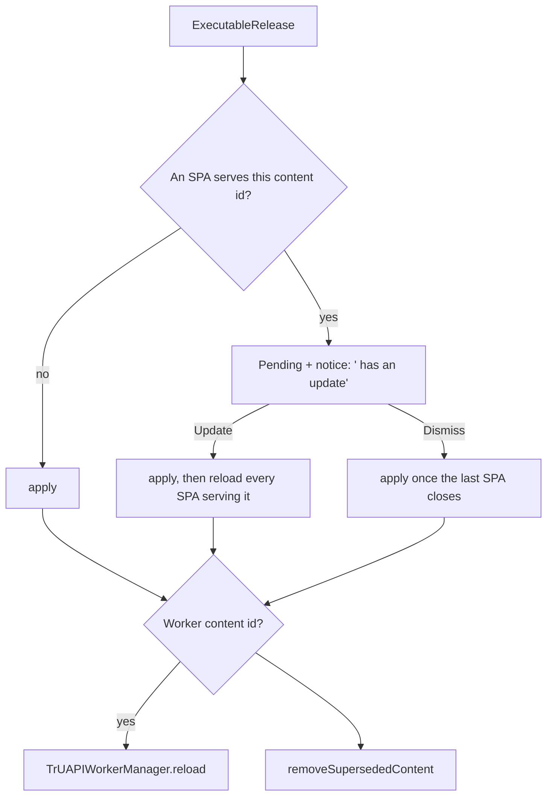

# Product loading and refresh

How a product's executables (app, widget, worker) reach disk, how newer releases are found, and how
they reach screens and workers. Code: `Packages/Products/Sources/Products/DotNs/` and
`polkadot-app/Modules/Products/Update/`.

## Storage

| What | Where | Notes |
|---|---|---|
| Archives | `DotNsContent/<hash>/` | Content-addressed, written to a staging folder and moved in place |
| Manifest records | `DotNsContent/Manifests/<base>.json` | Root `manifest` record plus one `executable` record per subname |
| Pointers | `ContentHashCache`: content id → hash | Which archive each executable serves |

A content id (`ProductExecutable.Identifier`) is the name an executable's archive resolves under:
`app.<base>`, `widget.<base>`, `worker.<base>`, or `<base>` for a legacy product.

Invariants:
- An executable's record and its pointer are applied together (`ExecutableRelease`), so an entry
  point never runs against another release's archive.
- Only `ProductContentLoader.apply` moves an existing pointer. `DotNsResolver.resolveToLocalURL`
  sets one only when none exists.
- Content ids are assumed stable across releases; refresh matches the old and new manifests by
  content id.

## Opening

`ProductContentLoader` is cache first.

- **`open(_:kind:policy:onPhase:)`**, for an SPA or widget: with a cached manifest and an applied
  archive, serves it at once and schedules a background refresh. Otherwise fetches the manifest and
  stages the archive under `policy`, then adopts the manifest and applies the release. SPAs pass
  `.untilCancelled`; the prewarmer passes `.attempts(3)`.
- **`openWorker(_:policy:)`**, for chat bots and workers: with a cached manifest, returns it and
  schedules a refresh. Otherwise fetches the manifest under `policy`. Either way it stages a missing
  worker archive under `policy`, best effort: a failed download is logged, and the worker resolves
  it again when it boots. Callers pass `.attempts(3)`.

## Retry and diagnostics

`withRetry(strategy: NetworkFetchRetryStrategy)`:
- A non-retryable error (`ProductLoadErrorClassifier`) fails at once.
- While the network path is down, it waits without spending an attempt.
- Otherwise it backs off 1 s, doubling to at most 30 s, until the policy's attempts run out.

Loads with the `.open` trigger are diagnosed through `ProductLoadDiagnostics`:
- `contentFetchStalled` once a load reaches 5 failed attempts or 60 s, time offline excluded.
- `contentUnavailable` on a non-retryable error, except dotNS contract errors.

Refreshes use the `.refresh` trigger and are never reported: a cached build is still served.

## Refresh

`refresh(_:)` runs at most once per product at a time; concurrent calls share the running one.

1. Read the cached manifest. Without one, there is nothing to refresh.
2. Take the served kinds: those with an applied archive.
3. Fetch the latest manifest and stage each served kind's archive (`Timing.refreshPolicy`, 3 attempts).
4. Commit: adopt the manifest, then for each served content id
   - same hash → apply silently (keeps the record current);
   - new or removed archive → publish an `ExecutableRelease` on `updates()`.

Triggers:
- every cache-hit `open` / `openWorker`;
- an SPA becoming visible (`checkForNewBuild`);
- `ProductUpdateCoordinator` on returning to the foreground: products with an open SPA plus
  host-placed products (`HostPlacedProductsProvider`).

The SPA's Refresh button does not refresh: it applies a pending update if there is one, else
reloads the applied build, or restarts a load that never served anything.

## Delivering releases

`ProductUpdateCoordinator` (MainActor) consumes `updates()`. Open SPAs register a presence by
content id.

- **Worker releases** (`worker.<base>`, or `<base>` for legacy) restart the TrUAPI worker through
  its transition queue. The chat handler and Pocket cards read the current execution on every call,
  so they follow the restart without being rebuilt. Native workers are not reloaded: they pick up
  the new archive on their next boot.
- **Cleanup** runs at start and after every apply. It deletes stored archives that no pointer
  names, no open SPA serves and no pending release holds, once they are older than 10 minutes.

## Known limits

- A worker restart loses the product's in-memory state, and chat or Pocket input sent while it
  restarts is dropped.
- Chat cards redraw after a restart only through the render retry. A cell gives up after three
  renders that draw nothing.
- A host-placed product is refreshed only once something has cached its manifest; the chat bot
  provider does that at launch.
- Uninstalled products keep their manifest and pointers.
